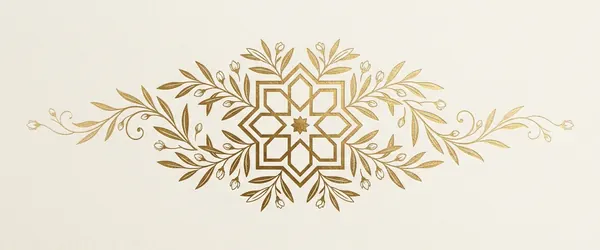
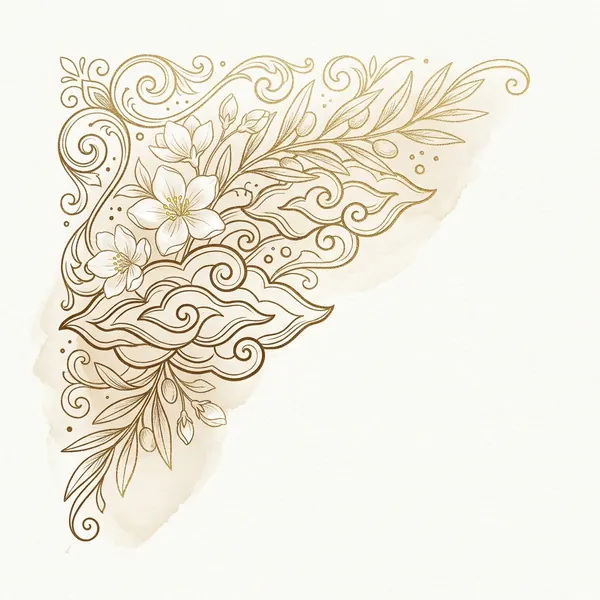

# Kode terbaru revisi Rumah 30

Isi file teks yang berubah dibanding proyek awal. Gunakan path setiap judul untuk mengganti file di proyek. PNG dan aset biner harus dipindahkan sebagai file. ZIP lengkap sudah tersedia; gunakan file dan folder aslinya untuk unggahan penuh. Belum diunggah ke GitHub/Vercel.

## index.html

````html
<!doctype html>
<html lang="id">
  <head>
    <meta charset="UTF-8" />
    <meta name="viewport" content="width=device-width, initial-scale=1, viewport-fit=cover, maximum-scale=5" />
    <meta name="theme-color" content="#243a31" />
    <title>{{title}} — Wedding Quest</title>
    <meta name="description" content="Undangan pernikahan interaktif {{couple.groom.name}} &amp; {{couple.bride.name}}. Jelajahi taman pernikahan kami — {{events.akad.displayDate}}, {{location.name}}, {{location.city}}." />

    <meta property="og:type" content="website" />
    <meta property="og:site_name" content="Wedding Quest" />
    <meta property="og:title" content="{{title}}" />
    <meta property="og:description" content="Yuk jalan-jalan keliling peta pernikahan kami dan sapa pasangan. {{events.akad.displayDate}}." />
    <meta property="og:url" content="%VITE_SITE_URL%/" />
    <meta property="og:image" content="%VITE_SITE_URL%/assets/couple-whimpy-xinxin.png" />
    <meta property="og:image:width" content="1200" />
    <meta property="og:image:height" content="630" />
    <meta property="og:locale" content="id_ID" />

    <meta name="twitter:card" content="summary_large_image" />
    <meta name="twitter:title" content="{{title}}" />
    <meta name="twitter:description" content="Undangan pernikahan interaktif 16-bit. {{events.akad.displayDate}}." />
    <meta name="twitter:image" content="%VITE_SITE_URL%/assets/couple-whimpy-xinxin.png" />

    <link rel="icon" href="/assets/icons/nav_pasangan.svg" />
    <link rel="preconnect" href="https://fonts.googleapis.com" />
    <link rel="preconnect" href="https://fonts.gstatic.com" crossorigin />
    <link
      rel="stylesheet"
      href="https://fonts.googleapis.com/css2?family=Press+Start+2P&family=Playfair+Display:ital,wght@0,600;0,700;1,600;1,700&family=Plus+Jakarta+Sans:wght@400;500;600;700&family=Amiri&display=swap"
    />
    <link rel="preload" as="image" href="/assets/rumah30/map-v5.png" />
  </head>
  <body>
    <div id="root"></div>
    <script type="module" src="/src/main.tsx"></script>
  </body>
</html>

````

## public/assets/frames/frame_batik_gold.svg

````xml
<svg xmlns="http://www.w3.org/2000/svg" viewBox="0 0 600 800" width="600" height="800">
 <defs><style>.name{font-family:Georgia,serif;fill:#344d40;text-anchor:middle}.small{font-family:Arial,'PingFang SC','Microsoft YaHei',sans-serif;fill:#617260;text-anchor:middle}</style></defs>
 <rect x="0" y="0" width="600" height="800" fill="#faf8ef"/>
 <rect x="18" y="18" width="564" height="764" rx="16" fill="none" stroke="#b6a586" stroke-width="1"/>
 <text x="300" y="54" class="small" font-size="11" letter-spacing="3">A MOMENT TO REMEMBER · 幸福留影</text>
 <rect x="60" y="95" width="480" height="520" fill="#ffffff"/>
 <rect x="55" y="90" width="490" height="530" fill="none" stroke="#b6a586"/>
 <g fill="#a8b698" stroke="#819578" stroke-width="1" opacity=".8"><path d="M29 126Q33 64 88 29" fill="none"/><ellipse cx="39" cy="87" rx="7" ry="18" transform="rotate(-25 39 87)"/><ellipse cx="59" cy="64" rx="7" ry="18" transform="rotate(42 59 64)"/><ellipse cx="75" cy="40" rx="6" ry="15" transform="rotate(38 75 40)"/></g>
 <g transform="translate(600 800) rotate(180)" fill="#a8b698" stroke="#819578" stroke-width="1" opacity=".8"><path d="M29 126Q33 64 88 29" fill="none"/><ellipse cx="39" cy="87" rx="7" ry="18" transform="rotate(-25 39 87)"/><ellipse cx="59" cy="64" rx="7" ry="18" transform="rotate(42 59 64)"/></g>
 <text x="300" y="690" class="name" font-size="31">{{couple.groom.name}} &amp; {{couple.bride.name}}</text>
 <text x="300" y="722" class="small" font-size="12" letter-spacing="2">20.12.2026 · RUMAH 30</text>
 <text x="300" y="756" class="small" font-size="10">Terima kasih telah hadir · 感谢您的到来</text>
</svg>
````

## public/assets/frames/frame_botanical.svg

````xml
<svg xmlns="http://www.w3.org/2000/svg" viewBox="0 0 600 800" width="600" height="800">
 <defs><style>.name{font-family:Georgia,serif;fill:#344d40;text-anchor:middle}.small{font-family:Arial,'PingFang SC','Microsoft YaHei',sans-serif;fill:#617260;text-anchor:middle}</style></defs>
 <rect x="0" y="0" width="600" height="800" fill="#eef1e7"/>
 <rect x="18" y="18" width="564" height="764" rx="16" fill="none" stroke="#819578" stroke-width="1"/>
 <text x="300" y="54" class="small" font-size="11" letter-spacing="3">A MOMENT TO REMEMBER · 幸福留影</text>
 <rect x="60" y="90" width="480" height="560" fill="#ffffff"/>
 <rect x="55" y="85" width="490" height="570" fill="none" stroke="#819578"/>
 <g fill="#a8b698" stroke="#819578" stroke-width="1" opacity=".8"><path d="M29 126Q33 64 88 29" fill="none"/><ellipse cx="39" cy="87" rx="7" ry="18" transform="rotate(-25 39 87)"/><ellipse cx="59" cy="64" rx="7" ry="18" transform="rotate(42 59 64)"/><ellipse cx="75" cy="40" rx="6" ry="15" transform="rotate(38 75 40)"/></g>
 <g transform="translate(600 800) rotate(180)" fill="#a8b698" stroke="#819578" stroke-width="1" opacity=".8"><path d="M29 126Q33 64 88 29" fill="none"/><ellipse cx="39" cy="87" rx="7" ry="18" transform="rotate(-25 39 87)"/><ellipse cx="59" cy="64" rx="7" ry="18" transform="rotate(42 59 64)"/></g>
 <text x="300" y="700" class="name" font-size="31">{{couple.groom.name}} &amp; {{couple.bride.name}}</text>
 <text x="300" y="732" class="small" font-size="12" letter-spacing="2">20.12.2026 · RUMAH 30</text>
 <text x="300" y="756" class="small" font-size="10">Terima kasih telah hadir · 感谢您的到来</text>
</svg>
````

## public/assets/frames/frame_retro_rpg.svg

````xml
<svg xmlns="http://www.w3.org/2000/svg" viewBox="0 0 600 800" width="600" height="800">
 <defs><style>.name{font-family:Georgia,serif;fill:#344d40;text-anchor:middle}.small{font-family:Arial,'PingFang SC','Microsoft YaHei',sans-serif;fill:#617260;text-anchor:middle}</style></defs>
 <rect x="0" y="0" width="600" height="800" fill="#fffef9"/>
 <rect x="18" y="18" width="564" height="764" rx="16" fill="none" stroke="#526b55" stroke-width="1"/>
 <text x="300" y="54" class="small" font-size="11" letter-spacing="3">A MOMENT TO REMEMBER · 幸福留影</text>
 <rect x="70" y="115" width="460" height="490" fill="#ffffff"/>
 <rect x="65" y="110" width="470" height="500" fill="none" stroke="#526b55"/>
 <g fill="#a8b698" stroke="#819578" stroke-width="1" opacity=".8"><path d="M29 126Q33 64 88 29" fill="none"/><ellipse cx="39" cy="87" rx="7" ry="18" transform="rotate(-25 39 87)"/><ellipse cx="59" cy="64" rx="7" ry="18" transform="rotate(42 59 64)"/><ellipse cx="75" cy="40" rx="6" ry="15" transform="rotate(38 75 40)"/></g>
 <g transform="translate(600 800) rotate(180)" fill="#a8b698" stroke="#819578" stroke-width="1" opacity=".8"><path d="M29 126Q33 64 88 29" fill="none"/><ellipse cx="39" cy="87" rx="7" ry="18" transform="rotate(-25 39 87)"/><ellipse cx="59" cy="64" rx="7" ry="18" transform="rotate(42 59 64)"/></g>
 <text x="300" y="690" class="name" font-size="31">{{couple.groom.name}} &amp; {{couple.bride.name}}</text>
 <text x="300" y="722" class="small" font-size="12" letter-spacing="2">20.12.2026 · RUMAH 30</text>
 <text x="300" y="756" class="small" font-size="10">Terima kasih telah hadir · 感谢您的到来</text>
</svg>
````

## public/assets/ui/cover_envelope.svg

````xml
<svg xmlns="http://www.w3.org/2000/svg" viewBox="0 0 500 420" role="img" aria-labelledby="coverLabel">
<title id="coverLabel">Undangan Whimpy dan Xinxin</title>
<defs>
  <linearGradient id="ivoryPaper" x2="0" y2="1"><stop stop-color="#fffef9"/><stop offset="1" stop-color="#f6f2e8"/></linearGradient>
  <style>
    .serif{font-family:Georgia,'Times New Roman',serif;fill:#30483c;text-anchor:middle}
    .sans{font-family:Arial,'PingFang SC','Microsoft YaHei',sans-serif;fill:#617361;text-anchor:middle}
    .guest-name{font-family:Arial,'PingFang SC','Microsoft YaHei',sans-serif;fill:#30483c;text-anchor:middle;font-size:21px;font-weight:600}
  </style>
</defs>
<rect x="18" y="18" width="464" height="384" rx="12" fill="url(#ivoryPaper)"/>
<rect x="29" y="29" width="442" height="362" rx="7" fill="none" stroke="#bac4b0" stroke-width="1"/>
<!-- Delicate native vector foliage, matching the garden palette. -->
<g fill="#99a78c" stroke="#7e9178" stroke-width="1" opacity=".8">
 <path d="M42 117Q50 67 107 44" fill="none"/>
 <ellipse cx="52" cy="92" rx="6" ry="15" transform="rotate(-35 52 92)"/>
 <ellipse cx="66" cy="76" rx="6" ry="14" transform="rotate(40 66 76)"/>
 <ellipse cx="79" cy="61" rx="5" ry="13" transform="rotate(-40 79 61)"/>
 <ellipse cx="96" cy="50" rx="5" ry="12" transform="rotate(48 96 50)"/>
 <path d="M458 303Q450 353 393 376" fill="none"/>
 <ellipse cx="448" cy="328" rx="6" ry="15" transform="rotate(-35 448 328)"/>
 <ellipse cx="434" cy="344" rx="6" ry="14" transform="rotate(40 434 344)"/>
 <ellipse cx="421" cy="359" rx="5" ry="13" transform="rotate(-40 421 359)"/>
</g>
<text x="250" y="73" class="sans" font-size="10" letter-spacing="3">THE WEDDING OF</text>
<text x="250" y="106" class="serif" font-size="17" font-style="italic">W &amp; X</text>
<text x="250" y="154" class="serif" font-size="34">{{couple.groom.name}} &amp; {{couple.bride.name}}</text>
<text x="250" y="183" class="sans" font-size="12" letter-spacing="1">20 DESEMBER 2026 · RUMAH 30</text>
<path d="M207 205H293" stroke="#b8a17c" stroke-width="1"/>
<text x="250" y="235" class="sans" font-size="12">Kepada tamu terhormat · 致亲爱的来宾</text>
<text x="250" y="265" class="guest-name">Tamu Undangan</text>
<g transform="translate(250 323)" style="cursor:pointer">
 <rect x="-145" y="-22" width="290" height="44" rx="22" fill="#526b55"/>
 <text x="0" y="5" text-anchor="middle" font-family="Arial,'PingFang SC','Microsoft YaHei',sans-serif" font-size="13" fill="#fffef9">Buka Undangan · 开启邀请  →</text>
</g>
<text x="250" y="374" class="sans" font-size="10" letter-spacing="1">20 · 12 · 2026</text>
</svg>

````

## public/assets/ui/joystick_pad.svg

````xml
<svg xmlns="http://www.w3.org/2000/svg" viewBox="0 0 120 120" width="120" height="120" >
  <!-- Outer D-Pad Base Ring (Translucent with Wood/Gold border) -->
  <circle cx="60" cy="60" r="54" fill="#344d40" fill-opacity="0.65" stroke="#b6a586" stroke-width="1.5"/>
  <circle cx="60" cy="60" r="48" fill="none" stroke="#fffef9" stroke-opacity="0.3" stroke-width="1" stroke-dasharray="4,4"/>

  <!-- Directional Pixel Arrows (Up, Down, Left, Right) -->
  <!-- UP Arrow -->
  <polygon points="60,14 52,24 68,24" fill="#eef1e7"/>
  <!-- DOWN Arrow -->
  <polygon points="60,106 52,96 68,96" fill="#eef1e7"/>
  <!-- LEFT Arrow -->
  <polygon points="14,60 24,52 24,68" fill="#eef1e7"/>
  <!-- RIGHT Arrow -->
  <polygon points="106,60 96,52 96,68" fill="#eef1e7"/>

  <!-- Center Thumb Stick Knob -->
  <circle cx="60" cy="60" r="24" fill="#526b55" stroke="#b6a586" stroke-width="1.5"/>
  <circle cx="60" cy="60" r="18" fill="#819578"/>
  <!-- Grip Lines on Center Knob -->
  <rect x="52" y="58" width="16" height="4" fill="#b6a586" rx="1"/>
  <rect x="58" y="52" width="4" height="16" fill="#b6a586" rx="1"/>
</svg>

````

## scripts/check-config.mjs

````js
/**
 * Validates the wedding JSON in use — wedding.local.json when it exists, else
 * wedding.json — against the shape of the public sample. Run: npm run check
 *
 * tsc only ever sees the sample, so without this a missing field in the real
 * file would build cleanly and render as a blank on the invitation.
 * Messages are in Indonesian: this is the check people editing the JSON meet.
 */
import { existsSync, readFileSync } from 'node:fs';

const FILE = existsSync('wedding.local.json') ? 'wedding.local.json' : 'wedding.json';
const read = (f) => {
  try { return JSON.parse(readFileSync(f, 'utf8')); }
  catch (e) { console.error(`✗ ${f} bukan JSON yang valid: ${e.message}`); process.exit(1); }
};
const sample = read('wedding.json');
const w = read(FILE);
const errors = [];
const kind = (v) => (Array.isArray(v) ? 'array' : v === null ? 'null' : typeof v);

// Every field in the sample must exist with the same type. Extra fields are fine.
(function same(want, got, path) {
  if (kind(want) !== kind(got)) return errors.push(`${path}: harus ${kind(want)}, ternyata ${kind(got)}`);
  if (kind(want) === 'array') {
    if (!got.length) { if (path === 'ngobrol.questions') return; return errors.push(`${path}: tidak boleh kosong`); }
    got.forEach((g, i) => same(want[0], g, `${path}[${i}]`));
  } else if (kind(want) === 'object') {
    for (const k of Object.keys(want)) {
      const at = path ? `${path}.${k}` : k;
      if (!(k in got)) errors.push(`${at}: belum diisi`);
      else same(want[k], got[k], at);
    }
  } else if (kind(want) === 'string' && !got.trim() && !/^(hashtag|couple\.(bride|groom)\.(instagram|bio)|ngobrol\.)/.test(path)) errors.push(`${path}: masih kosong`);
})(sample, w, '');

/** A rule on a field the shape check may already have reported missing: skip it then, it is listed. */
const rule = (path, pass, msg) => {
  try { if (!pass()) errors.push(`${path}: ${msg}`); } catch { /* reported above */ }
};

for (const key of ['akad', 'resepsi']) {
  const e = w.events?.[key];
  rule(`events.${key}.date`, () => /^\d{4}-\d{2}-\d{2}$/.test(e.date) && !isNaN(Date.parse(e.date)), 'format harus YYYY-MM-DD, contoh "2027-06-12"');
  rule(`events.${key}.time`, () => /\d{1,2}[:.]\d{2}/.test(e.time), 'tulis jamnya, contoh "08:00 - 10:00 WIB"');
  rule(`events.${key}.mapsUrl`, () => /^https?:\/\//.test(e.mapsUrl), 'harus link lengkap (https://...)');
}
rule('ceremonyStart', () => /^\d{4}-\d{2}-\d{2}T\d{2}:\d{2}(:\d{2})?[+-]\d{2}:\d{2}$/.test(w.ceremonyStart) && !isNaN(Date.parse(w.ceremonyStart)),
  'format harus "YYYY-MM-DDTHH:MM:SS+07:00" (WIB +07:00, WITA +08:00, WIT +09:00)');
for (const who of ['bride', 'groom']) {
  rule(`couple.${who}.instagram`, () => !w.couple[who].instagram.startsWith('@'), 'tulis tanpa "@"');
}
rule('bgmUrl', () => existsSync(`public${w.bgmUrl}`), `file public${w.bgmUrl} tidak ditemukan`);
if (!existsSync(`public${w.invitationBgm.url}`)) console.warn('Musik undangan belum tersedia: tambahkan public' + w.invitationBgm.url);
(w.ngobrol?.questions ?? []).forEach((q, i) => {
  const at = `ngobrol.questions[${i}]`;
  rule(at, () => q.options.length === 3, `harus tepat 3 pilihan (mempelai wanita, pria, dua-duanya), ada ${q.options?.length}`);
  (q.options ?? []).forEach((o, k) => {
    rule(`${at}.options[${k}].by`, () => o.by === undefined || ['bride', 'groom', 'both'].includes(o.by), 'hanya boleh "bride", "groom", atau "both"');
  });
});

if (errors.length) {
  console.error(`✗ ${FILE} perlu dibenahi:\n${errors.map((e) => `  - ${e}`).join('\n')}`);
  process.exit(1);
}
console.log(`✓ wedding config: ${FILE} valid`);

````

## scripts/check-map.mjs

````js
/**
 * Map geometry self-check. Run: npm run check
 *
 * Every one of these caught a real bug during the build:
 *  - landmark centres sat inside their own collision boxes, so half the
 *    destinations were impossible to reach on foot
 *  - the documented spawn point was the middle of the fountain
 *  - a stand point drifted inside the photobox kiosk
 */
import './_register-ts.mjs';
import assert from 'node:assert/strict';
import { LANDMARKS, SPAWN, BOUNDS, blocked, camClamp, nearest, WORLD_W, WORLD_H } from '../src/game/landmarks.ts';

let checks = 0;
const ok = (cond, msg) => { assert.ok(cond, msg); checks++; };

ok(!blocked(SPAWN.x, SPAWN.y), 'spawn point must be walkable');
ok(SPAWN.x > 0 && SPAWN.x < WORLD_W && SPAWN.y > 0 && SPAWN.y < WORLD_H, 'spawn inside the map');

for (const lm of LANDMARKS) {
  ok(!blocked(lm.sx, lm.sy), `${lm.id}: stand point is inside a collision box`);
  ok(lm.sx > 16 && lm.sx < WORLD_W - 16, `${lm.id}: stand point off the map horizontally`);
  ok(lm.sy > 120 && lm.sy < WORLD_H - 26, `${lm.id}: stand point outside the walkable band`);

  // Standing on the spot must actually trigger that landmark, not a neighbour.
  const hit = nearest(lm.sx, lm.sy);
  ok(hit?.lm.id === lm.id, `${lm.id}: standing on its own spot resolves to ${hit?.lm.id ?? 'nothing'}`);

  // Signs are drawn on the canvas at 8px Press Start 2P, which has a 1em
  // advance, plus a "+ " prefix and 16px of padding. Assert the rendered
  // width rather than a character count: the real constraint is fitting the
  // narrowest phone (320px CSS), not an arbitrary cap.
  const signWidth = (lm.label.length + 2) * 8 + 16;
  ok(signWidth <= 180, `${lm.id}: sign "+ ${lm.label}" renders ${signWidth}px — too wide for a 320px phone`);
}

// Two landmarks must never claim the same ground.
for (const a of LANDMARKS) {
  for (const b of LANDMARKS) {
    if (a.id >= b.id) continue;
    const d = Math.hypot(a.sx - b.sx, a.sy - b.sy);
    ok(d > 90, `${a.id} and ${b.id} stand points are ${Math.round(d)}px apart — they overlap`);
  }
}

// Keys 1-7 open LANDMARKS[0..6], so each must be a different destination.
const targets = new Set(LANDMARKS.map((l) => l.target));
ok(LANDMARKS.length === 6 && targets.size === 6 && !targets.has('ngobrol'), 'six unique destinations; quiz removed');
// The camera follows every destination, including those beside the verandas.
ok(LANDMARKS.find((l) => l.target === 'hadiah')?.id === 'meja-hadiah', 'the painted gift table hands out the gifts');
ok(LANDMARKS.find((l) => l.target === 'pasangan')?.id === 'pelaminan', 'gifts are delivered to the couple at the pelaminan');

// The guest roster is fixed at three men and two women.
const { NPC_MALE, NPC_FEMALE, chooseGuests } = await import('../src/game/roster.ts');
ok(NPC_MALE === 3 && NPC_FEMALE === 2, 'roster is three men and two women');

const pool = Array.from({ length: 40 }, (_, i) => ({
  id: `w${i}`, name: `G${i}`, message: 'x', attending: i % 7 !== 3,
  guests: 1, sticker: null, gender: i % 2 === 0 ? 'pria' : 'wanita', at: Date.now() - i,
}));
const cast = chooseGuests(pool);
ok(cast.length === 5, `five guests walk the garden, got ${cast.length}`);
ok(cast.filter((n) => n.gender === 'pria').length === 3, 'three of them are men');
ok(cast.filter((n) => n.gender === 'wanita').length === 2, 'two of them are women');
ok(cast.every((w) => w.attending), 'only guests who said they are coming walk the garden');

// Fewer wishes than seats must not throw or over-fill.
ok(chooseGuests(pool.slice(0, 2)).length <= 2, 'a short guest list yields fewer walkers, not a crash');
ok(chooseGuests([]).length === 0, 'an empty guest list yields an empty garden');

// --- guests must never spawn inside scenery, and must never animate in place
const { freeSpot, spawnNpcs } = await import('../src/game/Npc.ts');

ok(!blocked(freeSpot(500, 1040).x, freeSpot(500, 1040).y), 'freeSpot pushes a point out of the reception desk');
ok(!blocked(freeSpot(650, 600).x, freeSpot(650, 600).y), 'freeSpot pushes a point out of the buffet');
const keep = freeSpot(SPAWN.x, SPAWN.y);
ok(keep.x === SPAWN.x && keep.y === SPAWN.y, 'freeSpot leaves an already-walkable point alone');

const walkers = spawnNpcs(pool);
ok(walkers.length === 5, 'five walkers spawn');
walkers.forEach((n, i) => ok(!blocked(n.x, n.y), `walker ${i} spawns on walkable ground`));

// Wedge one against scenery and run it: a guest who cannot move must not play
// the walk cycle. This is the bug that made a stationary guest look glitched.
const stuck = walkers[0];
stuck.x = 214; stuck.y = 480;          // beside a veranda pillar
for (let i = 0; i < 400; i++) stuck.update(16);
const before = { x: stuck.x, y: stuck.y };
let animatedWhileStill = 0;
for (let i = 0; i < 600; i++) {
  const x0 = stuck.x, y0 = stuck.y;
  stuck.update(16);
  const moved = Math.hypot(stuck.x - x0, stuck.y - y0);
  if (moved < 0.01 && stuck.moving) animatedWhileStill++;
}
ok(animatedWhileStill === 0, `a stationary guest never reports moving (saw ${animatedWhileStill} frames)`);
ok(!blocked(stuck.x, stuck.y), 'a wedged guest never ends up inside scenery');
void before;

// Submitting an RSVP must not push the garden over the five-guest cap.
const { admit, NPC_CAP } = await import('../src/game/roster.ts');
ok(NPC_CAP === 5, 'the cap is five');
{
  const garden = spawnNpcs(pool);
  ok(garden.length === NPC_CAP, 'the garden starts at the cap');
  ok(admit(garden, 'newcomer').length === NPC_CAP, 'a new guest keeps it at the cap');
  ok(garden.at(-1) === 'newcomer', 'the new guest is the one who stayed');
  ok(admit(admit(garden, 'a'), 'b').length === NPC_CAP, 'repeated arrivals keep it at the cap');
  ok(admit([], 'first').length === 1, 'an empty garden accepts the first guest');
}

// A focused form field must own the keyboard. The world's key handler calls
// preventDefault on w/a/s/d, so without this every one of those letters was
// swallowed before it reached the RSVP name and message fields.
const { ownsKeyboard } = await import('../src/game/input.ts');
const el = (tagName, extra = {}) => ({ tagName, ...extra });
ok(ownsKeyboard(el('INPUT')), 'an input owns the keyboard');
ok(ownsKeyboard(el('TEXTAREA')), 'a textarea owns the keyboard');
ok(ownsKeyboard(el('SELECT')), 'a select owns the keyboard');
ok(ownsKeyboard(el('input')), 'tag name casing does not matter');
ok(ownsKeyboard(el('DIV', { isContentEditable: true })), 'a contenteditable owns the keyboard');
ok(!ownsKeyboard(el('DIV')), 'a plain div does not');
ok(!ownsKeyboard(el('BUTTON')), 'a button does not — 1-5 must still open destinations');
ok(!ownsKeyboard(el('CANVAS')), 'the map does not');
ok(!ownsKeyboard(null), 'a null target does not throw');
ok(!ownsKeyboard({}), 'a target with no tagName does not throw');

// The photobox window coordinates must still match the frame SVGs. Every frame
// paints its window opaque, so if these drift the photo lands in the wrong
// place — or, as shipped once, behind the frame entirely.
{
  const { readFileSync } = await import('node:fs');
  const { PHOTO_FRAMES, FRAME_W, FRAME_H } = await import('../src/data/photoFrames.ts');
  ok(PHOTO_FRAMES.length === 3, 'three photobox frames');
  for (const f of PHOTO_FRAMES) {
    const svg = readFileSync(`public/assets/frames/${f.id}.svg`, 'utf8');
    ok(svg.includes(`viewBox="0 0 ${FRAME_W} ${FRAME_H}"`), `${f.id}: still ${FRAME_W}x${FRAME_H}`);
    // The window must correspond to a real rect in the art.
    const rects = [...svg.matchAll(/<rect x="(\d+)" y="(\d+)" width="(\d+)" height="(\d+)"/g)]
      .map((m) => ({ x: +m[1], y: +m[2], w: +m[3], h: +m[4] }));
    const hit = rects.some((r) => r.x === f.win.x && r.y === f.win.y && r.w === f.win.w && r.h === f.win.h);
    ok(hit, `${f.id}: window ${f.win.x},${f.win.y} ${f.win.w}x${f.win.h} matches a rect in the SVG`);
    ok(f.win.x > 0 && f.win.y > 0 && f.win.x + f.win.w <= FRAME_W && f.win.y + f.win.h <= FRAME_H,
      `${f.id}: window sits inside the frame`);
  }
}

// Ngobrol: whoever the guest points at answers back, so option order is the
// speaker. A reordered option in the content would put words in the wrong mouth.
{
  const { ngobrol, speakerOf, tug, verdict } = await import('../src/data/ngobrol.ts');
  const v = ngobrol.verdicts;
  const plain = ngobrol.questions.findIndex((q) => q.options.every((o) => !o.by));
  if (plain >= 0) ok(speakerOf(plain, 0) === 'bride' && speakerOf(plain, 1) === 'groom' && speakerOf(plain, 2) === 'both', 'the pick speaks');
  ok(tug([]) === 50 && tug([0, 0]) === 0 && tug([1]) === 100 && tug([0, 1, 2, 2]) === 50, 'the tug-of-war');
  ok(tug([0, 2]) === 25, '"both" pulls the heart back toward the middle');
  ok(verdict([2, 2, 0]) === v.both, 'mostly both: diplomat');
  ok(verdict([0, 0, 1, 2]) === v.bride, 'mostly bride');
  ok(verdict([1, 1, 0, 2]) === v.groom, 'mostly groom');
  ok(verdict([0, 1, 0, 1, 2]) === v.tie, 'bride and groom tied above both: neutral');
  ok(verdict([0, 1, 2]) === v.both, 'a three-way tie goes to the diplomat');
}

// A guest must be reachable by thumb: the tap target is wider than the sprite.
const { DRAW_W } = await import('../src/game/sprites.ts');
const TAP_REACH = 46;
ok(TAP_REACH * 2 > DRAW_W, `tap target (${TAP_REACH * 2}px) is wider than the sprite (${DRAW_W}px)`);
ok(TAP_REACH * 2 >= 88, 'tap target clears the 44px minimum on both sides of centre');

// --- navigation: a guest must be able to walk anywhere, from anywhere
// Walking straight and sliding along whatever it hit left eleven of these
// thirty routes unfinishable, pinned in the corners of the fountain, the gift
// table and the photobox kiosk. This is why there is a pathfinder.
{
  const { Player } = await import('../src/game/Player.ts');
  const starts = [{ id: 'SPAWN', x: SPAWN.x, y: SPAWN.y },
    ...LANDMARKS.map((l) => ({ id: l.label, x: l.sx, y: l.sy }))];

  const walk = (from, to, cap = 2500) => {
    const p = new Player({ x: from.x, y: from.y });
    p.walkTo({ x: to.x, y: to.y });
    for (let i = 0; i < cap; i++) {
      p.update();
      if (Math.hypot(p.x - to.x, p.y - to.y) < 10) return i;
      if (!p.destination) break;
    }
    return Math.hypot(p.x - to.x, p.y - to.y) < 10 ? cap : -1;
  };

  let slowest = 0;
  for (const a of starts) {
    for (const b of starts) {
      if (a.id === b.id) continue;
      const frames = walk(a, b);
      ok(frames >= 0, `${a.id} -> ${b.id}: the walk completes`);
      slowest = Math.max(slowest, frames);
    }
  }
  ok(slowest < 1200, `the longest walk is under 20s (${(slowest / 60).toFixed(1)}s)`);

  // Tapping anywhere walkable must also work, not just the destinations.
  let unreachable = 0;
  for (let y = BOUNDS.minY + 10; y <= BOUNDS.maxY; y += 96) {
    for (let x = BOUNDS.minX + 8; x <= BOUNDS.maxX; x += 96) {
      if (blocked(x, y)) continue;
      if (walk(starts[0], { x, y }) < 0) unreachable++;
    }
  }
  ok(unreachable === 0, `every walkable tap is reachable from spawn (${unreachable} were not)`);

  // The walk cycle must mean real motion, and the sprite must not flicker.
  const watch = (p, frames, input) => {
    let inPlace = 0, flips = 0, face = p.facing;
    for (let i = 0; i < frames; i++) {
      input?.(p, i);
      const x0 = p.x, y0 = p.y;
      p.update();
      if (p.moving && Math.hypot(p.x - x0, p.y - y0) < 0.05) inPlace++;
      if (p.facing !== face) { flips++; face = p.facing; }
    }
    return { inPlace, flips };
  };
  {
    const p = new Player({ x: 384, y: 830 });
    const r = watch(p, 300, (pl) => { pl.stick = { x: 0, y: -1 }; });
    ok(r.inPlace === 0, `joystick pushed towards scenery does not stride on the spot (${r.inPlace} frames)`);
    ok(p.facing === 'up', 'and the guest continues facing the direction of input');
  }
  {
    const p = new Player({ x: 384, y: 1100 });
    const r = watch(p, 120, (pl, i) => {
      const a = Math.PI / 4 + Math.sin(i * 1.7) * 0.08; // a thumb wobbling on the diagonal
      pl.stick = { x: Math.cos(a) * 0.9, y: -Math.sin(a) * 0.9 };
    });
    ok(r.flips <= 1, `a wobbling diagonal does not flicker the sprite (${r.flips} facing changes in 2s)`);
  }
  {
    const p = new Player({ x: SPAWN.x, y: SPAWN.y });
    p.walkTo({ x: 500, y: 1040 }); // reception desk, approached from below
    ok(!blocked(p.destination.x, p.destination.y), 'a tap on scenery puts the marker on open ground');
    ok(p.destination.y >= 1082, 'tapping the desk from below stops on the near side');
    const r = watch(p, 900);
    ok(r.inPlace === 0 && !p.destination, `and the walk ends cleanly (${r.inPlace} frames on the spot)`);
  }
}

// The ring the engine draws is the trigger zone itself, so the prompt can
// never fire while the guest stands visibly outside it.
{
  const { ZONE_SQUASH } = await import('../src/game/landmarks.ts');
  for (const lm of LANDMARKS) {
    const ry = lm.radius * ZONE_SQUASH;
    ok(nearest(lm.sx + lm.radius * 0.98, lm.sy)?.lm.id === lm.id, `${lm.id}: just inside the ring's side triggers`);
    ok(nearest(lm.sx, lm.sy - ry * 0.98)?.lm.id === lm.id, `${lm.id}: just inside the ring's top triggers`);
    ok(nearest(lm.sx, lm.sy - ry * 1.05)?.lm.id !== lm.id, `${lm.id}: just outside the ring's top does not`);
  }
  const { landmarkAt } = await import('../src/game/landmarks.ts');
  for (const lm of LANDMARKS) {
    ok(landmarkAt(lm.x, lm.y)?.id === lm.id, `${lm.id}: tapping its scenery walks to it`);
    ok(landmarkAt(lm.x, lm.y - lm.signOffset - 10)?.id === lm.id, `${lm.id}: so does tapping its sign`);
  }
  ok(landmarkAt(384, 680) === null, 'the open lawn has no landmark — a tap there just walks');
  const acara = LANDMARKS.find((l) => l.target === 'acara');
  ok(acara.sx > acara.x && acara.sy > acara.y && !blocked(acara.sx, acara.sy), 'ACARA stands on the lawn beside the music corner');
}

// Outfits: each sheet must be where the code looks, in the base layout the
// renderer slices (8 x 2 cells of 150 x 224), and the picker's strip must hold
// one frame per outfit. A sheet dropped in at the wrong size draws garbage.
{
  const { readFileSync } = await import('node:fs');
  const { OUTFITS, OUTFIT_PREVIEWS, outfitOf, baseRow } = await import('../src/data/outfits.ts');
  const png = (url) => {
    const b = readFileSync(`public${url}`);
    return { w: b.readUInt32BE(16), h: b.readUInt32BE(20) };
  };
  ok(OUTFITS.length === 2 && new Set(OUTFITS.map((o) => o.id)).size === 2, 'two modern outfits');
  ok(OUTFITS.filter((o) => o.body === 'pria').length === 1 && OUTFITS.filter((o) => o.body === 'wanita').length === 1, 'both guest bodies available');
  const sheet = png(OUTFIT_PREVIEWS);
  ok(sheet.w > 0 && sheet.h > 0, 'modern guest sprite asset is present');
  ok(outfitOf('nope').id === 'suit', 'unknown outfits fall back to modern suit');
  ok(baseRow('pria') === 0 && baseRow('wanita') === 2, 'base bodies start at rows 0 and 2');
}

// Photobooth and travel crop props and obstacles out of their sheets by hand-
// measured rectangles. A sheet regenerated at another size would crop garbage.
{
  const { readFileSync, existsSync } = await import('node:fs');
  const dims = (url) => { const b = readFileSync(`public${url}`); return [b.readUInt32BE(16), b.readUInt32BE(20)]; };
  const inside = ([x, y, w, h], [W, H]) => x >= 0 && y >= 0 && x + w <= W && y + h <= H;

  const { ACCESSORIES, ACCESSORY_SHEET, ACCESSORY_SHEET_SIZE, BACKGROUNDS } = await import('../src/game/photobooth.ts');
  const acc = dims(ACCESSORY_SHEET);
  ok(acc[0] === ACCESSORY_SHEET_SIZE[0] && acc[1] === ACCESSORY_SHEET_SIZE[1], `accessory sheet is ${ACCESSORY_SHEET_SIZE.join('x')}, got ${acc.join('x')}`);
  ok(ACCESSORIES.filter((a) => a.src).length === 6 && ACCESSORIES.every((a) => !a.src || inside(a.src, acc)), 'six props, each cut from inside the sheet');
  ok(BACKGROUNDS.length === 2 && BACKGROUNDS.every((b) => existsSync(`public${b.src}`)), 'both Rumah 30 photobooth backgrounds are present');

  const { OBSTACLES } = await import('../src/game/travel.ts');
  const obs = dims('/assets/travel/obstacles.png');
  ok(OBSTACLES.every((o) => inside(o.src, obs)), 'every travel obstacle is cut from inside its sheet');
}


// The camera must keep the guest on screen at every stage width. It once
// locked to the centre of the map on anything 768px wide or more, while the
// stage itself caps at 480 — so on a laptop you could walk your own character
// clean off the edge of the box, and the photobox sat outside the view for good.
const STAGE_MAX = 480; // tailwind.config.js: maxWidth.stage
for (const view of [320, 360, 375, 414, 480]) {
  for (const x of [BOUNDS.minX, 144, 384, 624, BOUNDS.maxX]) {
    const cam = camClamp(x - view / 2, view, WORLD_W);
    ok(cam >= 0 && cam <= WORLD_W - view, `camera stays on the map (view ${view}, x ${x})`);
    const screenX = x - cam;
    ok(screenX >= 0 && screenX <= view, `guest at x=${x} stays on screen (view ${view})`);
  }
  for (const lm of LANDMARKS) {
    const cam = camClamp(lm.sx - view / 2, view, WORLD_W);
    ok(lm.sx - cam >= 0 && lm.sx - cam <= view, `${lm.id}: stand point reachable on a ${view}px stage`);
    ok(lm.x - cam >= -45 && lm.x - cam <= view + 45, `${lm.id}: sign readable on a ${view}px stage`);
  }
}
ok(STAGE_MAX < WORLD_W, 'the stage is narrower than the map, so the camera has to follow');

console.log(`✓ map geometry: ${checks} checks passed`);

````

## scripts/check-progress.mjs

````js
/**
 * The guest's saved progress: whatever storage hands back, the game must start,
 * and no quest may be completed — or celebrated — twice.
 * Run: node scripts/check-progress.mjs (part of npm run check)
 */
import './_register-ts.mjs';
import assert from 'node:assert/strict';

const { sanitize, award, has, loadProgress, saveProgress, FRESH, MILESTONES, QUESTS, CORE, allCore } =
  await import('../src/services/progress.ts');

let n = 0;
const ok = (c, m) => { assert.ok(c, m); n++; };
const same = (a, b) => { try { assert.deepStrictEqual(a, b); return true; } catch { return false; } };

// --- no storage at all, like a locked-down browser. Defined outright: Node's
// own localStorage getter warns when touched without --localstorage-file.
const storage = (value) => Object.defineProperty(globalThis, 'localStorage', { configurable: true, value });
storage(undefined);
ok(same(loadProgress(), FRESH), 'no storage: a fresh start, not a crash');
saveProgress({ done: ['welcome'], held: 'kado' });
n++; // reaching here means saving without storage did not throw

// --- whatever is stored is checked, field by field
for (const junk of [null, 'x', 42, [], { done: 'welcome' }, { held: 7 }]) {
  ok(same(sanitize(junk), FRESH), `junk ${JSON.stringify(junk)} starts fresh`);
}
const odd = sanitize({ v: 9, done: ['gift', 'paid', 'welcome', 'gift'], held: 'cash', extra: true });
ok(same(odd.done, ['welcome', 'gift']), 'unknown flags dropped, duplicates collapsed');
ok(odd.held === null, 'an unknown gift is not held');
ok(sanitize({ done: [], held: 'buket' }).held === 'buket', 'a real gift survives a reload');

// --- a fake browser storage: round trip, and a corrupt value
const store = new Map();
storage({ getItem: (k) => store.get(k) ?? null, setItem: (k, v) => store.set(k, String(v)) });
const saved = { outfit: 'floral', done: ['welcome', 'greeted'], held: 'amplop', buffetBest: 187 };
saveProgress(saved);
ok(same(loadProgress(), saved), 'progress survives a reload, outfit included');
ok(sanitize({ outfit: 'tuxedo' }).outfit === null, 'an unknown outfit falls back to the default pick');
ok(sanitize({ outfit: 'hijab' }).outfit === null, 'legacy outfit resets to modern default');
for (const bad of [-5, 301, 12.5, '99', null]) {
  ok(sanitize({ buffetBest: bad }).buffetBest === 0, `a best score of ${JSON.stringify(bad)} is not trusted`);
}
store.set('wq.progress.v1', '{not json');
ok(same(loadProgress(), FRESH), 'a corrupt saved value starts fresh');

// --- completion is idempotent
const once = award(FRESH, 'greeted');
ok(once && has(once, 'greeted'), 'greeting the couple completes the quest');
ok(award(once, 'greeted') === null, 'greeting again awards nothing');
ok(!has(FRESH, 'greeted'), 'awarding never mutates the old progress');

// --- giving is voluntary: the gift quest completes on its own, and is never a milestone
const gifted = award(FRESH, 'gift');
ok(gifted && has(gifted, 'gift') && gifted.held === null, 'the gift quest completes with nothing else required');
ok(!MILESTONES.gift, 'giving is not a milestone');
ok(MILESTONES.foodie && !QUESTS.find((q) => q.flag === 'foodie')?.optional, 'the buffet is a milestone and a core quest');
ok(QUESTS.find((q) => q.flag === 'gift')?.optional === true, 'the gift quest is marked optional');

// --- the final celebration: every core quest, never the gift
{
  let p = FRESH;
  for (const f of CORE) p = award(p, f);
  ok(allCore(p) && !has(p, 'gift'), 'all core quests done without ever giving: All-Star is earned');
  ok(!CORE.includes('gift'), 'the gift is not a core quest');
  ok(!allCore(award(award(award(FRESH, 'welcome'), 'greeted'), 'gift')), 'a gift cannot stand in for a missing quest');
  ok(!QUESTS.some((q) => q.flag === 'allstar'), 'All-Star is the reward, not one more quest on the list');
  ok(MILESTONES.photo && MILESTONES.allstar, 'Picture Perfect and Wedding All-Star are milestones');
}

console.log(`✓ progress: ${n} checks passed`);

````

## scripts/check-wishes.mjs

````js
/**
 * The browser side of the wishes store, against a fake network and storage:
 * refused vs dropped sends, the retry queue, and the calendar links.
 * Run: node scripts/check-wishes.mjs (part of npm run check)
 */
import './_register-ts.mjs';
import assert from 'node:assert/strict';

const store = new Map();
Object.defineProperty(globalThis, 'localStorage', {
  configurable: true,
  value: {
    getItem: (k) => (store.has(k) ? store.get(k) : null),
    setItem: (k, v) => store.set(k, String(v)),
  },
});

/** Each test sets `net` to decide what the "server" does. */
let net;
let posts = 0;
globalThis.fetch = async (_url, init = {}) => {
  if (init.method === 'POST') posts++;
  const r = net(init.method ?? 'GET', init.body ? JSON.parse(init.body) : null);
  if (r === 'down') throw new TypeError('Failed to fetch');
  return { ok: r.status < 300, status: r.status, json: async () => r.body };
};

const { add, load, isPending } = await import('../src/services/wishes.ts');
const { calendarUrl } = await import('../src/services/calendar.ts');

let n = 0;
const ok = (c, m) => { assert.ok(c, m); n++; };
const local = () => JSON.parse(store.get('wq.wishes.v1') ?? '[]');
const draft = (message) => ({ name: 'Rina', message, attending: true, guests: 2, sticker: null, gender: 'wanita' });
let id = 100;
const accept = (_m, body) => ({ status: 201, body: { wish: { ...body, id: String(id++), at: Date.now() } } });

// --- sending
net = accept;
let r = await add(draft('Barakallah'));
ok(r.saved && r.wish && !isPending(r.wish) && r.wish.mine, 'accepted wish comes back saved and marked mine');
ok(local().length === 1, 'accepted wish is remembered locally');

net = () => ({ status: 400, body: { error: 'Ucapan terlalu panjang' } });
r = await add(draft('x'));
ok(r.wish === null && r.error === 'Ucapan terlalu panjang', 'refused wish returns the server reason and no wish');
ok(local().length === 1, 'refused wish is never stored as if sent');

net = () => ({ status: 429, body: { error: 'Sabar ya' } });
r = await add(draft('cepat'));
ok(r.wish === null && r.error === 'Sabar ya', 'rate-limited send is shown as refused');

net = () => 'down';
r = await add(draft('lewat sinyal jelek'));
ok(!r.saved && r.wish && isPending(r.wish) && !r.error, 'dropped connection queues the wish');
await add(draft('lewat sinyal jelek'));
ok(local().filter(isPending).length === 1, 'retrying the same words does not queue a duplicate');

// --- loading delivers the queue
r = await load();
ok(!r.live && !r.wishes.some((w) => w.id.startsWith('seed-')), 'offline load never invents example guest wishes');

const serverRows = [{ id: '1', name: 'Budi', message: 'Selamat', attending: true, guests: 1, sticker: null, gender: 'pria', at: 1 }];
posts = 0;
net = (m, body) => (m === 'GET' ? { status: 200, body: { wishes: serverRows } } : accept(m, body));
r = await load();
ok(r.live && posts === 1, 'queued wish is re-sent once the server is reachable');
ok(local().filter(isPending).length === 0, 'delivered wish leaves the queue');
ok(r.wishes.some((w) => w.message === 'lewat sinyal jelek' && w.mine && !isPending(w)), 'delivered wish is listed as mine');

// already on the server (the response was lost, not the request): forget, never re-post
net = () => 'down';
await add(draft('sudah sampai'));
posts = 0;
net = (m, body) => (m === 'GET'
  ? { status: 200, body: { wishes: [...serverRows, { ...draft('sudah sampai'), id: '7', at: 2 }] } }
  : accept(m, body));
r = await load();
ok(posts === 0 && local().filter(isPending).length === 0, 'a queued wish the server already has is not sent twice');
ok(r.wishes.filter((w) => w.message === 'sudah sampai').length === 1, 'and is listed once');

// rate-limited during retry: kept for next time; refused for good: dropped
net = () => 'down';
await add(draft('nanti saja'));
net = (m) => (m === 'GET' ? { status: 200, body: { wishes: serverRows } } : { status: 429, body: { error: 'Sabar ya' } });
await load();
ok(local().some((w) => isPending(w) && w.message === 'nanti saja'), 'a 429 on retry keeps the wish queued');
net = (m) => (m === 'GET' ? { status: 200, body: { wishes: serverRows } } : { status: 400, body: { error: 'x' } });
await load();
ok(!local().some(isPending), 'a hard refusal on retry drops the wish instead of retrying forever');

// own wish stays highlighted once the server lists it
const saved = local().find((w) => w.message === 'Barakallah');
net = () => ({ status: 200, body: { wishes: [{ ...saved, mine: undefined }] } });
r = await load();
ok(r.wishes.find((w) => w.id === saved.id)?.mine === true, 'server copy of my own wish is marked mine');

// --- calendar: both ends from the event's own time, converted from WIB
const dates = (e) => new URL(calendarUrl(e)).searchParams.get('dates');
// A fixed event, not wedding.json: the maths is under test, not the couple's date.
const ev = { title: 'Akad', date: '2027-06-12', time: '09:00 - 11:00 WIB', venue: 'v', address: 'a', dresscode: 'd' };
ok(dates(ev) === '20270612T020000Z/20270612T040000Z', 'akad 09:00-11:00 WIB');
ok(dates({ ...ev, time: '12:30 - 17:00 WIB' }) === '20270612T053000Z/20270612T100000Z', 'resepsi 12:30-17:00 WIB, not start + 2h');
ok(dates({ ...ev, time: '19.30 WIB' }) === '20270612T123000Z/20270612T123000Z', 'single start time: no invented end time');

console.log(`✓ wishes client + calendar: ${n} checks passed`);

````

## src/App.tsx

````tsx
import { useCallback, useEffect, useMemo, useRef, useState } from 'react';
import Preloader from './components/Preloader';
import CoverOpening from './components/CoverOpening';
import CharacterSelect from './components/CharacterSelect';
import WelcomeSheet from './components/WelcomeSheet';
import GameCanvas from './components/GameCanvas';
import TravelGame from './components/TravelGame';
import CoupleModal, { type Moment } from './components/modals/CoupleModal';
import EventsModal from './components/modals/EventsModal';
import RsvpModal from './components/modals/RsvpModal';
import PhotoboxModal from './components/modals/PhotoboxModal';
import GreetModal from './components/modals/GreetModal';
import GiftModal from './components/modals/GiftModal';
import BuffetModal from './components/modals/BuffetModal';
import AllStarModal from './components/modals/AllStarModal';
import { useToast } from './hooks/useToast';
import { useVisualViewport } from './hooks/useVisualViewport';
import { preloadAssets, type LoadedAssets } from './services/assets';
import { ownsKeyboard } from './game/input';
import { audio } from './services/audio';
import { add as addWish, load as loadWishes, PENDING_NOTE } from './services/wishes';
import { allCore, award, loadProgress, MILESTONES, saveProgress, type Flag, type Progress } from './services/progress';
import { wedding } from './data/weddingInfo';
import { giftName } from './data/gifts';
import { DEFAULT_OUTFIT, outfitOf, type OutfitId } from './data/outfits';
import type { Destination, GiftItem, Wish } from './game/types';
import type { Npc } from './game/Npc';

type Phase = 'loading' | 'cover' | 'select' | 'travel' | 'play';

/**
 * `?to=Nama+Tamu`. URLSearchParams already decodes both `+` and `%20`; a second
 * decodeURIComponent threw on any name containing "%" and blanked the page,
 * and turned a real "+" (sent as %2B) into a space. Never trusts the length.
 */
function guestFromUrl(): string {
  const name = new URLSearchParams(window.location.search).get('to')?.trim();
  return name ? name.slice(0, 40) : 'Tamu Undangan';
}

export default function App() {
  const guestName = useMemo(guestFromUrl, []);

  // Keeps overlays pinned to what the guest can actually see on iOS Safari.
  useVisualViewport();

  const [phase, setPhase] = useState<Phase>('loading');
  const [pct, setPct] = useState(0);
  const [loadError, setLoadError] = useState<string | null>(null);
  const [assets, setAssets] = useState<LoadedAssets | null>(null);

  const [playerName, setPlayerName] = useState(guestName);
  const [showWelcome, setShowWelcome] = useState(false);

  const [wishes, setWishes] = useState<Wish[]>([]);
  const [modal, setModal] = useState<Destination | null>(null);
  const [greeting, setGreeting] = useState<Wish | null>(null);
  const [musicOn, setMusicOn] = useState(false);
  const [needsAudioTap, setNeedsAudioTap] = useState(false);
  const [moment, setMoment] = useState<Moment | null>(null);
  const [allStar, setAllStar] = useState(false);
  const toast = useToast();

  // Mirrored in a ref so two completions in one tick read each other's result:
  // that is what keeps a milestone from being awarded or celebrated twice.
  const [progress, setProgress] = useState<Progress>(loadProgress);
  const progressRef = useRef(progress);
  const [outfit, setOutfit] = useState<OutfitId>(progress.outfit ?? DEFAULT_OUTFIT);
  const commit = useCallback((next: Progress) => {
    progressRef.current = next;
    setProgress(next);
    saveProgress(next);
  }, []);
  const complete = useCallback((flag: Flag) => {
    const next = award(progressRef.current, flag);
    if (!next) return;
    commit(next);
    // The finale gets its own moment rather than a toast; it waits for
    // whatever modal earned it to close.
    if (flag === 'allstar') {
      setAllStar(true);
      return;
    }
    const m = MILESTONES[flag];
    if (m) {
      audio.play('levelup');
      toast(`${m.name}: ${m.text}`, 'win');
    }
    if (allCore(next)) complete('allstar');
  }, [commit, toast]);

  const load = useCallback(() => {
    setLoadError(null);
    setPct(0);
    const started = performance.now();
    preloadAssets(setPct)
      .then(async (a) => {
        // A preloader that flashes is worse than no preloader.
        const wait = Math.max(0, 900 - (performance.now() - started));
        await new Promise((r) => setTimeout(r, wait));
        setAssets(a);
        setPhase('cover');
      })
      .catch((e: unknown) => setLoadError(e instanceof Error ? e.message : 'gagal'));
  }, []);

  useEffect(load, [load]);

  // Fetched while the guest is still on the envelope, so the garden is
  // populated by the time they walk into it.
  useEffect(() => {
    let alive = true;
    void loadWishes().then((r) => { if (alive) setWishes(r.wishes); });
    return () => { alive = false; };
  }, []);

  useEffect(() => {
    document.body.classList.toggle('is-playing', phase === 'play' || phase === 'travel');
  }, [phase]);

  useEffect(() => {
    const onVis = () => (document.hidden ? audio.pauseForHidden() : audio.resumeFromHidden());
    document.addEventListener('visibilitychange', onVis);
    return () => document.removeEventListener('visibilitychange', onVis);
  }, []);

  useEffect(() => {
    if (phase !== 'play') return;
    const onKey = (e: KeyboardEvent) => {
      if (ownsKeyboard(e.target)) return; // "m" belongs to whoever is typing
      if (e.key.toLowerCase() === 'm') toggleMusic();
      if (e.key === '?') setShowWelcome(true);
    };
    window.addEventListener('keydown', onKey);
    return () => window.removeEventListener('keydown', onKey);
  });

  const onOpened = () => {
    setPhase('select');
    // Music may still be blocked on iOS even after a real gesture.
    window.setTimeout(() => {
      setMusicOn(audio.playing);
      setNeedsAudioTap(!audio.playing && audio.bgmAvailable);
    }, 1200);
  };

  const start = (picked: OutfitId, name: string) => {
    setOutfit(picked);
    commit({ ...progressRef.current, outfit: picked });
    setPlayerName(name);
    // The trip comes every time, so the flow is the same on every visit; it
    // starts on a still screen with a skip, and only moves once a ride is picked.
    setPhase('travel');
  };

  const enterVenue = () => {
    setPhase('play');
    let onboarded = false;
    try { onboarded = !!localStorage.getItem('wq.onboarded'); } catch { /* storage blocked: the getter itself throws */ }
    // Arriving is the first milestone. A first-timer gets it after the welcome
    // sheet, so the celebration is not hidden behind it.
    if (onboarded) complete('welcome');
    else setShowWelcome(true);
  };

  const dismissWelcome = () => {
    setShowWelcome(false);
    try { localStorage.setItem('wq.onboarded', '1'); } catch { /* private mode */ }
    complete('welcome');
  };

  const toggleMusic = () => {
    const on = audio.toggleBgm(wedding.bgmUrl);
    setMusicOn(on);
    if (on) setNeedsAudioTap(false);
  };

  const enableAudio = async () => {
    await audio.unlock();
    await audio.startBgm(wedding.bgmUrl);
    setMusicOn(audio.playing);
    setNeedsAudioTap(!audio.playing && audio.bgmAvailable);
  };

  const open = useCallback((d: Destination) => {
    audio.play('open');
    setModal(d);
  }, []);

  const close = useCallback(() => {
    setModal(null);
    setMoment(null);
  }, []);

  /**
   * The guest met the couple at the pelaminan. A gift in hand is handed over,
   * which completes the gift quest — with no payment anywhere in it. Either
   * way it is a greeting, and the couple's modal opens with their thanks.
   */
  const meetCouple = useCallback(() => {
    const item = progressRef.current.held;
    if (item) {
      commit({ ...progressRef.current, held: null });
      complete('gift');
    }
    complete('greeted');
    setMoment(item ? { kind: 'gift', item } : { kind: 'greet' });
    open('pasangan');
  }, [commit, complete, open]);

  /** Null puts the gift back on the table. */
  const pickGift = (item: GiftItem | null) => {
    commit({ ...progressRef.current, held: item });
    close();
    toast(item ? `${giftName(item)} di tangan. Bawa ke pelaminan, ya!` : 'Hadiah ditaruh kembali di meja', 'info');
  };

  const submitWish = async (w: Omit<Wish, 'id' | 'at' | 'mine'>): Promise<string | null> => {
    const res = await addWish(w);
    // A refused wish (too long, too fast) is not shown as if it were sent.
    const { wish } = res;
    if (wish) setWishes((prev) => [wish, ...prev.filter((p) => p.id !== wish.id)]);
    return res.saved ? null : (res.error ?? PENDING_NOTE);
  };

  const greet = useCallback((npc: Npc) => {
    audio.play('open');
    setGreeting(npc.wish);
  }, []);

  if (phase === 'loading' || !assets) {
    return <Preloader progress={pct} error={loadError} onRetry={load} />;
  }

  return (
    <>
      {phase === 'cover' && <CoverOpening guestName={guestName} onOpened={onOpened} />}

      {phase === 'select' && (
        <CharacterSelect initialName={guestName} initialOutfit={outfit} onStart={start} />
      )}

      {phase === 'travel' && <TravelGame assets={assets} outfit={outfit} onDone={enterVenue} />}

      {phase === 'play' && (
        <>
          <GameCanvas
            assets={assets}
            outfit={outfit}
            guestName={playerName}
            wishes={wishes}
            progress={progress}
            openModal={modal}
            musicOn={musicOn}
            needsAudioTap={needsAudioTap}
            unread={wishes.length}
            onOpen={open}
            onCouple={meetCouple}
            onToggleMusic={toggleMusic}
            onEnableAudio={enableAudio}
            onGreet={greet}
          />

          {showWelcome && <WelcomeSheet onClose={dismissWelcome} />}

          {modal === 'pasangan' && (
            <CoupleModal assets={assets} moment={moment} onPhoto={() => { setMoment(null); open('photobox'); }} onClose={close} />
          )}
          {modal === 'hadiah' && <GiftModal held={progress.held} onPick={pickGift} onClose={close} />}
          {modal === 'buffet' && (
            <BuffetModal
              best={progress.buffetBest}
              onFoodie={() => complete('foodie')}
              onRoundEnd={(total) => {
                if (total > progressRef.current.buffetBest) commit({ ...progressRef.current, buffetBest: total });
              }}
              onClose={close}
            />
          )}
          {modal === 'acara' && <EventsModal onClose={close} />}
          {modal === 'rsvp' && (
            <RsvpModal
              wishes={wishes}
              defaultName={playerName}
              gender={outfitOf(outfit).body}
              onSubmit={submitWish}
              onClose={close}
            />
          )}
          {modal === 'photobox' && (
            <PhotoboxModal assets={assets} outfit={outfit} onSaved={() => complete('photo')} onClose={close} />
          )}

          {greeting && <GreetModal wish={greeting} onClose={() => setGreeting(null)} />}
          {allStar && !modal && !greeting && (
            <AllStarModal onClose={() => { audio.play('close'); setAllStar(false); }} />
          )}
        </>
      )}
    </>
  );
}

````

## src/components/BottomNav.tsx

````tsx
import type { Destination } from '../game/types';
import { audio } from '../services/audio';
interface Props { active: Destination | null; unread: number; onPick: (d: Destination) => void }
const ITEMS: { id: Destination; label: string; zh: string; icon: string }[] = [
  { id: 'pasangan', label: 'Mempelai', zh: '新人', icon: '♡' },
  { id: 'acara', label: 'Acara', zh: '婚礼流程', icon: '◷' },
  { id: 'rsvp', label: 'RSVP', zh: '出席回复', icon: '✉' },
  { id: 'photobox', label: 'Photobooth', zh: '合影', icon: '▣' },
];
export default function BottomNav({ active, unread, onPick }: Props) {
  return <nav aria-label="Menu undangan · 邀请菜单" className="absolute inset-x-0 bottom-0 z-30 px-3" style={{paddingBottom:'max(12px, env(safe-area-inset-bottom))'}}>
    <ul className="grid grid-cols-4 gap-1 rounded-xl border border-wood-400 bg-parchment-100 p-1.5 shadow-modal">
      {ITEMS.map(it => <li key={it.id} className="min-w-0">
        <button type="button" aria-current={active === it.id ? 'page' : undefined} onClick={() => {audio.play('click');onPick(it.id);}}
          className={`relative flex min-h-[68px] w-full flex-col items-center justify-center rounded-lg px-1 py-2 transition-colors ${active === it.id ? 'bg-emerald-500 text-parchment-100' : 'text-ink-900 hover:bg-parchment-300'}`}>
          <span aria-hidden="true" className="text-[21px] leading-6">{it.icon}</span>
          <span className="mt-1 text-[10px] font-semibold leading-4 sm:text-[11px]">{it.label}</span>
          <span lang="zh-Hans" className="text-[10px] leading-4 opacity-75">{it.zh}</span>
          {it.id === 'rsvp' && unread > 0 && <span className="absolute right-1 top-1 rounded-full bg-emerald-500 px-1.5 text-[9px] text-white">{unread > 99 ? '99+' : unread}</span>}
        </button>
      </li>)}
    </ul>
  </nav>;
}

````

## src/components/CharacterSelect.tsx

````tsx
import { useState } from 'react';
import { audio } from '../services/audio';
import { OUTFITS, OUTFIT_PREVIEWS, type OutfitId } from '../data/outfits';

interface Props { initialName: string; initialOutfit: OutfitId; onStart: (outfit: OutfitId, name: string) => void }

/** One front frame from the previews strip: 150 x 224 cells, in OUTFITS order. */
const PREVIEW_W = 60;
const PREVIEW_H = Math.round((224 / 150) * PREVIEW_W);

export default function CharacterSelect({ initialName, initialOutfit, onStart }: Props) {
  const [outfit, setOutfit] = useState<OutfitId>(initialOutfit);
  const [name, setName] = useState(initialName);

  const start = () => {
    audio.play('levelup');
    onStart(outfit, name.trim() || 'Tamu Undangan');
  };

  return (
    <div className="relative grid h-full place-items-center overflow-hidden bg-wood-900 p-5">
      <div
        aria-hidden
        className="absolute inset-0 bg-[url('/assets/rumah30/map-v5.png')] bg-cover bg-top brightness-[.42]"
      />
      <div
        className="relative w-full max-w-[360px] rounded-lg border-4 border-gold-500 bg-parchment-200
                   px-5 py-6 text-center shadow-modal"
        style={{ animation: 'wq-rise 320ms ease-out' }}
      >
        <h1 className="mb-2 font-display text-[26px] font-bold text-ink-900">Pilih baju kamu · 选择服装</h1>
        <p className="mb-4 text-sm leading-[22px] text-ink-600">
          Pilih karakter untuk menjelajahi Rumah 30. 选择角色，探索我们的婚礼花园。
        </p>

        {/* Every outfit is free and open to everyone; nothing is picked for the guest from their name. */}
        <div className="mb-5 grid grid-cols-2 gap-2" role="group" aria-label="Pilih baju">
          {OUTFITS.map((o) => {
            const on = outfit === o.id;
            return (
              <button
                key={o.id}
                type="button"
                aria-pressed={on}
                aria-label={o.sub}
                onClick={() => { audio.play('click'); setOutfit(o.id); }}
                className={`relative flex flex-col items-center rounded-md bg-parchment-100 px-1 pb-2 pt-3 ${
                  on ? 'border-[3px] border-gold-500 opacity-100 shadow-raised-gold' : 'border-2 border-wood-400 opacity-80'
                }`}
              >
                {on && (
                  <span className="absolute -right-[8px] -top-[8px] grid h-5 w-5 place-items-center rounded-full
                                   border-2 border-wood-800 bg-wax-500 text-[10px] text-parchment-100">✓</span>
                )}
                <span
                  aria-hidden
                  className="mx-auto mb-1 block"
                  style={{
                    width: PREVIEW_W,
                    height: PREVIEW_H,
                    background: `url(${OUTFIT_PREVIEWS}) 0 ${o.body === "pria" ? 0 : -2 * PREVIEW_H}px / ${PREVIEW_W * 8}px ${PREVIEW_H * 4}px no-repeat`,
                  }}
                />
                <b className="block font-pixel text-[8px] text-ink-900">{o.label}</b>
                <span className="mt-1 block text-[10px] leading-3 text-ink-muted">{o.sub}</span>
              </button>
            );
          })}
        </div>

        <label htmlFor="wq-name" className="label-cap mb-2 block text-left">NAMA KAMU · 您的姓名</label>
        <input
          id="wq-name"
          className="field mb-5"
          value={name}
          maxLength={40}
          onChange={(e) => setName(e.target.value)}
          onKeyDown={(e) => { if (e.key === 'Enter') start(); }}
        />
        <button type="button" onClick={start} className="btn-primary w-full">MASUK · 进入花园</button>
        {/* The whole invitation without the game, for anyone who would rather just read it. */}
        <a
          href={`/undangan/${window.location.search}`}
          className="mt-4 inline-flex min-h-tap items-center text-[13px] font-semibold text-ink-600 underline underline-offset-4"
        >
          Langsung Lihat Undangan · 直接阅读邀请
        </a>
      </div>
    </div>
  );
}

````

## src/components/CoverOpening.tsx

````tsx
import { useState } from 'react';
import { audio, haptic } from '../services/audio';
import { wedding, coupleNames } from '../data/weddingInfo';

interface Props { guestName: string; onOpened: () => void }

export function CoverLeaves({ position }: { position: 'top' | 'bottom' }) {
  return <span className={`cover-leaves ${position}`} aria-hidden="true"><svg viewBox="0 0 100 115" fill="none">
    <path d="M9 105 Q20 40 85 9" stroke="#829175" strokeWidth="1" />
    <g fill="#a3b092"><ellipse cx="17" cy="83" rx="6" ry="16" transform="rotate(-26 17 83)" />
      <ellipse cx="34" cy="67" rx="7" ry="17" transform="rotate(44 34 67)" />
      <ellipse cx="43" cy="43" rx="6" ry="15" transform="rotate(-30 43 43)" />
      <ellipse cx="66" cy="32" rx="6" ry="16" transform="rotate(49 66 32)" /></g>
    <g fill="#fffef9" stroke="#c9c6ab" strokeWidth=".6"><circle cx="27" cy="46" r="7"/><circle cx="74" cy="14" r="6"/></g>
  </svg></span>;
}

export default function CoverOpening({ guestName, onOpened }: Props) {
  const [opening, setOpening] = useState(false);
  const open = () => {
    if (opening) return;
    setOpening(true);
    haptic(18);
    void audio.unlock().then(() => { audio.play('seal'); void audio.startBgm(wedding.bgmUrl); });
    window.setTimeout(onOpened, matchMedia('(prefers-reduced-motion: reduce)').matches ? 0 : 650);
  };
  return <section className={`opening-screen ${opening ? 'opening-leave' : ''}`} aria-label="Undangan pernikahan · 婚礼邀请">
    <div className="invitation-cover">
      <CoverLeaves position="top"/><CoverLeaves position="bottom"/>
      <p className="cover-kicker">THE WEDDING OF</p>
      <p className="cover-monogram" aria-hidden="true">{wedding.couple.groom.name[0]} &amp; {wedding.couple.bride.name[0]}</p>
      <h1 className="cover-names">{coupleNames}</h1>
      <p className="cover-date">20 DESEMBER 2026 · RUMAH 30</p>
      <hr className="cover-divider"/>
      <p className="cover-to">Kepada tamu terhormat<span lang="zh-Hans" className="cover-to-zh">致亲爱的来宾</span></p>
      <p className="cover-guest">{guestName || 'Tamu Undangan'}</p>
      <button type="button" className="cover-open" onClick={open} disabled={opening}>Buka Undangan · 开启邀请 <span aria-hidden="true">→</span></button>
      <p className="cover-footer">20 · 12 · 2026</p>
    </div>
  </section>;
}

````

## src/components/DressCode.tsx

````tsx
import { DRESS_COLORS } from '../data/presentation';
export default function DressCode() {
  return <section aria-labelledby="dress-title" className="doc-card mt-5 text-center">
    <p className="label-cap">DRESS CODE · 着装建议</p>
    <h3 id="dress-title" className="mb-1 mt-2 font-display text-[23px] text-ink-900">Garden Semi-Formal</h3>
    <p lang="zh-Hans" className="mb-6 text-[13px] text-ink-600">花园半正式着装</p>
    <div className="dress-swatches">{DRESS_COLORS.map(c=><div key={c.name}><span className="dress-swatch" style={{backgroundColor:c.hex}} aria-hidden="true"/><b className="block text-[12px] font-semibold text-ink-900">{c.name}</b><span lang="zh-Hans" className="mt-1 block text-[10px] text-ink-600">{c.zh}</span></div>)}</div>
    <p className="mb-0 mt-5 text-[12px] leading-5 text-ink-600">Warna di atas merupakan saran, bukan kewajiban.<br/><span lang="zh-Hans">以上颜色仅供参考，不作强制要求。</span></p>
  </section>;
}

````

## src/components/GameCanvas.tsx

````tsx
import { useEffect, useRef, useState } from 'react';
import { Engine } from '../game/Engine';
import { ownsKeyboard } from '../game/input';
import { LANDMARKS } from '../game/landmarks';
import type { Npc } from '../game/Npc';
import type { Destination, Landmark, Wish } from '../game/types';
import { outfitOf, type OutfitId } from '../data/outfits';
import { wedding } from '../data/weddingInfo';
import { gestureFor, type Beat } from '../game/meet';
import type { LoadedAssets } from '../services/assets';
import { audio, haptic } from '../services/audio';
import { QUESTS, has, type Progress } from '../services/progress';
import GameHUD from './GameHUD';
import BottomNav from './BottomNav';
import QuestModal from './modals/QuestModal';

interface Props {
  assets: LoadedAssets;
  outfit: OutfitId;
  /** The guest's own name, for the couple to answer them by. */
  guestName: string;
  wishes: Wish[];
  progress: Progress;
  openModal: Destination | null;
  musicOn: boolean;
  needsAudioTap: boolean;
  unread: number;
  onOpen: (d: Destination) => void;
  /** Called once the meeting on the pelaminan is over and its hearts have risen. */
  onCouple: () => void;
  onToggleMusic: () => void;
  onEnableAudio: () => void;
  onGreet: (npc: Npc) => void;
}

/** Long enough for a gift to fly up and the hearts to rise before the modal covers them. */
const MEET_MS = 900;

export default function GameCanvas({
  assets, outfit, guestName, wishes, progress, openModal, musicOn, needsAudioTap, unread,
  onOpen, onCouple, onToggleMusic, onEnableAudio, onGreet,
}: Props) {
  const canvasRef = useRef<HTMLCanvasElement>(null);
  const engineRef = useRef<Engine | null>(null);
  const [inRange, setInRange] = useState<Landmark | null>(null);
  const [promptHigh, setPromptHigh] = useState(false);
  const [questsOpen, setQuestsOpen] = useState(false);
  /** Where the meeting on the pelaminan has got to, for the HUD; null when there is none. */
  const [meetBeat, setMeetBeat] = useState<Beat | null>(null);
  const inRangeRef = useRef<Landmark | null>(null);
  const openRef = useRef(onOpen);
  openRef.current = onOpen;
  const coupleRef = useRef(onCouple);
  coupleRef.current = onCouple;
  const heldRef = useRef(progress.held);
  heldRef.current = progress.held;
  /** True from the meeting's end until its modal opens, so nothing starts another. */
  const meeting = useRef(false);
  const nameRef = useRef(guestName);
  nameRef.current = guestName;
  // The engine is built once. `wishes` changes on every RSVP, and rebuilding
  // the engine for that would reset the camera and teleport the player.
  const modalRef = useRef<Destination | 'quests' | null>(openModal);
  modalRef.current = openModal ?? (questsOpen ? 'quests' : null);

  /**
   * A or E. At the pelaminan it starts the meeting: up onto the dais, a
   * salaman held with each of the couple, the doa. Everywhere else it opens
   * that place. During the meeting the button is held, not pressed.
   */
  const interact = () => {
    const lm = inRangeRef.current;
    const engine = engineRef.current;
    if (!engine || engine.meeting || meeting.current) return;
    if (!lm) return;
    if (lm.id !== 'pelaminan') {
      openRef.current(lm.target);
      return;
    }
    audio.play('open');
    engine.startMeet(outfitOf(outfit).body, nameRef.current);
  };
  const press = (down: boolean) => {
    const engine = engineRef.current;
    if (engine?.meeting) engine.holding = down;
  };

  /** The meeting is over: the gift, if any, flies up; hearts rise; then the couple's card. */
  const meetDone = (engine: Engine) => {
    meeting.current = true;
    haptic(18);
    engine.celebrate(heldRef.current);
    window.setTimeout(() => {
      meeting.current = false;
      coupleRef.current();
    }, engine.deviceProfile.reduced ? 0 : MEET_MS);
  };
  const interactRef = useRef(interact);
  interactRef.current = interact;
  const wishesRef = useRef(wishes);
  wishesRef.current = wishes;
  const lastOwnWish = useRef<string | null>(null);

  useEffect(() => {
    const canvas = canvasRef.current;
    if (!canvas) return;

    lastOwnWish.current = wishesRef.current.find((w) => w.mine)?.id ?? null;
    const engine = new Engine(canvas, assets, outfit, wishesRef.current, {
      onProximity: (lm) => {
        inRangeRef.current = lm;
        setInRange(lm);
        // At the photobox and the chests the player stands right where the
        // prompt sits, hidden behind it. Move the prompt out of the way.
        if (lm) setPromptHigh(engine.playerFromBottom() < 300);
        if (lm) { audio.play('open'); haptic(8); }
      },
      onNpcTap: onGreet,
      onMeet: (beat) => {
        setMeetBeat(beat && beat.kind !== 'done' ? beat : null);
        if (beat?.kind === 'react') { audio.play('warmth'); haptic(20); }
        if (beat?.kind === 'doa') { audio.play('blessing'); haptic(30); }
        if (beat?.kind === 'done') meetDone(engine);
      },
    });
    engine.held = heldRef.current; // a gift picked up before a reload is still in hand
    engineRef.current = engine;
    engine.start();

    // Watches the canvas itself. orientationchange fires before layout settles,
    // so resizing on it kept the old size and stretched the map after a rotate.
    const ro = new ResizeObserver(() => engine.resize());
    ro.observe(canvas);

    const onKeyDown = (e: KeyboardEvent) => {
      // A form field owns the keyboard while it is focused, and the world
      // must keep its hands off: the movement keys preventDefault, which
      // silently ate every "a", "s", "d" and "w" typed into the RSVP form.
      if (ownsKeyboard(e.target)) return;
      // Nor should the player walk around behind an open modal.
      if (modalRef.current) return;
      const k = e.key.toLowerCase();
      if (['w', 'a', 's', 'd', 'arrowup', 'arrowdown', 'arrowleft', 'arrowright'].includes(k)) {
        e.preventDefault();
        engine.player.keys.add(k);
      } else if (k === 'e' || k === 'enter') {
        if (engine.meeting) engine.holding = true;
        else if (!e.repeat) interactRef.current();
      } else if (k >= '1' && k <= '7') {
        const lm = LANDMARKS[Number(k) - 1];
        if (lm) openRef.current(lm.target);
      }
    };
    const onKeyUp = (e: KeyboardEvent) => {
      const k = e.key.toLowerCase();
      engine.player.keys.delete(k);
      if (k === 'e' || k === 'enter') engine.holding = false;
    };
    window.addEventListener('keydown', onKeyDown);
    window.addEventListener('keyup', onKeyUp);

    const onHidden = () => { if (document.hidden) { engine.player.keys.clear(); engine.holding = false; } };
    document.addEventListener('visibilitychange', onHidden);

    return () => {
      engine.stop();
      ro.disconnect();
      window.removeEventListener('keydown', onKeyDown);
      window.removeEventListener('keyup', onKeyUp);
      document.removeEventListener('visibilitychange', onHidden);
      engineRef.current = null;
      // A rebuilt world starts its guest at the gate, out of range of everything.
      inRangeRef.current = null;
      setInRange(null);
    };
  }, [assets, outfit, onGreet]);

  // Wishes are fetched while the guest is still on the envelope, but a slow
  // connection can deliver them after the world is already running.
  const seated = useRef(false);
  useEffect(() => {
    if (seated.current || !engineRef.current || wishes.length === 0) return;
    seated.current = true;
    // A wish this guest sent on an earlier visit is already theirs, not a new
    // arrival — without this it walked in through the gate a second time.
    lastOwnWish.current = wishes.find((w) => w.mine)?.id ?? null;
    engineRef.current.setGuests(wishes);
  }, [wishes]);

  // A newly sent wish walks into the garden instead of rebuilding the world.
  useEffect(() => {
    const mine = wishes.find((w) => w.mine);
    if (mine && mine.id !== lastOwnWish.current && engineRef.current) {
      lastOwnWish.current = mine.id;
      engineRef.current.addGuest(mine);
    }
  }, [wishes]);

  // Ambience pauses while a modal is open; the world itself keeps running.
  useEffect(() => {
    const engine = engineRef.current;
    if (!engine) return;
    engine.quiet = openModal !== null || questsOpen;
    // A menu opened mid-meeting means the guest has gone elsewhere.
    if (engine.quiet) engine.cancelMeet();
    if (engine.quiet) {
      // Drop anything held, or a key down at the moment a modal opened would
      // leave the player walking for as long as it stayed open.
      engine.player.keys.clear();
      engine.player.stick = { x: 0, y: 0 };
    }
  }, [openModal, questsOpen]);

  useEffect(() => {
    if (engineRef.current) engineRef.current.held = progress.held;
  }, [progress.held]);

  // Opening from the nav also walks the player there, so closing leaves them in place.
  // Not when they are already standing at its door: they would be marched off and back.
  useEffect(() => {
    if (!openModal || !engineRef.current) return;
    if (inRangeRef.current?.target === openModal) return;
    // The photo with the couple is taken on the pelaminan, not at the kiosk.
    if (openModal === 'photobox' && inRangeRef.current?.id === 'pelaminan') return;
    const lm = LANDMARKS.find((l) => l.target === openModal);
    if (lm) engineRef.current.player.walkTo({ x: lm.sx, y: lm.sy });
  }, [openModal]);

  const goTo = (place: string) => {
    setQuestsOpen(false);
    const lm = LANDMARKS.find((l) => l.id === place);
    if (lm) engineRef.current?.player.walkTo({ x: lm.sx, y: lm.sy });
  };

  // Mid-meeting the prompt names who is being greeted and how; between
  // greetings it steps aside so the couple's words have the stage.
  const holdText = (beat: Beat) => {
    if (beat.kind !== 'hold') return '';
    const name = wedding.couple[beat.who].name.toUpperCase();
    return gestureFor(outfitOf(outfit).body, beat.who) === 'jabat'
      ? `🤝 TAHAN · SALAMAN DENGAN ${name}`
      : `🙏 TAHAN · SALAM UNTUK ${name}`;
  };
  const actionText = meetBeat ? holdText(meetBeat)
    : !inRange ? ''
    : inRange.id === 'pelaminan' ? `${progress.held ? '🎁' : '🤝'} NAIK KE PELAMINAN`
    : inRange.target === 'hadiah' ? '🎁 AMBIL HADIAH'
    : inRange.target === 'buffet' ? '🍜 RACIK MENU'
    : `💬 BUKA ${inRange.label}`;

  return (
    <div className="relative mx-auto h-full w-full max-w-stage overflow-hidden bg-wood-900">
      <canvas
        ref={canvasRef}
        className="block w-full touch-none"
        style={{height:'calc(100% - 100px - env(safe-area-inset-bottom))'}}
        aria-label="Peta taman pernikahan. Gunakan menu di bawah untuk membuka setiap bagian."
        role="img"
        onPointerUp={(e) => {
          if (e.pointerType === 'mouse' && e.button !== 0) return;
          engineRef.current?.handleTap(e.clientX, e.clientY);
        }}
      />
      <GameHUD
        musicOn={musicOn}
        needsAudioTap={needsAudioTap}
        actionText={actionText}
        quests={{ done: QUESTS.filter((q) => has(progress, q.flag)).length, total: QUESTS.length }}
        promptHigh={promptHigh}
        onToggleMusic={onToggleMusic}
        onEnableAudio={onEnableAudio}
        onQuests={() => { audio.play('open'); setQuestsOpen(true); }}
        onAction={interact}
        hold={meetBeat?.kind === 'hold'}
        onPress={press}
        onStick={(x, y) => { if (engineRef.current) engineRef.current.player.stick = { x, y }; }}
      />
      <BottomNav active={openModal} unread={unread} onPick={onOpen} />
      {questsOpen && <QuestModal progress={progress} onGo={goTo} onClose={() => setQuestsOpen(false)} />}
    </div>
  );
}

````

## src/components/GameHUD.tsx

````tsx
import { useRef, useState } from 'react';

interface Props {
  musicOn: boolean;
  needsAudioTap: boolean;
  /** What A does here; empty when there is nothing to do. */
  actionText: string;
  /** A is to be held down rather than pressed: the salaman. */
  hold: boolean;
  /** Quests done, out of the total, for the MISI button. */
  quests: { done: number; total: number };
  /** The player is standing where the prompt sits — show it at the top instead. */
  promptHigh: boolean;
  onToggleMusic: () => void;
  onEnableAudio: () => void;
  onQuests: () => void;
  onAction: () => void;
  /** Pressed down and let go, for holds. */
  onPress: (down: boolean) => void;
  onStick: (x: number, y: number) => void;
}

const DEAD = 0.12;
const MAX_R = 48;

export default function GameHUD({
  musicOn, needsAudioTap, actionText, hold, quests, promptHigh,
  onToggleMusic, onEnableAudio, onQuests, onAction, onPress, onStick,
}: Props) {
  const ready = actionText !== '';
  // Down and up as well as click: a click alone cannot be held.
  const pressable = {
    onPointerDown: () => onPress(true),
    onPointerUp: () => onPress(false),
    onPointerCancel: () => onPress(false),
    onPointerLeave: () => onPress(false),
    onContextMenu: (e: React.MouseEvent) => { if (hold) e.preventDefault(); }, // a long press must not open a menu
  };
  const pad = useRef<HTMLDivElement>(null);
  const [knob, setKnob] = useState({ x: 0, y: 0 });
  const touchId = useRef<number | null>(null);

  const move = (cx: number, cy: number) => {
    const r = pad.current?.getBoundingClientRect();
    if (!r) return;
    let dx = cx - (r.left + r.width / 2);
    let dy = cy - (r.top + r.height / 2);
    const d = Math.hypot(dx, dy);
    if (d > MAX_R) { dx = (dx / d) * MAX_R; dy = (dy / d) * MAX_R; }
    setKnob({ x: dx, y: dy });
    const mag = Math.min(1, d / MAX_R);
    if (mag < DEAD) onStick(0, 0);
    else onStick((dx / MAX_R), (dy / MAX_R));
  };

  const release = () => { touchId.current = null; setKnob({ x: 0, y: 0 }); onStick(0, 0); };

  return (
    <>
      <div className="pointer-events-none absolute inset-x-0 z-20 flex justify-center px-3" style={{top:'max(12px,env(safe-area-inset-top))'}}>
        <div className="pointer-events-auto flex overflow-hidden rounded-xl border border-wood-400 bg-parchment-100 shadow-modal">
          <button type="button" onClick={onQuests} aria-label={`Misi kecil: ${quests.done} dari ${quests.total} selesai`} className="min-h-tap border-r border-wood-400 px-3 py-2 text-left text-ink-900">
            <span className="block text-[10px] font-semibold">Misi · 任务</span><span className="block text-[12px]">{quests.done}/{quests.total}</span>
          </button>
          <button type="button" onClick={onToggleMusic} aria-pressed={musicOn} className="min-h-tap border-r border-wood-400 px-3 py-2 text-left text-ink-900">
            <span className="block text-[10px] font-semibold">Musik · 音乐</span><span className="block text-[12px]">{musicOn?'ON':'OFF'}</span>
          </button>
          <a href={`/undangan/${window.location.search}`} className="flex min-h-tap items-center px-3 text-center text-[11px] font-semibold text-emerald-500">Lihat Undangan<br/>阅读邀请 ↗</a>
        </div>
      </div>

      {/* Open prompt. Anchored low rather than over the player — the canvas
          already marks the player, and a control down here is in reach of the
          thumb holding the phone. It clears the joystick and action-button row
          so a long label like "UCAPAN & RSVP" cannot collide with SENTUH. */}
      {ready && (
        <div className={`pointer-events-none absolute inset-x-0 z-20 flex justify-center px-4 ${
          promptHigh ? 'top-[76px]' : 'bottom-[226px]'}`}>
          <button
            type="button"
            onClick={onAction}
            {...pressable}
            className="pointer-events-auto flex min-h-tap items-center gap-2 rounded-sm border
                       border-gold-500 bg-wood-800 px-5 py-3 font-body text-[12px] leading-4
                       text-ink-onwood shadow-card active:translate-y-[3px] active:shadow-pressed"
            style={{ animation: 'wq-bob 1.6s ease-in-out infinite' }}
          >
            {actionText} <span className="hidden sm:inline">(E)</span>
          </button>
        </div>
      )}

      {/* Joystick. It is placed where the thumb lands, not at a fixed spot. */}
      <div
        ref={pad}
        className="absolute bottom-[104px] left-4 z-20 h-[112px] w-[112px] touch-none select-none opacity-75 transition-opacity active:opacity-100"
        onPointerDown={(e) => { touchId.current = e.pointerId; e.currentTarget.setPointerCapture(e.pointerId); move(e.clientX, e.clientY); }}
        onPointerMove={(e) => { if (touchId.current === e.pointerId) move(e.clientX, e.clientY); }}
        // Only the finger that grabbed the stick lets go of it — a second finger
        // lifting (tapping A while walking) used to stop the player dead.
        onPointerUp={(e) => { if (touchId.current === e.pointerId) release(); }}
        onPointerCancel={(e) => { if (touchId.current === e.pointerId) release(); }}
        role="application"
        aria-label="Joystick untuk berjalan"
      >
        
        <span
          aria-hidden
          className="pointer-events-none absolute left-1/2 top-1/2 h-11 w-11 -translate-x-1/2 -translate-y-1/2
                     rounded-full border border-gold-500 bg-wood-600"
          style={{ transform: `translate(calc(-50% + ${knob.x}px), calc(-50% + ${knob.y}px))` }}
        />
        <span className="pointer-events-none absolute inset-x-0 -top-6 text-center font-pixel
                         text-[8px] tracking-[1px] text-ink-onwood [text-shadow:0_2px_0_#1b110d]">Gerak · 移动</span>
      </div>

      {/* Action button — the proximity state readout. */}
      <div className="absolute bottom-[104px] right-4 z-20 grid justify-items-center gap-2">
        <button
          type="button"
          onClick={onAction}
          {...pressable}
          disabled={!ready}
          aria-label={ready ? actionText : 'Tidak ada yang bisa dibuka di sini'}
          className={`grid h-[84px] w-[84px] select-none place-items-center rounded-full border font-pixel text-xl
                      active:translate-y-[3px] active:shadow-pressed ${
            ready
              ? 'border-gold-500 bg-wood-800 text-gold-400 shadow-card'
              : 'border-wood-600 bg-wood-800 text-ink-onwood opacity-75 shadow-raised'
          }`}
        >
          A
        </button>
        <span className="font-body text-[10px] tracking-[1px] text-ink-onwood [text-shadow:0_2px_0_#1b110d]">
          {hold ? 'Tahan · 长按' : ready ? 'Sentuh · 点击' : '—'}
        </span>
      </div>

      {needsAudioTap && (
        <button
          type="button"
          onClick={onEnableAudio}
          className="absolute bottom-[272px] right-4 z-20 flex min-h-tap items-center gap-2 rounded-full
                     border border-wood-800 bg-gold-500 px-4 py-2 font-body text-[12px]
                     text-wood-800 shadow-raised"
        >
          🔊 Musik · 开启音乐
        </button>
      )}
    </>
  );
}

````

## src/components/Preloader.tsx

````tsx
const SEGMENTS = 17;
const HINTS = [
  'Geser joystick · 拖动摇杆行走',
  'Dekati penanda · 靠近指示牌互动',
  'Sapa tamu lainnya · 与来宾打招呼',
];

interface Props { progress: number; error: string | null; onRetry: () => void }

export default function Preloader({ progress, error, onRetry }: Props) {
  const pct = Math.round(progress * 100);
  const filled = Math.round(progress * SEGMENTS);
  const hint = HINTS[Math.floor(pct / 34) % HINTS.length];

  const body = (
    <div className="rounded-xl border border-solid border-wood-600 px-4 py-6 text-center">
      <h1 className="mb-6 font-pixel text-[17px] leading-[30px] text-gold-400 [text-shadow:0_3px_0_#4a2e18]">
        WEDDING<br />QUEST
      </h1>
      <div
        className="flex gap-[2px] overflow-hidden rounded-[2px] border border-wood-600 bg-wood-900 p-[2px]"
        role="progressbar"
        aria-valuenow={pct}
        aria-valuemin={0}
        aria-valuemax={100}
        aria-label="Memuat peta"
      >
        {Array.from({ length: SEGMENTS }, (_, i) => (
          <i key={i} className={`h-[14px] grow ${error ? 'bg-wax-500' : i < filled ? 'bg-gold-500' : 'bg-wood-700'}`} />
        ))}
      </div>
      <span className="mt-4 block font-pixel text-[8px] tracking-[1px] text-parchment-300">
        {error ? 'GAGAL MEMUAT' : `PREPARING THE QUEST... ${pct}%`}
      </span>
      <p className="mt-5 text-xs text-gold-400/80">
        {error ? 'Gagal memuat peta — ketuk untuk coba lagi' : hint}
      </p>
    </div>
  );

  return (
    <div className="grid h-full place-items-center bg-wood-900 p-6">
      {error ? (
        <button
          type="button"
          onClick={onRetry}
          className="w-[300px] rounded-xl border border-gold-500 bg-wood-800 px-5 py-8 shadow-modal"
        >
          {body}
        </button>
      ) : (
        <div className="w-[300px] rounded-xl border border-gold-500 bg-wood-800 px-5 py-8 shadow-modal">{body}</div>
      )}
    </div>
  );
}

````

## src/components/TravelGame.tsx

````tsx
import { useEffect, useMemo, useRef, useState } from 'react';
import { audio, haptic } from '../services/audio';
import { CELL_W, CELL_H, type LoadedAssets } from '../services/assets';
import { outfitLook, OUTFITS, OUTFIT_PREVIEWS, type Look, type OutfitId } from '../data/outfits';
import {
  createRun, tick, DURATION, FINISH_H, FINISH_W, GROUND, H, HEARTS, MODES, OBSTACLES, PLAYER_X, W, obstacleW,
  type Run, type TravelMode,
} from '../game/travel';

interface Props {
  assets: LoadedAssets;
  outfit: OutfitId;
  /** Every way out leads to the venue: arriving, tumbling and skipping alike. */
  onDone: () => void;
}

const ART = '/assets/travel/';
/** A tap this soon before landing still jumps, so presses just before touchdown are not lost. */
const JUMP_BUFFER_MS = 140;

type Images = Record<'far' | 'near' | 'obstacles' | 'motor' | 'car' | 'finish', HTMLImageElement>;
const ready = (img: HTMLImageElement) => img.complete && img.naturalWidth > 0;

/**
 * Mirror-tiled, so art that was never painted to tile still joins without a seam:
 * each copy meets the next at the same edge of the painting.
 */
function tiled(ctx: CanvasRenderingContext2D, img: HTMLImageElement, scroll: number, y: number, h: number): boolean {
  if (!ready(img)) return false;
  const w = (img.naturalWidth / img.naturalHeight) * h;
  for (let k = Math.floor(scroll / w); k * w - scroll < W; k++) {
    const x = k * w - scroll;
    if (k % 2) {
      ctx.save();
      ctx.translate(x + w, y);
      ctx.scale(-1, 1);
      ctx.drawImage(img, 0, 0, w, h);
      ctx.restore();
    } else {
      ctx.drawImage(img, x, y, w, h);
    }
  }
  return true;
}

/** The whole scene for one frame, in the 450 x 300 logical space. */
function draw(ctx: CanvasRenderingContext2D, r: Run, img: Images, look: Look) {
  ctx.fillStyle = '#9cc9dc';
  ctx.fillRect(0, 0, W, H);
  // The village art stops just short of the bottom edge; gravel, not sky, below the road.
  ctx.fillStyle = '#776c59';
  ctx.fillRect(0, GROUND + 20, W, H - GROUND - 20);
  tiled(ctx, img.far, r.dist * 0.15, -40, 330);
  if (!tiled(ctx, img.near, r.dist, -51, 330)) {
    ctx.fillStyle = '#3d3f4a';
    ctx.fillRect(0, GROUND - 24, W, H - GROUND + 24);
  }

  if (r.finishX !== null) {
    if (ready(img.finish)) ctx.drawImage(img.finish, r.finishX, GROUND + 8 - FINISH_H, FINISH_W, FINISH_H);
    else { ctx.fillStyle = '#d4af37'; ctx.fillRect(r.finishX + FINISH_W / 2 - 4, GROUND - FINISH_H, 8, FINISH_H); }
  }

  for (const o of r.obstacles) {
    const h = OBSTACLES[o.kind].h;
    const w = obstacleW(o.kind);
    const [sx, sy, sw, sh] = OBSTACLES[o.kind].src;
    if (ready(img.obstacles)) ctx.drawImage(img.obstacles, sx, sy, sw, sh, o.x, GROUND - h + 2, w, h);
    else { ctx.fillStyle = '#7a4a2a'; ctx.fillRect(o.x, GROUND - h, w, h); }
  }

  // Blink while hurt; nothing else can hit during it.
  if (r.hurt > 0 && Math.floor(r.hurt / 100) % 2) return;
  const { drawH } = MODES[r.mode];
  const bottom = GROUND - r.lift + 4;
  ctx.save();
  if (r.mode === 'jalan') {
    // The guest's own outfit, side frames facing left in the art — mirrored to walk right.
    const dw = (CELL_W / CELL_H) * drawH;
    const col = r.lift > 0 ? 2 : 2 + (Math.floor(r.t / 140) % 2);
    ctx.translate(PLAYER_X + dw / 2, bottom - drawH);
    ctx.scale(-1, 1);
    ctx.drawImage(look.sheet, col * CELL_W, (look.base + 1) * CELL_H, CELL_W, CELL_H, 0, 0, dw, drawH);
  } else {
    const v = r.mode === 'motor' ? img.motor : img.car;
    const dw = ready(v) ? (v.naturalWidth / v.naturalHeight) * drawH : drawH * 1.4;
    ctx.translate(PLAYER_X, bottom);
    ctx.rotate(r.lift > 0 ? (r.vy > 0 ? -0.08 : 0.05) : 0); // nose up on the way up
    if (ready(v)) ctx.drawImage(v, -dw / 2, -drawH, dw, drawH);
    else { ctx.fillStyle = '#9b2f2f'; ctx.fillRect(-dw / 2, -drawH, dw, drawH); }
  }
  ctx.restore();
}

export default function TravelGame({ assets, outfit, onDone }: Props) {
  const [stage, setStage] = useState<'pick' | 'run' | 'end'>('pick');
  const [mode, setMode] = useState<TravelMode>('motor');
  const [hud, setHud] = useState({ hearts: HEARTS, pct: 0, outcome: null as Run['outcome'] });
  const canvasRef = useRef<HTMLCanvasElement>(null);
  const jumpAt = useRef(0);

  // Loading starts on the pick screen, so the art is there by the time a mode is chosen.
  const img = useMemo<Images>(() => {
    const load = (f: string) => Object.assign(new Image(), { src: ART + f });
    return {
      far: load('bg_far.jpg'), near: load('bg_near.png'), obstacles: load('obstacles.png'),
      motor: load('motor.png'), car: load('car.png'), finish: load('finish.png'),
    };
  }, []);
  const look = useRef<Look | null>(null);
  look.current ??= outfitLook(outfit, assets.sprites, (l) => { look.current = l; });

  const jump = () => { jumpAt.current = performance.now(); };

  useEffect(() => {
    if (stage !== 'run') return;
    const canvas = canvasRef.current;
    const ctx = canvas?.getContext('2d', { alpha: false });
    if (!canvas || !ctx) return;
    const run = createRun(mode);
    const fit = () => {
      const dpr = Math.min(window.devicePixelRatio || 1, 2);
      const cssW = canvas.getBoundingClientRect().width;
      canvas.width = Math.round(cssW * dpr);
      canvas.height = Math.round(((cssW * H) / W) * dpr);
      const k = (cssW / W) * dpr;
      ctx.setTransform(k, 0, 0, k, 0, 0);
    };
    fit();
    const ro = new ResizeObserver(fit);
    ro.observe(canvas);

    let raf = 0;
    let last = performance.now();
    let shown = { hearts: HEARTS, pct: 0 };
    const frame = (now: number) => {
      const want = jumpAt.current > 0 && now - jumpAt.current < JUMP_BUFFER_MS;
      const before = { lift: run.lift, hearts: run.hearts };
      tick(run, now - last, want);
      last = now;
      if (want && run.vy > 0 && before.lift === 0) { jumpAt.current = 0; audio.play('click'); }
      if (run.hearts < before.hearts) { audio.play('close'); haptic(30); }
      draw(ctx, run, img, look.current!);

      const pct = Math.min(100, Math.round((100 * run.t) / DURATION));
      if (pct !== shown.pct || run.hearts !== shown.hearts || run.outcome) {
        shown = { hearts: run.hearts, pct };
        setHud({ ...shown, outcome: run.outcome });
      }
      if (run.outcome) {
        audio.play(run.outcome === 'arrived' ? 'levelup' : 'close');
        setStage('end');
        return;
      }
      raf = requestAnimationFrame(frame);
    };
    raf = requestAnimationFrame(frame);

    const onKey = (e: KeyboardEvent) => {
      if (e.key === ' ' || e.key === 'ArrowUp' || e.key.toLowerCase() === 'w') { e.preventDefault(); jump(); }
    };
    window.addEventListener('keydown', onKey);
    return () => {
      cancelAnimationFrame(raf);
      ro.disconnect();
      window.removeEventListener('keydown', onKey);
    };
  }, [stage, mode, img]);

  const start = (m: TravelMode) => {
    audio.play('click');
    setMode(m);
    setHud({ hearts: HEARTS, pct: 0, outcome: null });
    setStage('run');
  };
  const skip = () => { audio.play('click'); onDone(); };

  if (stage === 'pick') return <Pick outfit={outfit} onPick={start} onSkip={skip} />;

  return (
    // touch-none: rapid taps must never scroll the page or zoom it on iOS.
    <div className="mx-auto flex h-full w-full max-w-stage touch-none select-none flex-col bg-wood-900">
      <header
        className="flex items-center gap-3 px-3 pb-2"
        style={{ paddingTop: 'max(12px, env(safe-area-inset-top))' }}
      >
        <span className="font-pixel text-[12px] tracking-[2px] text-wax-400" aria-label={`Nyawa ${hud.hearts} dari ${HEARTS}`}>
          {'♥'.repeat(hud.hearts)}<span className="text-wood-600">{'♥'.repeat(HEARTS - hud.hearts)}</span>
        </span>
        <div className="grid grow gap-1">
          <span className="font-pixel text-[9px] tracking-[1px] text-gold-400">MENUJU RUMAH 30 · 前往婚礼</span>
          <div className="h-2 overflow-hidden rounded-full border border-gold-500 bg-wood-800" aria-hidden>
            <div className="h-full bg-gold-500" style={{ width: `${hud.pct}%` }} />
          </div>
        </div>
        <button
          type="button"
          onClick={skip}
          className="min-h-tap rounded-sm border-2 border-gold-500 bg-wood-800 px-3 font-pixel text-[9px] text-ink-onwood"
        >
          Lewati · 跳过 ›
        </button>
      </header>

      <div className="relative grid grow place-items-center" onPointerDown={stage === 'run' ? jump : undefined}>
        <canvas
          ref={canvasRef}
          role="img"
          aria-label="Perjalanan ke lokasi acara"
          className="block aspect-[3/2] w-full border-y-[3px] border-gold-500"
        />
        {stage === 'end' && (
          <Arrival outcome={hud.outcome} hearts={hud.hearts} onGo={onDone} onAgain={() => setStage('pick')} />
        )}
      </div>

      <footer className="grid gap-2 px-4 pt-2" style={{ paddingBottom: 'max(16px, env(safe-area-inset-bottom))' }}>
        <button
          type="button"
          onPointerDown={(e) => { e.preventDefault(); jump(); }}
          disabled={stage !== 'run'}
          className="btn-primary h-[76px] w-full text-[13px]"
        >
          ▲ Lompat · 跳跃
        </button>
        <p className="m-0 text-center text-[11px] text-parchment-300">
          Ketuk layar atau tombol untuk melompat · 点击屏幕或按钮跳跃
        </p>
      </footer>
    </div>
  );
}

function Pick({ outfit, onPick, onSkip }: { outfit: OutfitId; onPick: (m: TravelMode) => void; onSkip: () => void }) {
  const preview = Math.max(0, OUTFITS.findIndex((o) => o.id === outfit));
  const thumb = (m: TravelMode) => m === 'jalan'
    ? (
      <span
        aria-hidden
        className="mx-auto block"
        style={{ width: 44, height: 66, background: `url(${OUTFIT_PREVIEWS}) 0 ${OUTFITS[preview].body === "pria" ? 0 : -132}px / 352px 264px no-repeat` }}
      />
    )
    : ;

  return (
    <div className="relative grid h-full place-items-center overflow-hidden bg-wood-900 p-5">
      <div aria-hidden className="absolute inset-0 bg-[url('/assets/rumah30/map-v5.png')] bg-cover bg-bottom brightness-[.42]" />
      <div
        className="relative w-full max-w-[360px] rounded-xl border border-wood-400 bg-parchment-200 px-5 py-6 text-center shadow-modal"
        style={{ animation: 'wq-rise 320ms ease-out' }}
      >
        <span className="label-cap">PERJALANAN · 出发</span>
        <h1 className="mb-2 mt-1 font-display text-[26px] font-bold text-ink-900">Berangkat ke acara</h1>
        <p className="mb-4 text-sm leading-[22px] text-ink-600">
          Pilih kendaraan dan mainkan perjalanan singkat, atau langsung masuk ke taman.
          <span lang="zh-Hans" className="mt-2 block text-[12px]">选择交通工具，体验约20秒的小游戏，也可直接进入花园。</span>
        </p>
        <div className="mb-4 grid grid-cols-3 gap-2" role="group" aria-label="Pilih kendaraan">
          {(Object.keys(MODES) as TravelMode[]).map((m) => (
            <button
              key={m}
              type="button"
              onClick={() => onPick(m)}
              className="flex flex-col items-center rounded-md border-2 border-wood-400 bg-parchment-100 px-1 pb-2 pt-3 active:border-gold-500"
            >
              {thumb(m)}
              <b className="mt-2 block font-pixel text-[8px] text-ink-900">{MODES[m].name}</b>
              <span className="mt-1 block text-[10px] leading-3 text-ink-muted">{MODES[m].sub}</span>
            </button>
          ))}
        </div>
        <button type="button" onClick={onSkip} className="btn-ghost w-full">Langsung ke taman · 直接进入花园</button>
      </div>
    </div>
  );
}

/** Some guests come back just to ride, so another go is one tap away. */
function Arrival({ outcome, hearts, onGo, onAgain }: {
  outcome: Run['outcome']; hearts: number; onGo: () => void; onAgain: () => void;
}) {
  const arrived = outcome === 'arrived';
  return (
    <div className="absolute inset-x-4 rounded-xl border border-wood-400 bg-parchment-200 p-5 text-center shadow-modal"
         style={{ animation: 'wq-rise 220ms ease-out' }}>
      <h2 className="mb-1 mt-0 font-display text-[22px] font-bold text-ink-900">
        {arrived ? 'Sampai! · 到达啦 🎉' : 'Perjalanan selesai · 旅程结束'}
      </h2>
      <p className="mb-4 mt-0 text-[13px] leading-5 text-ink-600">
        {!arrived ? 'Tenang, kamu tetap sampai di acara.'
          : hearts === HEARTS ? 'Mulus tanpa hambatan.' : 'Sedikit drama di jalan, tapi sampai juga.'}
      </p>
      <div className="grid gap-2">
        <button type="button" onClick={onGo} className="btn-primary w-full">Masuk ke taman · 进入花园</button>
        <button type="button" onClick={onAgain} className="btn-secondary w-full">Main lagi · 再玩一次</button>
      </div>
    </div>
  );
}

````

## src/components/WelcomeSheet.tsx

````tsx
import { useRef } from 'react';
import { audio } from '../services/audio';
import { useFocusTrap } from '../hooks/useFocusTrap';
const ROWS = [
  {icon:'↔',id:'Geser joystick untuk berjalan. Di komputer, gunakan WASD atau tombol panah.',zh:'拖动左下方摇杆行走；电脑可使用方向键或 WASD。'},
  {icon:'⌖',id:'Dekati penanda atau ketuk tempat tujuan untuk berinteraksi.',zh:'靠近指示牌，或点击想去的地方进行互动。'},
  {icon:'♡',id:'Sapa kami, tinggalkan ucapan, atau simpan foto kenang-kenangan.',zh:'与我们打招呼、留下祝福，或拍一张纪念照。'},
];
export default function WelcomeSheet({onClose}:{onClose:()=>void}) {
  const ref=useRef<HTMLDivElement>(null);useFocusTrap(ref,onClose);
  return <div className="fixed inset-x-0 z-[60] flex items-center justify-center px-4" style={{background:'var(--veil-strong)',top:'var(--vv-top,0px)',height:'var(--vv-height,100svh)',paddingTop:'max(16px,env(safe-area-inset-top))',paddingBottom:'max(16px,env(safe-area-inset-bottom))'}}>
    <div ref={ref} role="dialog" aria-modal="true" aria-label="Selamat datang · 欢迎" tabIndex={-1} className="max-h-full w-full max-w-[400px] overflow-y-auto rounded-xl border border-wood-400 bg-parchment-200 p-6 shadow-modal">
      <p className="label-cap">RUMAH 30 · BOGOR</p>
      <h2 className="mb-1 mt-2 font-display text-[27px] text-ink-900">Selamat datang</h2><p lang="zh-Hans" className="mb-5 text-[15px] text-ink-600">欢迎来到我们的婚礼花园</p>
      <ul className="grid gap-4">{ROWS.map(r=><li key={r.icon} className="flex gap-3"><span aria-hidden="true" className="grid h-9 w-9 shrink-0 place-items-center rounded-full bg-parchment-300 text-emerald-500">{r.icon}</span><div><p className="text-[13px] leading-6 text-ink-900">{r.id}</p><p lang="zh-Hans" className="mt-1 text-[12px] leading-5 text-ink-600">{r.zh}</p></div></li>)}</ul>
      <button type="button" onClick={()=>{audio.play('click');onClose();}} className="btn-primary mt-6 w-full">Mulai Jelajahi · 开始探索 →</button>
      <a href={`/undangan/${window.location.search}`} className="mt-3 flex min-h-tap items-center justify-center text-center text-[12px] text-emerald-500 underline underline-offset-4">Langsung lihat undangan · 直接阅读邀请</a>
    </div>
  </div>;
}

````

## src/components/modals/CharacterBooth.tsx

````tsx
import { useEffect, useMemo, useRef, useState } from 'react';
import { audio } from '../../services/audio';
import type { LoadedAssets } from '../../services/assets';
import { outfitLook, outfitOf, type Look, type OutfitId } from '../../data/outfits';
import {
  ACCESSORIES, ACCESSORY_SHEET, ACCESSORY_SHEET_SIZE, BACKGROUNDS, COUPLE_SHEET, POSES, SCENE_H, SCENE_W, renderScene,
  type AccessoryId, type BackgroundId, type PoseId,
} from '../../game/photobooth';

interface Props {
  assets: LoadedAssets;
  outfit: OutfitId;
  /** A fresh scene, every time a choice changes or an image arrives. */
  onScene: (scene: HTMLCanvasElement) => void;
}

/** The prop's own bounds from the sheet, fitted into a square tile. */
function PropIcon({ src, size }: { src: [number, number, number, number]; size: number }) {
  const [sx, sy, sw, sh] = src;
  const k = size / Math.max(sw, sh);
  return (
    <span aria-hidden className="grid place-items-center" style={{ width: size, height: size }}>
      <span
        style={{
          width: sw * k,
          height: sh * k,
          background: `url(${ACCESSORY_SHEET}) ${-sx * k}px ${-sy * k}px / ${ACCESSORY_SHEET_SIZE[0] * k}px ${ACCESSORY_SHEET_SIZE[1] * k}px no-repeat`,
        }}
      />
    </span>
  );
}

/** "With the bride and groom": the same switch in both photobox tabs. */
export function CoupleSwitch({ on, onToggle }: { on: boolean; onToggle: () => void }) {
  return (
    <button
      type="button"
      role="switch"
      aria-checked={on}
      onClick={onToggle}
      className={`flex min-h-tap w-full items-center justify-between gap-3 rounded-md px-4 py-2 text-left ${
        on ? 'border border-gold-500 bg-parchment-300' : 'border border-wood-400 bg-parchment-100'
      }`}
    >
      <span>
        <b className="block text-[14px] text-ink-900">Bersama Pengantin · 与新人合影</b>
        <span className="block text-[12px] text-ink-600">Whimpy & Xinxin</span>
      </span>
      <span aria-hidden className={`grid h-7 w-12 shrink-0 items-center rounded-full border border-wood-800 px-[2px] ${on ? 'justify-items-end bg-emerald-500' : 'justify-items-start bg-parchment-400'}`}>
        <span className="block h-5 w-5 rounded-full border border-wood-800 bg-parchment-100" />
      </span>
    </button>
  );
}

const pill = (on: boolean) =>
  `grid justify-items-center gap-1 rounded-md px-1 py-2 text-[11px] font-semibold leading-3 text-ink-900 ${
    on ? 'border border-gold-500 bg-parchment-300' : 'border border-wood-400 bg-parchment-100'
  }`;

export default function CharacterBooth({ assets, outfit, onScene }: Props) {
  const [background, setBackground] = useState<BackgroundId>('pelaminan');
  const [pose, setPose] = useState<PoseId>('formal');
  // No prop to start with. The couple are in the shot by default, and a
  // keepsake with the bride and groom should not arrive wearing novelty
  // glasses nobody asked for — the playful ones are one tap away.
  const [accessory, setAccessory] = useState<AccessoryId>('none');
  /** With the bride and groom either side: the photo a guest most wants to keep. */
  const [withCouple, setWithCouple] = useState(true);
  /** Bumped as images load, so the scene is redrawn with them. */
  const [loaded, setLoaded] = useState(0);
  const sceneRef = useRef(onScene);
  sceneRef.current = onScene;

  const images = useMemo(() => {
    const load = (src: string) => {
      const img = new Image();
      img.onload = () => setLoaded((n) => n + 1);
      img.src = src;
      return img;
    };
    return { backgrounds: BACKGROUNDS.map((b) => load(b.src)), accessories: load(ACCESSORY_SHEET), couple: load(COUPLE_SHEET) };
  }, []);
  const look = useRef<Look | null>(null);
  look.current ??= outfitLook(outfit, assets.sprites, (l) => { look.current = l; setLoaded((n) => n + 1); });

  useEffect(() => {
    const canvas = document.createElement('canvas');
    canvas.width = SCENE_W;
    canvas.height = SCENE_H;
    const ctx = canvas.getContext('2d');
    if (!ctx) return;
    renderScene(ctx, {
      background: images.backgrounds[BACKGROUNDS.findIndex((b) => b.id === background)],
      accessories: images.accessories,
      couple: withCouple ? images.couple : null,
      look: look.current!,
      body: outfitOf(outfit).body,
      pose,
      accessory,
    });
    sceneRef.current(canvas);
  }, [background, pose, accessory, withCouple, loaded, images, outfit]);

  const choose = <T,>(set: (v: T) => void, v: T) => () => { audio.play('click'); set(v); };

  return (
    <div className="grid gap-4">
      <CoupleSwitch on={withCouple} onToggle={choose(setWithCouple, !withCouple)} />

      <div>
        <span className="label-cap mb-2 block">Latar · 选择背景</span>
        <div className="grid grid-cols-2 gap-2">
          {BACKGROUNDS.map((b) => (
            <button key={b.id} type="button" aria-pressed={background === b.id} onClick={choose(setBackground, b.id)} className={pill(background === b.id)}>
              <span aria-hidden className="block h-12 w-full rounded-sm bg-cover bg-center" style={{ backgroundImage: `url(${b.src})` }} />
              {b.name}
            </button>
          ))}
        </div>
      </div>

      <div>
        <span className="label-cap mb-2 block">Pose · 姿势</span>
        <div className="grid grid-cols-4 gap-2">
          {POSES.map((p) => (
            <button key={p.id} type="button" aria-pressed={pose === p.id} onClick={choose(setPose, p.id)} className={pill(pose === p.id)}>
              <span aria-hidden className="text-[22px] leading-7">{p.icon}</span>
              {p.name}
            </button>
          ))}
        </div>
      </div>

      <div>
        <span className="label-cap mb-2 block">Aksesori · 配饰</span>
        <div className="grid grid-cols-4 gap-2">
          {ACCESSORIES.map((p) => (
            <button key={p.id} type="button" aria-pressed={accessory === p.id} onClick={choose(setAccessory, p.id)} className={pill(accessory === p.id)}>
              {p.src ? <PropIcon src={p.src} size={36} /> : <span aria-hidden className="grid h-9 place-items-center text-[18px]">∅</span>}
              {p.name}
            </button>
          ))}
        </div>
      </div>
    </div>
  );
}

````

## src/components/modals/CoupleModal.tsx

````tsx
import Modal from '../ui/Modal';
import { GiftIcon } from './GiftModal';
import { coupleNames, wedding, type Person } from '../../data/weddingInfo';
import { giftName } from '../../data/gifts';
import type { LoadedAssets } from '../../services/assets';
import type { GiftItem } from '../../game/types';
export type Moment = {kind:'greet'}|{kind:'gift';item:GiftItem};
function PersonCard({p,groom}:{p:Person;groom:boolean}) {
  return <article className="doc-card">
    <p className="label-cap">{groom?'THE GROOM · 新郎':'THE BRIDE · 新娘'}</p>
    <h3 className="mb-2 mt-2 font-display text-[25px] leading-8 text-ink-900">{p.fullName}</h3>
    <p className="mb-4 text-[12px] leading-6 text-ink-600">{p.orderInFamily}</p>
    <dl className="grid gap-3 rounded-lg bg-parchment-300 p-4 text-[13px]">
      <div className="grid grid-cols-[74px_1fr] gap-2"><dt className="text-ink-600">Ayah · 父亲</dt><dd className="font-semibold text-ink-900">{p.fatherName}</dd></div>
      <div className="grid grid-cols-[74px_1fr] gap-2"><dt className="text-ink-600">Ibu · 母亲</dt><dd className="font-semibold text-ink-900">{p.motherName}</dd></div>
    </dl>
    {p.instagram&&<a href={`https://instagram.com/${p.instagram}`} target="_blank" rel="noopener noreferrer" className="mt-4 inline-flex min-h-tap items-center text-[13px] text-emerald-500">@{p.instagram}</a>}
  </article>;
}
export default function CoupleModal({assets:_assets,moment,onPhoto,onClose}:{assets:LoadedAssets;moment?:Moment|null;onPhoto:()=>void;onClose:()=>void}) {
  return <Modal title="Mempelai · 新人" icon="♡" onClose={onClose}>
    {moment&&<section className="mb-5 rounded-xl border border-wood-400 bg-parchment-300 p-5 text-center">
      {moment.kind==='gift'&&<div className="mb-3 flex justify-center"><GiftIcon item={moment.item} size={48}/></div>}
      <h3 className="font-display text-[22px] leading-7 text-ink-900">{moment.kind==='gift'?`${giftName(moment.item)} sudah sampai`:'Terima kasih sudah hadir!'}</h3>
      <p lang="zh-Hans" className="mt-2 text-[13px] text-ink-600">感谢你与我们分享这份喜悦！</p>
      <button type="button" onClick={onPhoto} className="btn-primary mt-4 w-full">Foto Bersama · 一起合影</button>
      <button type="button" onClick={onClose} className="btn-ghost mt-2 w-full">Lanjut Jelajah · 继续探索</button>
    </section>}
    <div className="mb-6 overflow-hidden rounded-xl border border-wood-400 bg-parchment-100">
      
      <div className="px-4 py-5 text-center"><p className="label-cap">20 DESEMBER 2026 · RUMAH 30</p><h3 className="mt-2 font-display text-[27px] text-ink-900">{coupleNames}</h3></div>
    </div>
    <div className="grid gap-4"><PersonCard p={wedding.couple.groom} groom/><PersonCard p={wedding.couple.bride} groom={false}/></div>
    <section className="bible-card mt-6" aria-label="Kolose 3:14 · 歌罗西书 3:14">
      <p className="label-cap mb-4">KASIH YANG MEMPERSATUKAN · 以爱相连</p>
      <p lang="zh-Hans" className="text-ink-900">{wedding.quote.arabic}</p>
      <hr className="mx-auto my-5 w-12 border-0 border-t border-gold-500"/>
      <p className="text-[14px] leading-7 text-ink-600">{wedding.quote.translation}</p>
      <p className="mt-4 text-[11px] leading-5 text-ink-600">{wedding.quote.source}</p>
    </section>
  </Modal>;
}

````

## src/components/modals/EventsModal.tsx

````tsx
import Modal from '../ui/Modal';
import {wedding,type WeddingEvent} from '../../data/weddingInfo';
import {useCountdown} from '../../hooks/useCountdown';
import {calendarUrl} from '../../services/calendar';
import DressCode from '../DressCode';
function EventCard({e,blessing}:{e:WeddingEvent;blessing:boolean}) {
  return <article className="overflow-hidden rounded-xl border border-wood-400 bg-parchment-100">
    <div className="h-1 bg-emerald-500"/>
    <div className="p-5">
      <p className="label-cap">{blessing?'PEMBERKATAN · 婚礼祝福仪式':'RESEPSI · 婚宴'}</p>
      <p className="mb-1 mt-4 font-display text-[31px] leading-10 text-ink-900">{blessing?'15.00':'17.00–20.00'} <span className="text-[14px]">WIB</span></p>
      {blessing&&<p className="text-[12px] text-ink-600">Hingga selesai · 至仪式结束</p>}
      <p className="mt-4 text-[13px] leading-6 text-ink-900">Minggu, 20 Desember 2026<br/><span lang="zh-Hans" className="text-ink-600">2026年12月20日 · 星期日</span></p>
      <hr className="my-4 border-0 border-t border-wood-400"/>
      <h3 className="font-display text-[22px] text-ink-900">{e.venue}</h3><p className="mt-2 text-[12px] leading-6 text-ink-600">{e.address}</p>
      <div className="mt-5 grid grid-cols-2 gap-2">
        <a href={e.mapsUrl} target="_blank" rel="noopener noreferrer" className="btn-primary flex items-center justify-center px-2 text-center text-[12px]">Maps · 查看地图 ↗</a>
        <a href={calendarUrl(e)} target="_blank" rel="noopener noreferrer" className="btn-secondary flex items-center justify-center px-2 text-center text-[12px]">Kalender · 日历</a>
      </div>
    </div>
  </article>;
}
export default function EventsModal({onClose}:{onClose:()=>void}) {
  const rem=useCountdown(wedding.ceremonyStart);
  return <Modal title="Acara · 婚礼流程" icon="◷" onClose={onClose}>
    <div className="mb-6 text-center"><p className="label-cap">MENUJU HARI BAHAGIA · 婚礼倒计时</p>
      {rem.past?<p className="mt-3 text-[15px] text-ink-900">Hari bahagia telah tiba · 幸福的日子到来了</p>:<div className="mt-4 grid grid-cols-4 gap-2">{[[rem.days,'Hari','天'],[rem.hours,'Jam','时'],[rem.mins,'Menit','分'],[rem.secs,'Detik','秒']].map(([n,id,zh])=><div key={id} className="rounded-lg border border-wood-400 bg-parchment-100 py-3"><b className="block font-display text-[25px] text-ink-900">{String(n).padStart(2,'0')}</b><span className="mt-1 block text-[10px] text-ink-600">{id} · {zh}</span></div>)}</div>}
    </div>
    <div className="grid gap-4"><EventCard e={wedding.events.akad} blessing/><EventCard e={wedding.events.resepsi} blessing={false}/></div>
    <DressCode/>
  </Modal>;
}

````

## src/components/modals/NgobrolModal.tsx

````tsx
import { useEffect, useRef, useState, type ReactNode } from 'react';
import Modal from '../ui/Modal';
import { ngobrol, speakerOf, tally, tug, verdict, type Speaker } from '../../data/ngobrol';
import { audio, haptic } from '../../services/audio';
import type { LoadedAssets } from '../../services/assets';

const QS = ngobrol.questions;
const KEY = 'wq.ngobrol';

const { bride: BRIDE, groom: GROOM } = ngobrol.names;
const NAME: Record<Speaker, string> = { bride: BRIDE, groom: GROOM, both: `${BRIDE} & ${GROOM}` };
const TINT: Record<Speaker, string> = { bride: 'text-rose-700', groom: 'text-emerald-500', both: 'text-gold-900' };

/** Head crops of couple_pelaminan.png (900 x 672): x, y, side. */
const FACE = { groom: [323, 189, 105], bride: [470, 209, 105] } as const;

/** The pause before a line lands. A punchline that arrives instantly is not a punchline. */
const TYPING_MS = { q: 650, r: 1100 } as const;

/** Answers outlive the modal — a stray swipe on the header must not cost ten questions. */
function loadPicks(): number[] {
  try {
    const v: unknown = JSON.parse(localStorage.getItem(KEY) ?? '[]');
    return Array.isArray(v) ? v.filter((n) => n === 0 || n === 1 || n === 2).slice(0, QS.length) : [];
  } catch {
    return [];
  }
}

function savePicks(p: number[]) {
  try { localStorage.setItem(KEY, JSON.stringify(p)); } catch { /* private mode */ }
}

type Turn = { kind: 'q' | 'a' | 'r'; i: number };

/** The whole conversation so far: each question, then the guest's pick and the reply to it. */
function thread(picks: number[]): Turn[] {
  const out: Turn[] = [];
  for (let i = 0; i < QS.length; i++) {
    out.push({ kind: 'q', i });
    if (picks[i] === undefined) break;
    out.push({ kind: 'a', i }, { kind: 'r', i });
  }
  return out;
}

function Face({ assets, who, size }: { assets: LoadedAssets; who: 'bride' | 'groom'; size: number }) {
  return (
    <canvas
      width={72}
      height={72}
      aria-hidden
      className="shrink-0 rounded-sm border-2 border-gold-500 bg-wood-600"
      style={{ width: size, height: size }}
      ref={(el) => {
        const ctx = el?.getContext('2d');
        if (!ctx) return;
        const [x, y, s] = FACE[who];
        ctx.clearRect(0, 0, 72, 72);
        ctx.drawImage(assets.couple, x, y, s, s, 0, 0, 72, 72);
      }}
    />
  );
}

function Said({ assets, who, strong, children }: {
  assets: LoadedAssets; who: Speaker; strong?: boolean; children: ReactNode;
}) {
  return (
    <div className="flex items-end gap-2" style={{ animation: 'wq-rise 180ms ease-out' }}>
      <span className="flex w-10 shrink-0 justify-center">
        {who === 'both' ? (
          <>
            <Face assets={assets} who="bride" size={26} />
            <span className="-ml-3 mt-[6px]"><Face assets={assets} who="groom" size={26} /></span>
          </>
        ) : (
          <Face assets={assets} who={who} size={32} />
        )}
      </span>
      <div className="grid min-w-0 max-w-[80%] gap-1">
        <span className={`text-[11px] font-bold ${TINT[who]}`}>{NAME[who]}</span>
        <div className={`rounded-lg rounded-bl-sm border-2 bg-parchment-100 px-3 py-2 text-[14px] leading-[21px]
                         text-ink-900 shadow-card ${strong ? 'border-gold-500 font-semibold' : 'border-wood-400'}`}>
          {children}
        </div>
      </div>
    </div>
  );
}

interface Props { assets: LoadedAssets; onClose: () => void; onWish: () => void }

export default function NgobrolModal({ assets, onClose, onWish }: Props) {
  const [picks, setPicks] = useState(loadPicks);
  const [view, setView] = useState<'intro' | 'chat' | 'result'>(() =>
    picks.length === 0 ? 'intro' : picks.length === QS.length ? 'result' : 'chat');
  // A returning guest sees their past turns at once; only what comes next is typed out.
  const [shown, setShown] = useState(picks.length * 3);
  const endRef = useRef<HTMLDivElement>(null);

  const turns = thread(picks);
  const next: Turn | undefined = turns[shown];
  const waiting = view === 'chat' && !next && picks.length < QS.length;

  useEffect(() => {
    if (view !== 'chat' || !next) return;
    const t = window.setTimeout(() => {
      setShown((s) => s + 1);
      audio.play(next.kind === 'r' ? 'open' : 'click');
    }, next.kind === 'r' ? TYPING_MS.r : TYPING_MS.q);
    return () => window.clearTimeout(t);
  }, [view, shown, picks]);

  useEffect(() => {
    endRef.current?.scrollIntoView({ block: 'end', behavior: 'smooth' });
  }, [view, shown]);

  const pick = (k: number) => {
    if (!waiting) return;
    const p = [...picks, k];
    setPicks(p);
    savePicks(p);
    setShown((s) => s + 1);
    audio.play('click');
    haptic(10);
  };

  const finish = () => {
    audio.play('levelup');
    haptic(18);
    setView('result');
  };

  const restart = () => {
    audio.play('click');
    setPicks([]);
    savePicks([]);
    setShown(0);
    setView('chat');
  };

  const typer: Speaker | null = view === 'chat' && next
    ? (next.kind === 'q' ? 'both' : speakerOf(next.i, picks[next.i]))
    : null;
  const pos = Math.min(94, Math.max(6, tug(picks)));

  const footer = view === 'chat' && (
    <div className="grid gap-3">
      <div className="flex min-h-[24px] items-center justify-between">
        <span className="label-cap">PERTANYAAN {Math.max(1, Math.ceil(shown / 3))} / {QS.length}</span>
        {picks.length > 0 && picks.length < QS.length && (
          <button type="button" onClick={finish} className="text-[13px] font-semibold text-ink-600 underline">
            Udahan dulu
          </button>
        )}
      </div>

      {/* Tarik tambang: no score, just which way the guest is leaning. */}
      <div className="flex items-center gap-2" role="img"
           aria-label={`Tarik tambang: ${pos < 45 ? `condong ke ${BRIDE}` : pos > 55 ? `condong ke ${GROOM}` : 'seimbang'}`}>
        <span className="font-pixel text-[8px] text-rose-700">{BRIDE.toUpperCase()}</span>
        <div className="relative h-3 flex-1 rounded-[2px] border-2 border-wood-800 bg-emerald-100">
          <span className="absolute inset-y-0 left-0 bg-rose-100 transition-[width] duration-500" style={{ width: `${pos}%` }} />
          <span
            className="absolute top-1/2 h-[14px] w-[14px] -translate-x-1/2 -translate-y-1/2 rotate-45 border-2
                       border-wood-800 bg-wax-500 transition-[left] duration-500"
            style={{ left: `${pos}%` }}
          />
        </div>
        <span className="font-pixel text-[8px] text-emerald-500">{GROOM.toUpperCase()}</span>
      </div>

      {picks.length === QS.length ? (
        <button type="button" onClick={finish} disabled={!!next} className="btn-primary w-full">
          LIHAT GELARKU ▶
        </button>
      ) : (
        <div className="grid grid-cols-3 gap-2">
          {QS[picks.length].options.map((o, k) => (
            <button
              key={k}
              type="button"
              disabled={!waiting}
              onClick={() => pick(k)}
              className="min-h-tap rounded-sm border-[3px] border-wood-800 bg-parchment-100 px-1 py-2 text-[13px]
                         font-semibold leading-4 text-ink-900 shadow-raised active:translate-y-[3px]
                         active:shadow-pressed disabled:opacity-45 disabled:shadow-none"
            >
              {o.label}
            </button>
          ))}
        </div>
      )}
    </div>
  );

  return (
    <Modal title="Ngobrol bareng kami" icon="💬" onClose={onClose} footer={footer || undefined} tall={view === 'chat'}>
      {view === 'intro' && (
        <div className="grid justify-items-center gap-4 py-2 text-center">
          <div className="flex gap-2">
            <Face assets={assets} who="bride" size={64} />
            <Face assets={assets} who="groom" size={64} />
          </div>
          <h3 className="m-0 font-display text-[24px] font-bold leading-8 text-ink-900">{ngobrol.title}</h3>
          <p className="m-0 text-[14px] leading-[22px] text-ink-600">{ngobrol.subtitle}</p>
          <span className="label-cap">{QS.length} PERTANYAAN · ±3 MENIT · BISA UDAHAN KAPAN SAJA</span>
          <button type="button" onClick={() => { audio.play('click'); setView('chat'); }} className="btn-primary w-full">
            DUDUK DULU ▶
          </button>
        </div>
      )}

      {view === 'chat' && (
        <div className="flex flex-col gap-3">
          <div role="log" aria-label="Obrolan" className="flex flex-col gap-3">
            {turns.slice(0, shown).map(({ kind, i }) => {
              const q = QS[i];
              if (kind === 'q') return <Said key={`q${i}`} assets={assets} who="both" strong>{q.question}</Said>;
              const o = q.options[picks[i]];
              if (kind === 'a') return (
                <p key={`a${i}`} style={{ animation: 'wq-rise 180ms ease-out' }}
                   className="m-0 max-w-[75%] self-end rounded-lg rounded-br-sm border-2 border-wood-800 bg-gold-500
                              px-3 py-2 text-[14px] font-semibold leading-[21px] text-wood-800">
                  {o.label}
                </p>
              );
              return <Said key={`r${i}`} assets={assets} who={speakerOf(i, picks[i])}>{o.response}</Said>;
            })}
          </div>
          {typer && (
            <Said assets={assets} who={typer}>
              <span className="flex h-[21px] items-center gap-1">
                {[0, 150, 300].map((d) => (
                  <span key={d} className="h-[6px] w-[6px] rounded-full bg-ink-muted"
                        style={{ animation: `wq-bob 0.9s ease-in-out ${d}ms infinite` }} />
                ))}
                <span className="sr-only">{NAME[typer]} sedang mengetik</span>
              </span>
            </Said>
          )}
          <div ref={endRef} />
        </div>
      )}

      {view === 'result' && <Result picks={picks} onWish={onWish} onResume={() => { audio.play('click'); setView('chat'); }} onRestart={restart} />}
    </Modal>
  );
}

function Result({ picks, onWish, onResume, onRestart }: {
  picks: number[]; onWish: () => void; onResume: () => void; onRestart: () => void;
}) {
  const v = verdict(picks);
  const [bride, groom, both] = tally(picks);
  const rows = [[BRIDE, bride, 'bg-rose-700'], [GROOM, groom, 'bg-emerald-500'], ['Dua-duanya', both, 'bg-gold-700']] as const;
  const partial = picks.length < QS.length;

  return (
    <div className="grid gap-4">
      <section className="rounded-md border-[3px] border-gold-500 bg-wood-800 p-5 text-center shadow-modal"
               style={{ animation: 'wq-rise 220ms ease-out' }}>
        <span className="font-pixel text-[8px] leading-4 tracking-[1px] text-gold-400">GELAR BARU DIDAPAT</span>
        <h3 className="mb-2 mt-2 font-display text-[24px] font-bold leading-8 text-ink-onwood">{v.title}</h3>
        <p className="m-0 text-[14px] leading-[22px] text-parchment-300">{v.body}</p>
      </section>

      <ul className="doc-card m-0 grid list-none gap-2">
        {rows.map(([label, n, bar]) => (
          <li key={label} className="flex items-center gap-3 text-[13px] font-semibold text-ink-900">
            <span className="w-[84px] shrink-0">{label}</span>
            <span className="h-2 flex-1 rounded-[2px] bg-parchment-400">
              <span className={`block h-full rounded-[2px] ${bar}`} style={{ width: `${(n / picks.length) * 100}%` }} />
            </span>
            <span className="w-5 text-right">{n}</span>
          </li>
        ))}
      </ul>
      {partial && (
        <p className="label-cap m-0 text-center">UDAHAN DI {picks.length} DARI {QS.length} PERTANYAAN</p>
      )}

      <p className="m-0 text-center text-[14px] leading-[22px] text-ink-600">
        Sekarang giliran kamu meninggalkan ucapan baik 💌
      </p>
      <button type="button" onClick={onWish} className="btn-primary w-full">TULIS UCAPAN ▶</button>
      {partial ? (
        <button type="button" onClick={onResume} className="btn-secondary w-full">LANJUT NGOBROL</button>
      ) : (
        <button type="button" onClick={onRestart} className="btn-secondary w-full">NGOBROL DARI AWAL</button>
      )}
    </div>
  );
}

````

## src/components/modals/PhotoboxModal.tsx

````tsx
import { useEffect, useMemo, useRef, useState } from 'react';
import Modal from '../ui/Modal';
import { audio, haptic } from '../../services/audio';
import { useToast } from '../../hooks/useToast';
import { FRAME_H, FRAME_W, PHOTO_FRAMES as FRAMES } from '../../data/photoFrames';
import { coupleNames, wedding } from '../../data/weddingInfo';
import CharacterBooth, { CoupleSwitch } from './CharacterBooth';
import { CELL_H, CELL_W, type LoadedAssets } from '../../services/assets';
import { COUPLE_SHEET } from '../../game/photobooth';
import type { OutfitId } from '../../data/outfits';

/** Output size. The frame SVGs are 600x800, so 2x gives a printable PNG. */
const SCALE = 2;
const OUT_W = FRAME_W * SCALE;
const OUT_H = FRAME_H * SCALE;

type Stage = 'pick' | 'live' | 'done';
type Mode = 'karakter' | 'kamera';

/**
 * Safari on iPhone ignores downloads; the share sheet's "Save Image" is the
 * only way into Photos there. Everywhere else a download lands in the gallery.
 */
const IOS = /iPad|iPhone|iPod/.test(navigator.userAgent) || (navigator.platform === 'MacIntel' && navigator.maxTouchPoints > 1);

/**
 * The couple standing either side of a selfie, like the life-size standee at
 * a real wedding photobooth: groom at the left edge, bride at the right, feet
 * on the bottom. Drawn on a transparent canvas the size of the frame's photo
 * window, so the same picture sits over the live camera and in the saved photo.
 */
function standee(sheet: HTMLImageElement, w: number, h: number): HTMLCanvasElement {
  const cv = document.createElement('canvas');
  cv.width = w;
  cv.height = h;
  const ctx = cv.getContext('2d')!;
  ctx.imageSmoothingEnabled = false;
  const k = (0.6 * h) / 172; // a standing body is 172 px of its 224 px cell
  for (const [col, cx] of [[0, 0.16], [1, 0.83]] as const) {
    ctx.drawImage(sheet, col * sheet.naturalWidth / 2, 0, sheet.naturalWidth / 2, sheet.naturalHeight / 4, cx * w - (CELL_W / 2) * k, h - 200 * k, CELL_W * k, CELL_H * k);
  }
  return cv;
}

interface Props {
  assets: LoadedAssets;
  outfit: OutfitId;
  /** The guest kept a picture: that is what Picture Perfect is for. */
  onSaved: () => void;
  onClose: () => void;
}

/**
 * Two ways to the same framed keepsake. The character photo needs no camera
 * and no permission, so it comes first; the camera photo is one tab away.
 * Both are composed and framed here, on the device, and never uploaded.
 */
export default function PhotoboxModal({ assets, outfit, onSaved, onClose }: Props) {
  const toast = useToast();
  const [mode, setMode] = useState<Mode>('karakter');
  const [frame, setFrame] = useState(FRAMES[0].id);
  const [stage, setStage] = useState<Stage>('pick');
  const [count, setCount] = useState<number | null>(null);
  const [flash, setFlash] = useState(false);
  const [result, setResult] = useState<string | null>(null);
  const resultBlob = useRef<Blob | null>(null);
  const [camError, setCamError] = useState(false);
  /** Camera tab: the couple standing either side of the guest. */
  const [withCouple, setWithCouple] = useState(true);
  const [coupleReady, setCoupleReady] = useState(false);
  const coupleSheet = useMemo(() => {
    const img = new Image();
    img.onload = () => setCoupleReady(true);
    img.src = COUPLE_SHEET;
    return img;
  }, []);
  const spec = FRAMES.find((f) => f.id === frame) ?? FRAMES[0];
  const overlay = useMemo(
    () => (withCouple && coupleReady ? standee(coupleSheet, spec.win.w * SCALE, spec.win.h * SCALE) : null),
    [withCouple, coupleReady, coupleSheet, spec],
  );
  const overlayUrl = useMemo(() => overlay?.toDataURL('image/png') ?? null, [overlay]);

  const video = useRef<HTMLVideoElement>(null);
  /** The 3-2-1 timer, so closing mid-countdown cannot fire the shutter into a dead modal. */
  const countdown = useRef<number | undefined>(undefined);
  /** Each composite bumps this; a slower, older one finishing late must not win. */
  const job = useRef(0);
  const stream = useRef<MediaStream | null>(null);
  /** The photo itself, kept so a frame picked afterwards re-frames it instead of being ignored. */
  const shot = useRef<HTMLImageElement | HTMLCanvasElement | null>(null);

  const stopCam = () => {
    stream.current?.getTracks().forEach((t) => t.stop());
    stream.current = null;
  };

  // The camera must not outlive the modal, or a backgrounded tab.
  useEffect(() => {
    const onHide = () => { if (document.hidden) { stopCam(); setStage('pick'); } };
    document.addEventListener('visibilitychange', onHide);
    return () => { document.removeEventListener('visibilitychange', onHide); stopCam(); window.clearInterval(countdown.current); };
  }, []);

  const startCamera = async () => {
    if (!navigator.mediaDevices?.getUserMedia) {
      setCamError(true);
      toast('Kamera tidak tersedia di browser ini — silakan unggah foto', 'bad');
      return;
    }
    try {
      stream.current = await navigator.mediaDevices.getUserMedia({
        video: { facingMode: 'user', width: { ideal: 1280 }, height: { ideal: 1280 } },
        audio: false,
      });
      setCamError(false);
      setStage('live'); // the effect below attaches it once the <video> exists
    } catch {
      setCamError(true);
      toast('Kamera tidak bisa dibuka — silakan unggah foto', 'bad');
    }
  };

  /**
   * Attach the stream after React has actually put the <video> in the DOM.
   * The old code did this from a requestAnimationFrame fired straight after
   * setStage, which can run before the commit — `video.current` was null and
   * the preview stayed blank. iOS also wants muted and playsInline set as
   * properties before play(), or it refuses to start inline.
   */
  useEffect(() => {
    const el = video.current;
    const s = stream.current;
    if (stage !== 'live' || !el || !s) return;
    el.srcObject = s;
    el.muted = true;
    el.playsInline = true;
    void el.play().catch(() => {
      setCamError(true);
      setStage('pick');
    });
  }, [stage]);

  const onUpload = (file: File) => {
    const img = new Image();
    const url = URL.createObjectURL(file);
    img.onload = () => { URL.revokeObjectURL(url); shot.current = img; void composite(img); };
    img.onerror = () => { URL.revokeObjectURL(url); toast('Foto tidak bisa dibaca — coba foto lain', 'bad'); };
    img.src = url;
  };

  useEffect(() => {
    if (shot.current) void composite(shot.current);
  }, [frame, overlay]); // a new frame, or the couple switched on or off, re-frames the photo already taken

  /** Draws the frame, then the photo cover-fit into that frame's window. */
  async function composite(source: HTMLImageElement | HTMLCanvasElement) {
    const mine = ++job.current;
    const spec = FRAMES.find((f) => f.id === frame) ?? FRAMES[0];
    const cv = document.createElement('canvas');
    cv.width = OUT_W;
    cv.height = OUT_H;
    const ctx = cv.getContext('2d');
    if (!ctx) return;

    ctx.fillStyle = '#fdf6e2';
    ctx.fillRect(0, 0, OUT_W, OUT_H);

    // Frame first. Its window is opaque, so the photo goes on top of it.
    const frameImg = new Image();
    frameImg.decoding = 'sync';
    const framed = await new Promise<boolean>((res) => {
      frameImg.onload = () => res(true);
      frameImg.onerror = () => res(false);
      frameImg.src = `/assets/frames/${spec.id}.svg`;
    });
    // Tapping through the frames quickly starts several of these at once.
    if (mine !== job.current) return;
    if (framed && frameImg.naturalWidth) ctx.drawImage(frameImg, 0, 0, OUT_W, OUT_H);

    const sw = source instanceof HTMLImageElement ? source.naturalWidth : source.width;
    const sh = source instanceof HTMLImageElement ? source.naturalHeight : source.height;
    const dx = spec.win.x * SCALE, dy = spec.win.y * SCALE;
    const dw = spec.win.w * SCALE, dh = spec.win.h * SCALE;
    const fit = Math.max(dw / sw, dh / sh);
    const w = sw * fit, h = sh * fit;

    ctx.save();
    ctx.beginPath();
    ctx.rect(dx, dy, dw, dh);
    ctx.clip();
    ctx.drawImage(source, dx + (dw - w) / 2, dy + (dh - h) / 2, w, h);
    // The couple stand in the selfie exactly where they stood over the live camera.
    if (mode === 'kamera' && overlay) ctx.drawImage(overlay, dx, dy, dw, dh);
    ctx.restore();

    setResult(cv.toDataURL('image/png'));
    cv.toBlob((b) => { resultBlob.current = b; }, 'image/png');
    setStage('done');
    stopCam();
  }

  const capture = () => {
    let n = 3;
    setCount(n);
    window.clearInterval(countdown.current);
    const tick = window.setInterval(() => {
      n -= 1;
      if (n > 0) {
        setCount(n);
        audio.play('click');
      } else {
        window.clearInterval(tick);
        setCount(null);
        setFlash(true);
        audio.play('camera');
        haptic(20);
        window.setTimeout(() => setFlash(false), 220);
        const v = video.current;
        if (v?.videoWidth) {
          // A snapshot at the camera's real size. The <video> element itself
          // reports width 0, so every camera photo used to be stretched to the
          // frame's 3:4. Mirrored, like the preview the guest framed themselves in.
          const c = document.createElement('canvas');
          c.width = v.videoWidth;
          c.height = v.videoHeight;
          const g = c.getContext('2d');
          if (g) { g.translate(c.width, 0); g.scale(-1, 1); g.drawImage(v, 0, 0); }
          shot.current = c;
          void composite(c);
        }
      }
    }, 1000);
    countdown.current = tick;
    audio.play('click');
  };

  /**
   * iOS Safari ignores the `download` attribute, so the old one-liner did
   * nothing at all on an iPhone — which is most of the guests. Share sheet
   * first (that is how you get a photo into the camera roll on iOS), a real
   * download where that exists, and a new tab as the last resort.
   */
  const switchMode = (m: Mode) => {
    if (m === mode) return;
    audio.play('click');
    stopCam();
    window.clearInterval(countdown.current);
    setCount(null);
    shot.current = null;
    setResult(null);
    setStage('pick');
    setMode(m);
  };

  const fileName = () => `WeddingQuest-${wedding.couple.groom.name}-${wedding.couple.bride.name}-${Date.now()}.png`;
  const shareable = (blob: Blob | null): File | null => {
    if (!blob || typeof navigator.share !== 'function') return null;
    const file = new File([blob], fileName(), { type: 'image/png' });
    return navigator.canShare?.({ files: [file] }) ? file : null;
  };

  /**
   * Into the gallery. On an iPhone that means the share sheet's "Save Image";
   * elsewhere a download, which the gallery picks up. Picture Perfect follows
   * the "saved" toast: there is one toast slot, and its words say it too.
   */
  const saveToGallery = async () => {
    const blob = resultBlob.current;
    const file = IOS ? shareable(blob) : null;
    if (file) {
      try {
        await navigator.share({ files: [file] });
        onSaved();
      } catch { /* dismissed: nothing was saved */ }
      return;
    }
    const href = blob ? URL.createObjectURL(blob) : result;
    if (!href) return;
    const a = document.createElement('a');
    a.href = href;
    a.download = fileName();
    a.rel = 'noopener';
    document.body.appendChild(a);
    a.click();
    a.remove();
    if (blob) window.setTimeout(() => URL.revokeObjectURL(href), 30_000);
    toast('Foto tersimpan di galeri 📸', 'ok');
    onSaved();
  };

  /** Straight to WhatsApp, Instagram and the rest, where the phone can share files. */
  const share = async () => {
    const file = shareable(resultBlob.current);
    if (!file) return;
    try {
      await navigator.share({ files: [file], title: `Wedding Quest — ${coupleNames}`, text: `Foto bareng ${coupleNames} 💍 ${wedding.hashtag}` });
      onSaved();
    } catch { /* dismissed */ }
  };
  const canShare = !!result && typeof navigator.share === 'function' && typeof navigator.canShare === 'function';

  const framePicker = (
    <div>
      <span className="label-cap mb-2 block">Bingkai · 选择相框</span>
      <div className="grid grid-cols-3 gap-2">
        {FRAMES.map((f) => (
          <button
            key={f.id}
            type="button"
            aria-pressed={frame === f.id}
            onClick={() => { audio.play('click'); setFrame(f.id); }}
            className={`rounded-md bg-parchment-100 p-2 ${
              frame === f.id ? 'border border-gold-500 shadow-none' : 'border border-wood-400 opacity-75'
            }`}
          >
            
            <span className="block text-center font-body text-[10px] leading-[11px] text-ink-900">{f.name}</span>
          </button>
        ))}
      </div>
    </div>
  );

  const save = (
    <div className="grid gap-2">
      <div className={`grid gap-2 ${canShare ? 'grid-cols-[1fr_auto]' : ''}`}>
        <button type="button" onClick={() => void saveToGallery()} disabled={!result} className="btn-primary w-full">
          Simpan Foto · 保存照片
        </button>
        {canShare && (
          <button type="button" onClick={() => void share()} className="btn-secondary px-4" aria-label="Bagikan foto">
            📤
          </button>
        )}
      </div>
      <p className="m-0 text-center text-[11px] leading-4 text-ink-muted">
        {IOS && canShare ? 'Di iPhone: pilih “Simpan Gambar” di menu yang muncul.' : 'Foto masuk ke folder Download dan muncul di Galeri.'}
        {' '}Tidak jalan? Tekan lama fotonya, lalu simpan.
      </p>
    </div>
  );

  return (
    <Modal title="Photobooth · 合影" icon="📷" onClose={onClose} footer={mode === 'karakter' ? save : undefined}>
      <p className="mb-4 mt-0 text-[13px] leading-5 text-ink-600">
        Simpan kenang-kenangan di Rumah 30. 留下与我们的幸福合影。 <strong>Foto diproses langsung di perangkat kamu</strong> —
        tidak ada yang dikirim ke mana pun.
      </p>

      <div className="mb-5 grid grid-cols-2 overflow-hidden rounded-md border border-wood-400" role="tablist">
        {([['karakter', 'Karakter · 角色照'], ['kamera', 'Foto Kamu · 你的照片']] as const).map(([m, label]) => (
          <button
            key={m}
            type="button"
            role="tab"
            aria-selected={mode === m}
            onClick={() => switchMode(m)}
            className={`min-h-tap font-body text-[11px] ${mode === m ? 'bg-gold-500 text-wood-800' : 'bg-parchment-100 text-ink-600'}`}
          >
            {label}
          </button>
        ))}
      </div>

      {mode === 'karakter' && (
        <div className="grid gap-5">
          {result
            ? 
            : (
              <div className="mx-auto grid aspect-[3/4] max-h-[44vh] w-2/3 place-items-center rounded-md border border-dashed border-wood-400 text-[12px] text-ink-muted">
                Menyiapkan foto · 正在准备照片…
              </div>
            )}
          <CharacterBooth assets={assets} outfit={outfit} onScene={(scene) => { shot.current = scene; void composite(scene); }} />
          {framePicker}
        </div>
      )}

      {mode === 'kamera' && (
        <div className="grid gap-5">
          <CoupleSwitch on={withCouple} onToggle={() => { audio.play('click'); setWithCouple((v) => !v); }} />
          {framePicker}

          {stage === 'pick' && (
            <div className="grid gap-2">
              <button type="button" onClick={startCamera} className="btn-primary w-full">Kamera · 拍照</button>
              <label className="btn-secondary w-full cursor-pointer text-center">
                Pilih Foto · 选择照片
                <input
                  type="file"
                  accept="image/*"
                  className="sr-only"
                  // Cleared after reading, or choosing the same photo again after Ulangi · 重拍 did nothing.
                  onChange={(e) => { const f = e.target.files?.[0]; e.target.value = ''; if (f) onUpload(f); }}
                />
              </label>
              {camError && (
                <p className="m-0 text-[11px] leading-4 text-ink-muted">
                  Kamera tidak tersedia atau ditolak. Mengunggah foto dari galeri hasilnya sama persis.
                </p>
              )}
            </div>
          )}

          {stage === 'live' && (
            <div className="grid gap-3">
              {/* Shaped like the frame's photo window and cropped the same way, so
                  the couple stand over the live camera exactly where they will be in the photo. */}
              <div
                className="relative overflow-hidden rounded-md border border-wood-400 bg-wood-900"
                style={{ aspectRatio: `${spec.win.w} / ${spec.win.h}` }}
              >
                <video ref={video} playsInline muted className="block h-full w-full -scale-x-100 object-cover" />
                {overlayUrl && }
                {count !== null && (
                  <div className="absolute inset-0 grid place-items-center bg-wood-900/50">
                    <span className="font-pixel text-[54px] text-gold-400">{count}</span>
                  </div>
                )}
                {flash && (
                  <div className="absolute inset-0 bg-white" style={{ animation: 'wq-flash 220ms ease-out forwards' }} />
                )}
              </div>
              <button type="button" onClick={capture} disabled={count !== null} className="btn-primary w-full">
                {count !== null ? 'BERSIAP…' : '📸 JEPRET (3-2-1)'}
              </button>
              <button type="button" onClick={() => { stopCam(); setStage('pick'); }} className="btn-ghost w-full">BATAL</button>
            </div>
          )}

          {stage === 'done' && result && (
            <div className="grid gap-3">
              
              {save}
              <button
                type="button"
                onClick={() => { shot.current = null; setResult(null); setStage('pick'); }}
                className="btn-secondary w-full"
              >
                Ulangi · 重拍
              </button>
            </div>
          )}
        </div>
      )}
    </Modal>
  );
}

````

## src/components/modals/RsvpModal.tsx

````tsx
import { useState } from 'react';
import Modal from '../ui/Modal';
import WishList from './WishList';
import { STICKERS, stickerUrl } from '../../services/wishes';
import { audio, haptic } from '../../services/audio';
import { useToast } from '../../hooks/useToast';
import type { Gender, Wish } from '../../game/types';

const MAX_MSG = 200;

interface Props {
  wishes: Wish[];
  defaultName: string;
  /** The body the guest picked — their character joins the garden on submit. */
  gender: Gender;
  onSubmit: (w: Omit<Wish, 'id' | 'at' | 'mine'>) => Promise<string | null>;
  onClose: () => void;
}

export default function RsvpModal({ wishes, defaultName, gender, onSubmit, onClose }: Props) {
  const toast = useToast();
  const [name, setName] = useState(defaultName);
  const [message, setMessage] = useState('');
  const [attending, setAttending] = useState<boolean | null>(null);
  const [guests, setGuests] = useState(1);
  const [sticker, setSticker] = useState<string | null>(null);
  const [tray, setTray] = useState(false);
  const [touched, setTouched] = useState(false);
  const [sending, setSending] = useState(false);

  const nameBad = touched && !name.trim();
  const msgBad = touched && !message.trim();
  const attendBad = touched && attending === null;
  const ready = !!name.trim() && !!message.trim() && attending !== null;

  const submit = async () => {
    setTouched(true);
    if (!ready || sending) return;
    setSending(true);
    const problem = await onSubmit({
      name: name.trim(), message: message.trim(), attending: attending!,
      guests: attending ? guests : 0, sticker, gender,
    });
    setSending(false);
    if (problem) {
      // The words are kept either way, so say what happened without alarm.
      toast(problem, 'bad');
      return;
    }
    audio.play('success');
    haptic(18);
    toast('Ucapanmu sudah sampai — karaktermu masuk ke taman!', 'info');
    setMessage('');
    setSticker(null);
    setTouched(false);
  };

  return (
    <Modal title="RSVP & Ucapan · 回复与祝福" icon="💌" onClose={onClose}>
      <div className="grid gap-5">
        <div className="grid gap-2">
          <label htmlFor="rsvp-name" className="label-cap">Nama · 姓名</label>
          <input
            id="rsvp-name"
            className={`field ${nameBad ? '!border-wax-500' : ''}`}
            value={name}
            maxLength={40}
            onChange={(e) => setName(e.target.value)}
          />
          {nameBad && <span className="text-[11px] font-medium text-wax-500">Isi nama terlebih dahulu · 请填写姓名</span>}
        </div>

        <div className="grid gap-2">
          <label htmlFor="rsvp-msg" className="label-cap">Ucapan · 新婚祝福</label>
          <textarea
            id="rsvp-msg"
            className={`field min-h-[88px] resize-y ${msgBad ? '!border-wax-500' : ''}`}
            value={message}
            maxLength={MAX_MSG}
            onChange={(e) => setMessage(e.target.value)}
          />
          <div className="flex items-center justify-between">
            {msgBad ? <span className="text-[11px] font-medium text-wax-500">Isi ucapan terlebih dahulu · 请填写祝福</span> : <span />}
            <span className={`text-[11px] ${MAX_MSG - message.length <= 20 ? 'font-bold text-wax-500' : 'text-ink-muted'}`}>
              {message.length} / {MAX_MSG}
            </span>
          </div>
        </div>

        <div className="grid gap-2">
          <span className="label-cap">Kehadiran · 出席情况</span>
          <div className="flex gap-2">
            <button
              type="button"
              aria-pressed={attending === true}
              onClick={() => { audio.play('click'); setAttending(true); }}
              className={`pixel-btn flex-1 ${
                attending === true
                  ? 'bg-emerald-500 text-parchment-100 shadow-raised'
                  : `bg-parchment-100 text-ink-900 shadow-raised ${attending === false ? 'opacity-45' : ''}`
              }`}
            >
              Hadir · 出席
            </button>
            <button
              type="button"
              aria-pressed={attending === false}
              onClick={() => { audio.play('click'); setAttending(false); }}
              className={`pixel-btn flex-1 border-rose-700 shadow-none ${
                attending === false
                  ? 'bg-wax-500 text-parchment-100'
                  : `bg-transparent text-rose-700 ${attending === true ? 'opacity-45' : ''}`
              }`}
            >
              Tidak Hadir · 无法出席
            </button>
          </div>
          {attendBad && <span className="text-[11px] font-medium text-wax-500">Pilih kehadiran · 请选择出席情况</span>}
        </div>

        {attending && (
          <div className="grid gap-2">
            <span className="label-cap">Jumlah Tamu · 出席人数</span>
            <div className="flex w-max items-center overflow-hidden rounded-sm border-2 border-wood-800 shadow-raised">
              <button type="button" aria-label="Kurangi" onClick={() => setGuests((g) => Math.max(1, g - 1))}
                      className="h-11 w-11 bg-parchment-100 font-pixel text-xs text-ink-900 active:bg-parchment-400">−</button>
              <span aria-live="polite" className="grid h-11 min-w-16 place-items-center border-x-2 border-wood-800
                                                   bg-parchment-300 text-[15px] font-bold text-ink-900">{guests}</span>
              <button type="button" aria-label="Tambah" onClick={() => setGuests((g) => Math.min(10, g + 1))}
                      className="h-11 w-11 bg-parchment-100 font-pixel text-xs text-ink-900 active:bg-parchment-400">+</button>
            </div>
          </div>
        )}

        <div className="grid gap-2">
          <button
            type="button"
            onClick={() => setTray((t) => !t)}
            aria-expanded={tray}
            className="flex min-h-tap w-max items-center gap-2 rounded-full border-[1.5px] border-dashed
                       border-wood-400 bg-parchment-100 px-4 text-[13px] text-ink-muted"
          >
            {sticker ?  : '🖼️'}
            {sticker ? 'Ganti stiker · 更换贴纸' : 'Pilih stiker · 选择贴纸'}
          </button>
          {tray && (
            <div className="grid grid-cols-5 gap-2 rounded-md border-2 border-wood-400 bg-parchment-100 p-3 sm:grid-cols-7">
              {STICKERS.map((s) => (
                <button
                  key={s}
                  type="button"
                  aria-label={`Sticker ${s}`}
                  aria-pressed={sticker === s}
                  onClick={() => { setSticker(sticker === s ? null : s); setTray(false); }}
                  className={`grid aspect-square place-items-center rounded-md border-2 p-1 ${
                    sticker === s ? 'border-gold-500 bg-parchment-300' : 'border-transparent'
                  }`}
                >
                  
                </button>
              ))}
            </div>
          )}
        </div>

        <div className="grid gap-2">
          <button type="button" onClick={() => void submit()} disabled={sending} className="btn-primary w-full">
            {sending ? 'Mengirim · 发送中…' : 'Kirim · 提交回复与祝福'}
          </button>
          {/* Sending is the consent to both, so it is said before, not after. */}
          <p className="m-0 text-[11px] leading-4 text-ink-muted">
            Nama dan ucapanmu dapat dilihat tamu lain. 姓名与祝福将向其他来宾展示。
          </p>
        </div>

        <section>
          <div className="mb-3 flex items-baseline justify-between">
            <span className="label-cap">Ucapan Tamu · 来宾祝福</span>
            <span className="label-cap">{wishes.length}</span>
          </div>
          <WishList wishes={wishes.slice(0, 40)} />
        </section>
      </div>
    </Modal>
  );
}

````

## src/components/ui/Modal.tsx

````tsx
import { useEffect, useRef, type ReactNode } from 'react';
import { useFocusTrap } from '../../hooks/useFocusTrap';
import { audio } from '../../services/audio';
interface Props {title:string;icon:string;onClose:()=>void;children:ReactNode;footer?:ReactNode;tall?:boolean}
export default function Modal({title,icon,onClose,children,footer,tall}:Props) {
  const ref=useRef<HTMLDivElement>(null);useFocusTrap(ref,onClose);
  useEffect(()=>{audio.duck(true);return()=>audio.duck(false);},[]);
  const startY=useRef<number|null>(null);
  return <div className="fixed inset-x-0 z-50 flex items-center justify-center px-3 sm:px-5" style={{background:'var(--veil-strong)',top:'var(--vv-top,0px)',height:'var(--vv-height,100svh)',paddingTop:'max(12px,env(safe-area-inset-top))',paddingBottom:'max(12px,env(safe-area-inset-bottom))'}} onMouseDown={e=>{if(e.target===e.currentTarget)onClose();}}>
    <div ref={ref} role="dialog" aria-modal="true" aria-label={title} tabIndex={-1} className={`flex max-h-full w-full max-w-stage flex-col overflow-hidden rounded-xl border border-wood-400 bg-parchment-100 shadow-modal outline-none ${tall?'h-full':''}`} style={{animation:'wq-rise 180ms ease-out'}}>
      <header className="flex min-h-[60px] shrink-0 items-center gap-3 border-b border-wood-400 bg-parchment-100 px-4 py-3" onTouchStart={e=>{startY.current=e.touches[0].clientY;}} onTouchEnd={e=>{if(startY.current!==null&&e.changedTouches[0].clientY-startY.current>90)onClose();startY.current=null;}}>
        <span aria-hidden="true" className="grid h-8 w-8 shrink-0 place-items-center rounded-full bg-parchment-300 text-[17px] text-emerald-500">{icon}</span>
        <h2 className="min-w-0 flex-1 font-display text-[18px] leading-6 text-ink-900">{title}</h2>
        <button type="button" aria-label="Tutup · 关闭" onClick={()=>{audio.play('close');onClose();}} className="grid h-10 w-10 shrink-0 place-items-center rounded-full border border-wood-400 text-xl text-ink-900 hover:bg-parchment-300">×</button>
      </header>
      <div className="grow overflow-y-auto overscroll-contain bg-parchment-200 px-5 py-6">{children}</div>
      {footer&&<div className="shrink-0 border-t border-wood-400 bg-parchment-100 px-4 py-3">{footer}</div>}
    </div>
  </div>;
}

````

## src/data/outfits.ts

````ts
import type { Gender } from '../game/types';
export type OutfitId = 'suit' | 'floral';
export const OUTFITS: { id: OutfitId; label: string; sub: string; body: Gender; sheet?: string }[] = [
  { id: 'suit', label: 'SUIT', sub: 'Jas modern · 西装', body: 'pria' },
  { id: 'floral', label: 'DRESS', sub: 'Sage dress · 绿色礼裙', body: 'wanita' },
];
export const DEFAULT_OUTFIT: OutfitId = 'suit';
export const OUTFIT_PREVIEWS = '/assets/characters/guests-garden-v3.png';
export const outfitOf = (id: OutfitId) => OUTFITS.find((o) => o.id === id) ?? OUTFITS[0];
export const isOutfit = (v: unknown): v is OutfitId => OUTFITS.some((o) => o.id === v);
export const baseRow = (body: Gender): number => body === 'pria' ? 0 : 2;
export interface Look { sheet: CanvasImageSource; base: number }
export function outfitLook(id: OutfitId, baseSheet: CanvasImageSource, _onSheet: (look: Look) => void): Look {
  return { sheet: baseSheet, base: baseRow(outfitOf(id).body) };
}

````

## src/data/photoFrames.ts

````ts
/**
 * The photobox frames, and the window inside each where the guest's photo goes.
 *
 * Every frame paints its window opaque — white in two of them, the page
 * background in the third — so the photo is drawn ON TOP of the frame, not
 * under it. Drawn under, the result was an empty white box.
 *
 * These coordinates are read off the SVGs, in their own 600x800 units, and
 * `npm run check` re-reads the SVGs to make sure they still agree.
 */
export interface PhotoFrame {
  id: string;
  name: string;
  win: { x: number; y: number; w: number; h: number };
}

export const FRAME_W = 600;
export const FRAME_H = 800;

export const PHOTO_FRAMES: PhotoFrame[] = [
  { id: 'frame_batik_gold', name: 'IVORY · 象牙白', win: { x: 60, y: 95, w: 480, h: 520 } },
  { id: 'frame_botanical', name: 'SAGE · 鼠尾草绿', win: { x: 60, y: 90, w: 480, h: 560 } },
  { id: 'frame_retro_rpg', name: 'GARDEN · 花园', win: { x: 70, y: 115, w: 460, h: 490 } },
];

````

## src/data/presentation.ts

````ts
export const DRESS_COLORS = [
  {name:'Beige',zh:'米色',hex:'#dfd2bb'},
  {name:'Taupe',zh:'灰褐色',hex:'#afa393'},
  {name:'Mocha',zh:'摩卡色',hex:'#876c59'},
  {name:'Sage',zh:'鼠尾草绿',hex:'#9ca98b'},
] as const;
export const VENUE_IMAGES = {
  courtyard:'/assets/rumah30/courtyard.png',
  pelaminan:'/assets/rumah30/pelaminan.png',
  map:'/assets/rumah30/map-v5.png',
} as const;

````

## src/data/seedWishes.ts

````ts
import type { Wish } from '../game/types';
export const SEED_WISHES: Wish[] = [];

````

## src/data/weddingInfo.ts

````ts
/**
 * The couple's details, from wedding.json at the repo root — or from
 * wedding.local.json when that file exists (vite.config.ts picks). Edit the
 * JSON, not this file. `npm run check` validates whichever one is in use,
 * since tsc only ever sees the public sample.
 */
import data from '@wedding' with { type: 'json' };

export interface Person {
  name: string;
  fullName: string;
  orderInFamily: string;
  fatherName: string;
  motherName: string;
  instagram: string;
  bio: string;
  attire: string;
}

export interface WeddingEvent {
  title: string;
  date: string;
  displayDate: string;
  time: string;
  venue: string;
  address: string;
  mapsUrl: string;
  dresscode: string;
}

/** Whoever answers in Ngobrol. Option 0 is the bride, 1 the groom, 2 both — unless `by` says otherwise. */
export type Speaker = 'bride' | 'groom' | 'both';
export interface NgobrolOption { label: string; response: string; by?: Speaker }
export interface Verdict { title: string; body: string }

export interface WeddingConfig {
  title: string;
  hashtag: string;
  location: { name: string; city: string };
  couple: { bride: Person; groom: Person };
  events: { akad: WeddingEvent; resepsi: WeddingEvent };
  /** Akad start with an explicit offset, so overseas guests count down to the right hour. */
  ceremonyStart: string;
  quote: { arabic: string; translation: string; source: string };
  blessing: { text: string; meaning: string; source: string };
  /** /assets/* is cached as immutable for a year: a new track needs a new file name. */
  bgmUrl: string;
  invitationBgm: { url: string; credit: string };
  ngobrol: {
    names: { bride: string; groom: string };
    title: string;
    subtitle: string;
    questions: { question: string; options: NgobrolOption[] }[];
    verdicts: { both: Verdict; tie: Verdict; bride: Verdict; groom: Verdict };
  };
}

export const wedding = data as WeddingConfig;

/** "Nadia & Raka" */
export const coupleNames = `${wedding.couple.groom.name} & ${wedding.couple.bride.name}`;

````

## src/game/Engine.ts

````ts
import { LANDMARKS, SPAWN, WORLD_W, WORLD_H, ZONE_SQUASH, camClamp, landmarkAt, nearest } from './landmarks';
import { Player } from './Player';
import { Npc, spawnNpcs, freeSpot, admit } from './Npc';
import { Particles, detectProfile } from './Particles';
import { drawSprite, drawShadow, drawNameplate, drawPlayerRing, drawPlayerTag, DRAW_H, DRAW_W } from './sprites';
import type { Destination, Facing, Gender, GiftItem, Landmark, Vec2, Wish } from './types';
import { beatOf, gestureFor, startMeet, stepMeet, type Beat, type Gesture, type Meet, type Who } from './meet';
import type { LoadedAssets } from '../services/assets';
import { GIFTS, GIFT_CELL, GIFT_SHEET, giftIndex } from '../data/gifts';
import { baseRow, outfitLook, type Look, type OutfitId } from '../data/outfits';
import { wrap } from './text';

const LERP = 0.08;

export interface EngineHooks {
  onProximity: (lm: Landmark | null) => void;
  onNpcTap: (npc: Npc) => void;
  /** Each beat of the meeting on the pelaminan; null when it is called off. */
  onMeet: (beat: Beat | null) => void;
  onFps?: (fps: number) => void;
}

interface FloatingWish { wish: Wish; x: number; y: number; life: number }
// Ucapan & RSVP lives at the tree, so guests now stand where the bubbles rise.
// Fewer and further apart keeps two cards from stacking on each other.
const WISH_LIFE = 9000;
const WISH_MAX = 2;
/** Half-width of a guest's tap target, in world px. */
const TAP_REACH = 46;

/** Where the couple sit, painted into the map. */
const PELAMINAN = LANDMARKS.find((l) => l.id === 'pelaminan')!;
const HOP_MS = 420;
const FLIGHT_MS = 520;
interface Heart { x: number; y: number; vx: number; vy: number; life: number; max: number; color: string }
const HEART = ['.X.X.', 'XXXXX', 'XXXXX', '.XXX.', '..X..'];

/**
 * The couple as painted into the map, measured off it: each one's centre, and
 * the spot beside them where a guest stands to greet them — beside, not in
 * front, because characters draw over the painting and would cover their faces.
 */
const COUPLE: Record<Who, { x: number; spot: Vec2; face: Facing }> = {
  groom: { x: 365, spot: { x: 330, y: 270 }, face: 'right' },
  bride: { x: 422, spot: { x: 462, y: 270 }, face: 'left' },
};
/** From the groom to the bride the guest steps down and round, not across the couple. */
const DIP: Vec2 = { x: 394, y: 290 };
const HEAD_Y = 177;
const MEET_SPEED = 0.11; // px/ms: an unhurried step
interface Bubble { text: string; x: number; y: number; delay: number; life: number; max: number }
const SALAMAN_ICONS = '/assets/game/salaman_icons.png';
const GESTURE_CELL: Record<Gesture | 'doa', number> = { jabat: 0, salam: 1, doa: 2 };
const GESTURE_EMOJI: Record<Gesture | 'doa', string> = { jabat: '🤝', salam: '🙏', doa: '🤲' };

/**
 * The couple as standing sprites — public/assets/photobooth/couple.png,
 * 2 cols × 4 rows of 150 × 224. Row 0 standing, 1 peace, 2 finger heart, 3 wave.
 * Col 0 groom, col 1 bride.
 */
type CouplePose = 0 | 1 | 2 | 3;
const REACT_POSES: CouplePose[] = [1, 2, 3]; // peace, finger heart, wave

/** Camera zoom during salaman: eases to 1.6× and back. */
const ZOOM_TARGET = 1.6;
const ZOOM_IN_MS = 600;
const ZOOM_OUT_MS = 500;
type ZoomPhase = 'in' | 'hold' | 'out' | null;

/** Confetti particle for the celebration burst. */
interface Confetti {
  x: number; y: number; vx: number; vy: number;
  life: number; max: number; size: number; color: string; rot: number; vr: number;
}
const CONFETTI_COLORS = ['#d9decf', '#e8687f', '#7ec8e3', '#f7c8d8', '#b6a586', '#fffef9'];

/** A golden sparkle during the hold. */
interface MeetSparkle { x: number; y: number; vx: number; vy: number; life: number; max: number }

/** Light ray during the doa. */
interface LightRay { x: number; w: number; a: number; speed: number }

export class Engine {
  private ctx: CanvasRenderingContext2D;
  private raf = 0;
  private last = 0;
  private clock = 0;
  private camX = 0;
  private camY = 0;
  private vw = 0;
  private vh = 0;
  private dpr = 1;
  private profile = detectProfile();
  private particles: Particles;
  private npcs: Npc[];
  private floats: FloatingWish[] = [];
  private nextFloat = 2000;
  private wishes: Wish[];
  private inRange: Landmark | null = null;
  private frames = 0;
  private fpsAt = 0;
  /** Modals pause ambience but never the world — it keeps breathing behind them. */
  quiet = false;
  /** The virtual gift in the guest's hands. The app owns it; the engine only draws it. */
  held: GiftItem | null = null;
  private giftSheet = Object.assign(new Image(), { src: GIFT_SHEET });
  private hearts: Heart[] = [];
  /** A gift on its way from the guest's hands to the couple, in world px. */
  private flight: { item: GiftItem; t: number; x: number; y: number } | null = null;
  private hop = 0;
  private look: Look;
  /** The meeting on the pelaminan, while it lasts. */
  private meet: { m: Meet; body: Gender; name: string; path: Vec2[] } | null = null;
  /** The action button is held down: the handshake itself. */
  holding = false;
  private bubbles: Bubble[] = [];
  private gesture: { kind: Gesture | 'doa'; x: number; y: number; life: number } | null = null;
  private icons = Object.assign(new Image(), { src: SALAMAN_ICONS });

  // --- Option C: Hybrid salaman VFX ---
  /** Camera zoom state during salaman. */
  private zoom: { phase: ZoomPhase; t: number; scale: number } = { phase: null, t: 0, scale: 1 };
  /** Couple pose for each (changes on react beats). */
  private couplePose: Record<Who, CouplePose> = { groom: 0, bride: 0 };
  /** Confetti burst at the celebration. */
  private confetti: Confetti[] = [];
  /** Golden sparkles during the hold mechanic. */
  private meetSparkles: MeetSparkle[] = [];
  /** Light rays during the doa. */
  private lightRays: LightRay[] = [];
  /** Warm tint overlay: 0 = none, 1 = full. */
  private warmth = 0;
  /** Dim overlay for the doa: 0 = none, 1 = full. */
  private doaDim = 0;

  readonly player: Player;

  constructor(
    private canvas: HTMLCanvasElement,
    private assets: LoadedAssets,
    outfit: OutfitId,
    wishes: Wish[],
    private hooks: EngineHooks,
  ) {
    const ctx = canvas.getContext('2d', { alpha: false });
    if (!ctx) throw new Error('2D canvas unavailable');
    this.ctx = ctx;
    this.player = new Player(SPAWN);
    this.look = outfitLook(outfit, assets.sprites, (look) => { this.look = look; });
    this.wishes = wishes;
    this.particles = new Particles(this.profile);
    this.npcs = spawnNpcs(wishes);
    this.resize();
    this.camX = this.clampCamX(this.player.x - this.vw / 2);
    this.camY = this.clampCamY(this.player.y - this.vh / 2);
  }

  get deviceProfile() { return this.profile; }

  /**
   * The wishes arrive over the network, so they may land after the guest has
   * already walked into the garden. Seat the walkers when they do.
   */
  setGuests(wishes: Wish[]): void {
    this.wishes = wishes;
    this.npcs = spawnNpcs(wishes);
  }

  /**
   * A guest who just sent their RSVP walks in through the garden gate.
   * This exists so a new wish never forces the engine to be rebuilt — doing
   * that would reset the camera and teleport the player back to the spawn.
   */
  addGuest(wish: Wish): void {
    this.wishes = [wish, ...this.wishes];
    const gate = freeSpot(SPAWN.x + (Math.random() - 0.5) * 60, SPAWN.y);
    // Five is a hard cap, so someone leaves as the new guest arrives.
    admit(this.npcs, new Npc(wish, gate.x, gate.y, wish.gender));
  }

  resize = (): void => {
    const rect = this.canvas.getBoundingClientRect();
    this.dpr = Math.min(window.devicePixelRatio || 1, 2);
    this.vw = rect.width;
    this.vh = rect.height;
    this.canvas.width = Math.round(this.vw * this.dpr);
    this.canvas.height = Math.round(this.vh * this.dpr);
    this.ctx.setTransform(this.dpr, 0, 0, this.dpr, 0, 0);
    this.ctx.imageSmoothingEnabled = false;
  };

  private clampCamX(x: number): number {
    // X used to lock to the centre of the map above 768px wide. The stage caps
    // at 480 while the map is 768, so a third of the garden sat outside the
    // view: walk left on a laptop and your own character left the box, and the
    // photobox could not be reached at all. Following is right at every width.
    return camClamp(x, this.vw, WORLD_W);
  }

  private clampCamY(y: number): number {
    return camClamp(y, this.vh, WORLD_H);
  }

  /**
   * How far the player will sit from the bottom of the screen once the camera
   * settles. Near the bottom of the map the camera stops at the edge, so the
   * player drops low on screen — down where the HUD's open prompt sits.
   */
  playerFromBottom(): number {
    return this.vh - (this.player.y - this.clampCamY(this.player.y - this.vh / 2));
  }

  /** Screen point → world point, for tap-to-move and NPC hit tests. */
  toWorld(clientX: number, clientY: number): { x: number; y: number } {
    const r = this.canvas.getBoundingClientRect();
    return { x: clientX - r.left + this.camX, y: clientY - r.top + this.camY };
  }

  /**
   * A tap either greets a guest or becomes a walk order.
   *
   * Nearest-within-reach rather than a strict box around each sprite. The box
   * was 56px wide on a target that walks, on a phone, with a thumb — missing
   * was the normal outcome, and a miss sends you walking away from the very
   * guest you were trying to read.
   */
  handleTap(clientX: number, clientY: number): void {
    const p = this.toWorld(clientX, clientY);
    let best: { npc: Npc; d: number } | null = null;
    for (const npc of this.npcs) {
      if (p.y < npc.y - DRAW_H - 18 || p.y > npc.y + 18) continue;
      const d = Math.abs(npc.x - p.x);
      if (d <= TAP_REACH && (!best || d < best.d)) best = { npc, d };
    }
    if (best) {
      this.hooks.onNpcTap(best.npc);
      return;
    }
    const lm = landmarkAt(p.x, p.y);
    this.player.walkTo(lm ? { x: lm.sx, y: lm.sy } : p);
  }

  /**
   * Meeting the couple: the guest turns to them and hops, and hearts rise off
   * the pelaminan — after the gift, if one is in hand, has flown up to them.
   * The app opens its modal once this has played; reduced motion skips it.
   */
  celebrate(item: GiftItem | null): void {
    this.player.facing = 'up';
    this.held = null;
    if (this.profile.reduced) return;
    this.hop = HOP_MS;
    if (item) this.flight = { item, t: 0, x: this.player.x, y: this.player.y - DRAW_H * 0.4 };
    else this.burst();
    // Option C: confetti, couple waves, zoom out
    this.couplePose = { groom: 3, bride: 3 }; // wave
    this.spawnConfetti();
    this.warmth = 0;
    this.doaDim = 0;
    this.lightRays = [];
    if (this.zoom.phase) this.zoom = { phase: 'out', t: 0, scale: this.zoom.scale };
  }

  private burst(): void {
    for (let i = 0; i < 14; i++) {
      this.hearts.push({
        x: PELAMINAN.x + (Math.random() - 0.5) * 70,
        y: PELAMINAN.y - 6 + (Math.random() - 0.5) * 24,
        vx: (Math.random() - 0.5) * 0.08,
        vy: -0.04 - Math.random() * 0.06,
        life: 0,
        max: 900 + Math.random() * 600,
        color: i % 3 ? '#e8687f' : '#d9decf',
      });
    }
  }

  /** Option C: scatter confetti for the celebration. */
  private spawnConfetti(): void {
    for (let i = 0; i < 40; i++) {
      this.confetti.push({
        x: PELAMINAN.x + (Math.random() - 0.5) * 120,
        y: PELAMINAN.y - 20 + (Math.random() - 0.5) * 40,
        vx: (Math.random() - 0.5) * 0.18,
        vy: -0.08 - Math.random() * 0.14,
        life: 0,
        max: 1400 + Math.random() * 800,
        size: 3 + Math.random() * 3,
        color: CONFETTI_COLORS[Math.floor(Math.random() * CONFETTI_COLORS.length)],
        rot: Math.random() * Math.PI * 2,
        vr: (Math.random() - 0.5) * 0.01,
      });
    }
  }

  /** Option C: descending light rays for the doa blessing. */
  private spawnLightRays(): void {
    this.lightRays = [];
    for (let i = 0; i < 5; i++) {
      this.lightRays.push({
        x: PELAMINAN.x - 60 + i * 30 + (Math.random() - 0.5) * 20,
        w: 8 + Math.random() * 12,
        a: 0.08 + Math.random() * 0.12,
        speed: 0.0004 + Math.random() * 0.0003,
      });
    }
  }

  get meeting(): boolean { return this.meet !== null; }

  /**
   * Up onto the pelaminan: walk to the groom, greet him, then the bride, say
   * the doa. `body` decides handshake or salam (see meet.ts); `name` is the
   * guest's own, for the couple to answer them by.
   */
  startMeet(body: Gender, name: string): void {
    this.player.halt();
    this.holding = false;
    this.meet = { m: startMeet(), body, name: name.split(' ')[0].slice(0, 12) || 'kamu', path: [COUPLE.groom.spot] };
    this.hooks.onMeet(beatOf(this.meet.m));
    // Option C: zoom the camera in toward the pelaminan
    if (!this.profile.reduced) {
      this.zoom = { phase: 'in', t: 0, scale: 1 };
      this.couplePose = { groom: 0, bride: 0 };
      this.meetSparkles = [];
      this.warmth = 0;
      this.doaDim = 0;
    }
  }

  cancelMeet(): void {
    if (!this.meet) return;
    this.meet = null;
    this.holding = false;
    this.player.moving = false;
    this.hooks.onMeet(null);
    // Option C: zoom back out and clear VFX
    if (this.zoom.phase) this.zoom = { phase: 'out', t: 0, scale: this.zoom.scale };
    this.meetSparkles = [];
    this.lightRays = [];
    this.warmth = 0;
    this.doaDim = 0;
  }

  gestureFor(who: Who): Gesture {
    return gestureFor(this.meet?.body ?? 'pria', who);
  }

  /** One line at a time, like a conversation: a new line replaces whatever is showing. */
  private say(text: string, x: number, y: number, delay = 0, max = 2600): void {
    if (delay <= 0) this.bubbles = this.bubbles.filter((b) => b.delay > 0);
    this.bubbles.push({ text, x, y, delay, life: 0, max });
  }

  private updateMeet(dt: number): void {
    const meet = this.meet!;
    const p = this.player;
    // Walking off with the stick or the keys calls the meeting off.
    if (p.keys.size || p.stick.x || p.stick.y) {
      this.cancelMeet();
      p.update(dt);
      return;
    }
    const beat = beatOf(meet.m);
    let arrived = false;
    if (beat.kind === 'walk') {
      const to = meet.path[0];
      const dx = to.x - p.x, dy = to.y - p.y;
      const d = Math.hypot(dx, dy);
      const step = Math.min(d, MEET_SPEED * dt);
      if (d > 0.5) {
        p.x += (dx / d) * step;
        p.y += (dy / d) * step;
        p.facing = Math.abs(dx) > Math.abs(dy) ? (dx > 0 ? 'right' : 'left') : (dy > 0 ? 'down' : 'up');
        p.moving = true;
      }
      if (d - step <= 0.5) meet.path.shift();
      arrived = meet.path.length === 0;
    } else {
      p.moving = false;
      if (beat.kind === 'hold' || beat.kind === 'react') p.facing = COUPLE[beat.who].face;
    }

    if (beat.kind === 'hold') {
      const c = COUPLE[beat.who];
      const gx = (c.x + c.spot.x) / 2;
      const gy = 268;
      if (this.holding) {
        this.warmth = Math.min(1, this.warmth + dt / 250);
        if (!this.profile.reduced && Math.random() < 0.45) {
          this.meetSparkles.push({
            x: gx + (Math.random() - 0.5) * 24,
            y: gy + (Math.random() - 0.5) * 16,
            vx: (Math.random() - 0.5) * 0.05,
            vy: -0.04 - Math.random() * 0.04,
            life: 0,
            max: 350 + Math.random() * 250,
          });
        }
      } else {
        this.warmth = Math.max(0, this.warmth - dt / 250);
      }
    }

    const before = meet.m.i;
    meet.m = stepMeet(meet.m, dt, { holding: this.holding, arrived });
    if (meet.m.i === before) return;

    const next = beatOf(meet.m);
    if (next.kind === 'walk') {
      meet.path = next.to === 'bride' ? [DIP, COUPLE.bride.spot] : [COUPLE.groom.spot];
      this.warmth = 0;
      this.doaDim = 0;
      this.lightRays = [];
      if (next.to === 'bride') this.couplePose.groom = 0;
    }
    if (next.kind === 'react') {
      const c = COUPLE[next.who];
      const kind = this.gestureFor(next.who);
      this.gesture = { kind, x: (c.x + c.spot.x) / 2, y: 268, life: 0 };
      this.say(next.who === 'groom' ? `Makasih sudah datang, ${meet.name}!` : 'Senang banget kamu ke sini 🤍', c.x, HEAD_Y);
      // Couple reacts with peace sign (1) or finger heart (2)
      this.couplePose[next.who] = REACT_POSES[Math.floor(Math.random() * (REACT_POSES.length - 1))];
      this.warmth = 0.9;
    }
    if (next.kind === 'doa') {
      this.holding = false;
      p.facing = 'up';
      this.couplePose = { groom: 0, bride: 0 };
      this.gesture = { kind: 'doa', x: p.x, y: p.y - DRAW_H - 26, life: 0 };
      this.say('Bahagia selalu! 新婚快乐！', p.x, p.y - DRAW_H - 10, 0, 2000);
      this.say('Terima kasih! 谢谢你的祝福', PELAMINAN.x, HEAD_Y, 900, 2400);
      if (!this.profile.reduced) {
        this.doaDim = 0.45;
        this.spawnLightRays();
      }
    }
    if (next.kind === 'done') this.meet = null;
    this.hooks.onMeet(next);
  }

  start(): void {
    this.last = performance.now();
    this.fpsAt = this.last;
    this.raf = requestAnimationFrame(this.frame);
  }

  stop(): void {
    cancelAnimationFrame(this.raf);
  }

  private frame = (t: number): void => {
    const dt = Math.min(48, t - this.last); // a backgrounded tab must not teleport anyone
    this.last = t;
    this.clock += dt;
    this.update(dt);
    this.draw();

    this.frames++;
    if (t - this.fpsAt >= 1000) {
      this.hooks.onFps?.(this.frames);
      this.frames = 0;
      this.fpsAt = t;
    }
    this.raf = requestAnimationFrame(this.frame);
  };

  private update(dt: number): void {
    if (this.meet) this.updateMeet(dt);
    else this.player.update(dt);

    const target = nearest(this.player.x, this.player.y);
    const lm = target?.lm ?? null;
    if (lm?.id !== this.inRange?.id) {
      this.inRange = lm;
      this.hooks.onProximity(lm);
    }

    // LERP is per 60Hz frame; this keeps the camera's ease the same at any refresh rate.
    const ease = 1 - Math.pow(1 - LERP, dt / (1000 / 60));
    this.camX += (this.clampCamX(this.player.x - this.vw / 2) - this.camX) * ease;
    this.camY += (this.clampCamY(this.player.y - this.vh / 2) - this.camY) * ease;

    for (const n of this.npcs) n.update(dt);

    // Before the quiet check: the couple's modal opens while the hearts are
    // still rising, and they should finish behind it rather than wait for it.
    this.hop = Math.max(0, this.hop - dt);
    if (this.flight && (this.flight.t += dt) >= FLIGHT_MS) {
      this.flight = null;
      this.burst();
    }
    for (let i = this.hearts.length - 1; i >= 0; i--) {
      const h = this.hearts[i];
      h.life += dt;
      h.x += h.vx * dt;
      h.y += h.vy * dt;
      if (h.life >= h.max) this.hearts.splice(i, 1);
    }

    // Option C: update zoom, sparkles, confetti and light rays
    if (!this.profile.reduced) {
      if (this.zoom.phase === 'in') {
        this.zoom.t += dt;
        const k = Math.min(1, this.zoom.t / ZOOM_IN_MS);
        const e = k * k * (3 - 2 * k);
        this.zoom.scale = 1 + (ZOOM_TARGET - 1) * e;
        if (k >= 1) this.zoom.phase = 'hold';
      } else if (this.zoom.phase === 'out') {
        this.zoom.t += dt;
        const k = Math.min(1, this.zoom.t / ZOOM_OUT_MS);
        const e = k * k * (3 - 2 * k);
        this.zoom.scale = ZOOM_TARGET - (ZOOM_TARGET - 1) * e;
        if (k >= 1) {
          this.zoom.phase = null;
          this.zoom.scale = 1;
        }
      }
    }
    for (let i = this.meetSparkles.length - 1; i >= 0; i--) {
      const s = this.meetSparkles[i];
      s.life += dt;
      s.x += s.vx * dt;
      s.y += s.vy * dt;
      if (s.life >= s.max) this.meetSparkles.splice(i, 1);
    }
    for (let i = this.confetti.length - 1; i >= 0; i--) {
      const c = this.confetti[i];
      c.life += dt;
      c.x += c.vx * dt;
      c.y += c.vy * dt;
      c.vy += 0.00012 * dt;
      c.rot += c.vr * dt;
      if (c.life >= c.max) this.confetti.splice(i, 1);
    }
    for (const r of this.lightRays) {
      r.x += Math.sin(this.clock * r.speed) * 0.25;
    }
    if (this.meet) {
      const b = beatOf(this.meet.m);
      if (b.kind !== 'hold' && b.kind !== 'react') this.warmth = Math.max(0, this.warmth - dt / 350);
      if (b.kind !== 'doa') this.doaDim = Math.max(0, this.doaDim - dt / 400);
    } else {
      this.warmth = Math.max(0, this.warmth - dt / 350);
      this.doaDim = Math.max(0, this.doaDim - dt / 400);
    }

    for (let i = this.bubbles.length - 1; i >= 0; i--) {
      const b = this.bubbles[i];
      if (b.delay > 0 && (b.delay -= dt) <= 0) {
        // A reply that has waited its turn takes the floor.
        this.bubbles = this.bubbles.filter((o) => o === b || o.delay > 0);
        i = this.bubbles.length;
      } else if (b.delay <= 0 && (b.life += dt) >= b.max) {
        this.bubbles.splice(i, 1);
      }
    }
    if (this.gesture && (this.gesture.life += dt) > 1400) this.gesture = null;

    if (this.quiet) return;
    this.particles.update(dt);

    this.nextFloat -= dt;
    if (this.nextFloat <= 0 && this.floats.length < WISH_MAX && this.wishes.length) {
      this.nextFloat = 6000 + Math.random() * 4000;
      const w = this.wishes[Math.floor(Math.random() * Math.min(24, this.wishes.length))];
      this.floats.push({ wish: w, x: 480 + (Math.random() - 0.5) * 70, y: 1000, life: 0 });
    }
    for (let i = this.floats.length - 1; i >= 0; i--) {
      const f = this.floats[i];
      f.life += dt;
      f.y -= (200 / WISH_LIFE) * dt;
      if (f.life >= WISH_LIFE) this.floats.splice(i, 1);
    }
  }

  private draw(): void {
    const { ctx, camX, camY, vw, vh } = this;
    const cx = Math.round(camX);
    const cy = Math.round(camY);

    ctx.save();
    const scale = this.zoom.scale;
    if (scale !== 1) {
      const fx = Math.round(PELAMINAN.x - cx);
      const fy = Math.round(PELAMINAN.y + 40 - cy);
      ctx.translate(fx, fy);
      ctx.scale(scale, scale);
      ctx.translate(-fx, -fy);
    }

    ctx.drawImage(this.assets.map, cx, cy, Math.ceil(vw), Math.ceil(vh), 0, 0, Math.ceil(vw), Math.ceil(vh));

    if (!this.quiet) this.particles.draw(ctx, cx, cy, vw, vh);

    if (this.inRange) this.drawProximityRing(this.inRange, cx, cy);

    // y-sorted so a guest lower on the map overlaps one standing behind them
    const cast: { y: number; paint: () => void }[] = [];
    for (const n of this.npcs) {
      const sx = n.x - cx;
      const sy = n.y - cy;
      if (sx < -80 || sy < -140 || sx > vw + 80 || sy > vh + 80) continue;
      cast.push({
        y: n.y,
        paint: () => {
          if (this.profile.shadows) drawShadow(ctx, sx, sy);
          drawSprite(ctx, this.assets.sprites, baseRow(n.gender), n.facing, n.moving, this.clock + n.x * 7, sx, sy);
          drawNameplate(ctx, n.wish.name, sx, sy);
        },
      });
    }

    // The approved Rumah 30 map already contains the couple.
    if (!this.assets.bakedCouple) {
      cast.push({
        y: 270,
        paint: () => this.drawCouple(ctx, cx, cy),
      });
    }

    const px = this.player.x - cx;
    const py = this.player.y - cy;
    const lift = this.hop > 0 ? Math.sin((1 - this.hop / HOP_MS) * Math.PI) * 7 : 0;
    cast.push({
      y: this.player.y,
      paint: () => {
        drawPlayerRing(ctx, px, py);
        drawSprite(ctx, this.look.sheet, this.look.base, this.player.facing, this.player.moving, this.clock, px, py - lift);
        if (this.held) this.drawGift(this.held, px + DRAW_W * 0.32, py - lift - DRAW_H * 0.36, 22);
      },
    });
    cast.sort((a, b) => a.y - b.y).forEach((c) => c.paint());

    // Option C: Salaman VFX layers
    this.drawDoa(cx, cy);
    this.drawWarmthAura(cx, cy);
    this.drawMeetSparkles(cx, cy);
    this.drawConfetti(cx, cy);

    this.drawSigns(cx, cy, vw, vh);
    if (!this.quiet) this.drawFloats(cx, cy);
    this.drawDestination(cx, cy);
    if (!this.meet) drawPlayerTag(ctx, px, py, this.clock, !!this.inRange);

    if (this.flight) {
      const f = this.flight;
      const k = f.t / FLIGHT_MS;
      const e = k * k * (3 - 2 * k); // smoothstep
      const x = f.x + (PELAMINAN.x - f.x) * e + Math.sin(k * Math.PI) * 46;
      const y = f.y + (PELAMINAN.y - f.y) * e - Math.sin(k * Math.PI) * 24;
      this.drawGift(f.item, x - cx, y - cy, 26);
    }
    this.drawHearts(cx, cy);
    this.drawMeet(cx, cy);

    ctx.restore();
  }

  /** Option C: Draw the animated bride and groom sprites with dynamic poses. */
  private drawCouple(ctx: CanvasRenderingContext2D, cx: number, cy: number): void {
    if (this.assets.bakedCouple) return;
    const sheet = this.assets.coupleStand;
    if (!sheet) return;

    const groomX = COUPLE.groom.x - cx;
    const groomY = 286 - cy;
    const brideX = COUPLE.bride.x - cx;
    const brideY = 286 - cy;

    if (this.profile.shadows) {
      drawShadow(ctx, groomX, groomY);
      drawShadow(ctx, brideX, brideY);
    }

    // Groom: col 0, row = couplePose.groom
    const COUPLE_CELL_W = sheet.width / 2;
    const COUPLE_CELL_H = sheet.height / 4;
    const gRow = this.couplePose.groom;
    ctx.drawImage(
      sheet,
      0, gRow * COUPLE_CELL_H, COUPLE_CELL_W, COUPLE_CELL_H,
      Math.round(groomX - DRAW_W / 2), Math.round(groomY - DRAW_H), DRAW_W, DRAW_H,
    );

    // Bride: col 1, row = couplePose.bride
    const bRow = this.couplePose.bride;
    ctx.drawImage(
      sheet,
      COUPLE_CELL_W, bRow * COUPLE_CELL_H, COUPLE_CELL_W, COUPLE_CELL_H,
      Math.round(brideX - DRAW_W / 2), Math.round(brideY - DRAW_H), DRAW_W, DRAW_H,
    );
  }

  /** Option C: Ethereal illumination and descending light rays during doa. */
  private drawDoa(cx: number, cy: number): void {
    if (this.doaDim <= 0.01) return;
    const { ctx } = this;
    const px = PELAMINAN.x - cx;
    const py = PELAMINAN.y + 40 - cy;
    ctx.save();
    const spot = ctx.createRadialGradient(px, py, 45, px, py, 260);
    spot.addColorStop(0, `rgba(254, 243, 199, ${0.14 * this.doaDim})`);
    spot.addColorStop(0.55, `rgba(30, 18, 10, ${0.25 * this.doaDim})`);
    spot.addColorStop(1, `rgba(18, 9, 5, ${0.52 * this.doaDim})`);
    ctx.fillStyle = spot;
    ctx.fillRect(0, 0, this.vw, this.vh);

    for (const r of this.lightRays) {
      const rx = r.x - cx;
      const ray = ctx.createLinearGradient(rx, PELAMINAN.y - 120 - cy, rx, PELAMINAN.y + 100 - cy);
      ray.addColorStop(0, `rgba(254, 240, 138, ${r.a * this.doaDim * 1.6})`);
      ray.addColorStop(1, 'rgba(254, 240, 138, 0)');
      ctx.fillStyle = ray;
      ctx.beginPath();
      ctx.moveTo(rx - r.w * 0.4, PELAMINAN.y - 120 - cy);
      ctx.lineTo(rx + r.w * 0.4, PELAMINAN.y - 120 - cy);
      ctx.lineTo(rx + r.w * 1.3, PELAMINAN.y + 100 - cy);
      ctx.lineTo(rx - r.w * 1.3, PELAMINAN.y + 100 - cy);
      ctx.closePath();
      ctx.fill();
    }
    ctx.restore();
  }

  /** Option C: Warm golden aura glowing at the handshake or salam clasp point. */
  private drawWarmthAura(cx: number, cy: number): void {
    if (this.warmth <= 0.02 || !this.meet) return;
    const { ctx } = this;
    const beat = beatOf(this.meet.m);
    if (beat.kind === 'hold' || beat.kind === 'react') {
      const c = COUPLE[beat.who];
      const gx = (c.x + c.spot.x) / 2 - cx;
      const gy = 268 - cy;
      const pulse = 0.88 + 0.12 * Math.sin(this.clock / 130);
      const rad = ctx.createRadialGradient(gx, gy, 4, gx, gy, 50 * pulse);
      rad.addColorStop(0, `rgba(254, 224, 123, ${0.48 * this.warmth})`);
      rad.addColorStop(0.6, `rgba(244, 180, 70, ${0.2 * this.warmth})`);
      rad.addColorStop(1, 'rgba(244, 180, 70, 0)');
      ctx.save();
      ctx.fillStyle = rad;
      ctx.beginPath();
      ctx.arc(gx, gy, 50 * pulse, 0, Math.PI * 2);
      ctx.fill();
      ctx.restore();
    }
  }

  /** Option C: Pixel sparkles orbiting the handshake during hold. */
  private drawMeetSparkles(cx: number, cy: number): void {
    const { ctx } = this;
    for (const s of this.meetSparkles) {
      const k = s.life / s.max;
      const a = Math.min(1, k / 0.15) * (1 - k);
      const sx = Math.round(s.x - cx);
      const sy = Math.round(s.y - cy);
      ctx.save();
      ctx.globalAlpha = a;
      ctx.fillStyle = '#e0d4b9';
      ctx.fillRect(sx - 1, sy - 1, 3, 3);
      ctx.fillStyle = '#ffffff';
      ctx.fillRect(sx, sy, 1, 1);
      ctx.restore();
    }
  }

  /** Option C: Confetti burst particles fluttering down at celebration. */
  private drawConfetti(cx: number, cy: number): void {
    const { ctx } = this;
    for (const c of this.confetti) {
      const k = c.life / c.max;
      const a = Math.min(1, k / 0.1) * Math.min(1, (1 - k) / 0.3);
      const sx = c.x - cx;
      const sy = c.y - cy;
      ctx.save();
      ctx.globalAlpha = a;
      ctx.translate(sx, sy);
      ctx.rotate(c.rot);
      ctx.fillStyle = c.color;
      ctx.fillRect(-c.size / 2, -c.size * 0.3, c.size, c.size * 0.6);
      ctx.restore();
    }
  }

  /** The gesture as pixel art, or the emoji until the art arrives. */
  private drawGesture(kind: Gesture | 'doa', x: number, y: number, size: number): void {
    const { ctx } = this;
    const img = this.icons;
    if (img.complete && img.naturalWidth) {
      const cw = img.naturalWidth / 3;
      ctx.imageSmoothingEnabled = true;
      ctx.drawImage(img, GESTURE_CELL[kind] * cw, 0, cw, img.naturalHeight, x - size / 2, y - size / 2, size, size);
      ctx.imageSmoothingEnabled = false;
    } else {
      ctx.font = `${size * 0.8}px "Apple Color Emoji", "Segoe UI Emoji", "Noto Color Emoji", sans-serif`;
      ctx.textAlign = 'center';
      ctx.textBaseline = 'middle';
      ctx.fillText(GESTURE_EMOJI[kind], x, y);
    }
  }

  /**
   * The meeting: a ring between the guest's hand and the person's that fills
   * while A is held, the gesture popping when it completes, and what everyone says.
   */
  private drawMeet(cx: number, cy: number): void {
    const { ctx } = this;
    const beat = this.meet ? beatOf(this.meet.m) : null;
    if (beat?.kind === 'hold') {
      const c = COUPLE[beat.who];
      const x = (c.x + c.spot.x) / 2 - cx;
      const y = 268 - cy;
      const pulse = 0.5 + 0.5 * Math.sin(this.clock / 160);
      ctx.save();
      ctx.lineWidth = 4;
      ctx.strokeStyle = 'rgba(27, 17, 13, 0.55)';
      ctx.beginPath();
      ctx.arc(x, y, 19, 0, Math.PI * 2);
      ctx.stroke();
      ctx.strokeStyle = '#d9decf';
      ctx.beginPath();
      ctx.arc(x, y, 19, -Math.PI / 2, -Math.PI / 2 + Math.PI * 2 * this.meet!.m.hold);
      ctx.stroke();
      ctx.globalAlpha = 0.55 + 0.45 * (this.meet!.m.hold > 0 ? 1 : pulse);
      this.drawGesture(this.gestureFor(beat.who), x, y, 24);
      ctx.restore();
    }

    if (this.gesture) {
      const g = this.gesture;
      const k = g.life < 220 ? 0.6 + (g.life / 220) * 0.6 : 1.2 - Math.min(0.2, (g.life - 220) / 1000);
      ctx.save();
      ctx.globalAlpha = Math.min(1, (1400 - g.life) / 300);
      this.drawGesture(g.kind, g.x - cx, g.y - cy - Math.min(10, g.life / 40), 30 * k);
      ctx.restore();
    }

    ctx.save();
    ctx.font = '600 11px "Plus Jakarta Sans", system-ui, sans-serif';
    ctx.textAlign = 'center';
    ctx.textBaseline = 'middle';
    for (const b of this.bubbles) {
      if (b.delay > 0) continue;
      const w = Math.ceil(ctx.measureText(b.text).width) + 18;
      const h = 24;
      const tipX = b.x - cx;
      const x = Math.round(Math.max(6, Math.min(this.vw - w - 6, tipX - w / 2)));
      const y = Math.round(b.y - cy - h - 8);
      ctx.globalAlpha = Math.min(1, b.life / 160, (b.max - b.life) / 300);
      ctx.fillStyle = '#fffef9';
      ctx.strokeStyle = '#526b55';
      ctx.lineWidth = 2;
      ctx.fillRect(x, y, w, h);
      ctx.strokeRect(x + 1, y + 1, w - 2, h - 2);
      ctx.beginPath();
      ctx.moveTo(tipX - 5, y + h - 1);
      ctx.lineTo(tipX + 5, y + h - 1);
      ctx.lineTo(tipX, y + h + 7);
      ctx.closePath();
      ctx.fill();
      ctx.stroke();
      ctx.fillStyle = '#344d40';
      ctx.fillText(b.text, x + w / 2, y + h / 2 + 1);
    }
    ctx.restore();
  }

  /** Exactly the trigger zone from `nearest` — the guest is inside it whenever it shows. */
  private drawProximityRing(lm: Landmark, cx: number, cy: number): void {
    const { ctx } = this;
    const pulse = 0.5 + 0.5 * Math.sin(this.clock / 190);
    ctx.save();
    ctx.beginPath();
    ctx.ellipse(Math.round(lm.sx - cx), Math.round(lm.sy - cy), lm.radius, lm.radius * ZONE_SQUASH, 0, 0, Math.PI * 2);
    ctx.globalAlpha = 0.16;
    ctx.fillStyle = '#d9decf';
    ctx.fill();
    ctx.globalAlpha = 0.55 + pulse * 0.4;
    ctx.strokeStyle = '#b6a586';
    ctx.lineWidth = 3;
    ctx.stroke();
    ctx.restore();
  }

  private drawSigns(cx: number, cy: number, vw: number, vh: number): void {
    const { ctx } = this;
    ctx.font = '600 11px "Plus Jakarta Sans", system-ui, sans-serif';
    ctx.textAlign = 'center';
    ctx.textBaseline = 'middle';
    for (const lm of LANDMARKS) {
      // Mid-meeting the couple's own words sit where their sign is.
      if (this.meet && lm.id === 'pelaminan') continue;
      const sx = lm.x - cx;
      const sy = lm.y - cy - lm.signOffset;
      if (sx < -90 || sy < -40 || sx > vw + 90 || sy > vh + 40) continue;

      const near = this.inRange?.id === lm.id;
      const text = `+ ${lm.label}`;
      const w = Math.ceil(ctx.measureText(text).width) + 16;
      const h = 20;
      const x = Math.round(sx - w / 2);
      const y = Math.round(sy - h);

      ctx.fillStyle = '#526b55';
      ctx.fillRect(Math.round(sx) - 2, y + h, 4, 12);

      ctx.fillStyle = near ? '#647c68' : '#344d40';
      ctx.fillRect(x, y, w, h);
      ctx.strokeStyle = near ? '#e0d4b9' : '#b6a586';
      ctx.lineWidth = 2;
      ctx.strokeRect(x + 1, y + 1, w - 2, h - 2);
      ctx.fillStyle = '#fffef9';
      ctx.fillText(text, x + w / 2, y + h / 2 + 1);
    }
  }

  private drawFloats(cx: number, cy: number): void {
    const { ctx } = this;
    ctx.font = '11px "Plus Jakarta Sans", system-ui, sans-serif';
    ctx.textAlign = 'left';
    ctx.textBaseline = 'top';
    for (const f of this.floats) {
      const k = f.life / WISH_LIFE;
      const a = Math.min(1, k / 0.15) * Math.min(1, (1 - k) / 0.2);
      const msg = f.wish.message.length > 52 ? `${f.wish.message.slice(0, 51)}…` : f.wish.message;
      const w = Math.min(190, Math.max(110, ctx.measureText(msg).width * 0.62 + 20));
      // Clamp into the viewport — a bubble half off the edge reads as a bug.
      const x = Math.round(Math.max(6, Math.min(this.vw - w - 6, f.x - cx - w / 2)));
      const y = Math.round(f.y - cy);

      ctx.save();
      ctx.globalAlpha = a;
      ctx.fillStyle = '#fffef9';
      ctx.fillRect(x, y, w, 46);
      ctx.strokeStyle = '#526b55';
      ctx.lineWidth = 2;
      ctx.strokeRect(x + 1, y + 1, w - 2, 44);
      ctx.fillStyle = '#7a5f3a';
      ctx.font = 'bold 8px "Plus Jakarta Sans", system-ui, sans-serif';
      ctx.fillText(f.wish.name.toUpperCase().slice(0, 18), x + 7, y + 6);
      ctx.fillStyle = '#344d40';
      ctx.font = '10px "Plus Jakarta Sans", system-ui, sans-serif';
      wrap(ctx, msg, x + 7, y + 19, w - 14, 11, 2);
      ctx.restore();
    }
  }

  /** Smoothed, unlike the sprites: at this size nearest-neighbour turns the gifts to noise. */
  private drawGift(item: GiftItem, x: number, y: number, size: number): void {
    const { ctx } = this;
    const sheet = this.giftSheet;
    ctx.save();
    if (sheet.complete && sheet.naturalWidth) {
      ctx.imageSmoothingEnabled = true;
      ctx.drawImage(sheet, giftIndex(item) * GIFT_CELL, 0, GIFT_CELL, GIFT_CELL,
        Math.round(x - size / 2), Math.round(y - size / 2), size, size);
    } else {
      ctx.font = `${size - 4}px system-ui, sans-serif`;
      ctx.textAlign = 'center';
      ctx.textBaseline = 'middle';
      ctx.fillText(GIFTS[giftIndex(item)].emoji, x, y);
    }
    ctx.restore();
  }

  private drawHearts(cx: number, cy: number): void {
    const { ctx } = this;
    for (const h of this.hearts) {
      const k = h.life / h.max;
      ctx.globalAlpha = Math.min(1, k / 0.1) * Math.min(1, (1 - k) / 0.4);
      ctx.fillStyle = h.color;
      const x = Math.round(h.x - cx) - 5;
      const y = Math.round(h.y - cy) - 5;
      HEART.forEach((row, r) => [...row].forEach((c, i) => { if (c === 'X') ctx.fillRect(x + i * 2, y + r * 2, 2, 2); }));
    }
    ctx.globalAlpha = 1;
  }

  private drawDestination(cx: number, cy: number): void {
    const d = this.player.destination;
    if (!d) return;
    const { ctx } = this;
    ctx.save();
    ctx.globalAlpha = 0.6 + 0.3 * Math.sin(this.clock / 150);
    ctx.strokeStyle = '#d9decf';
    ctx.lineWidth = 2;
    ctx.beginPath();
    ctx.ellipse(d.x - cx, d.y - cy, 14, 6, 0, 0, Math.PI * 2);
    ctx.stroke();
    ctx.restore();
  }
}

export type { Landmark, Destination };

````

## src/game/Npc.ts

````ts
import { blocked, SPAWN, WORLD_H } from './landmarks';
import { admit, chooseGuests, NPC_CAP, NPC_MALE, NPC_FEMALE } from './roster';
import type { Facing, Gender, Wish } from './types';

export { admit, NPC_CAP, NPC_MALE, NPC_FEMALE };

const SPEED = 0.85; // a stroll. They are ambience; anything faster reads as traffic.

/**
 * A seeded guest: one submitted wish, given a body and a walking loop.
 * This is what replaces real multiplayer — the garden is busy for the first
 * visitor at 2am, with nothing to run and nothing to moderate.
 */
export class Npc {
  x: number;
  y: number;
  facing: Facing = 'down';
  moving = false;
  gender: Gender;
  readonly wish: Wish;

  private tx: number;
  private ty: number;
  private pause = 0;

  constructor(wish: Wish, x: number, y: number, gender: Gender) {
    this.wish = wish;
    this.x = x;
    this.y = y;
    this.gender = gender;
    this.tx = x;
    this.ty = y;
    this.pickTarget();
  }

  /** Short wanders around where they already are, so nobody crosses the map. */
  private pickTarget(): void {
    for (let i = 0; i < 12; i++) {
      const x = this.x + (Math.random() - 0.5) * 150;
      const y = this.y + (Math.random() - 0.5) * 150;
      if (x > 40 && x < 720 && y > 450 && y < WORLD_H - 30 && !blocked(x, y)) {
        this.tx = x; this.ty = y; return;
      }
    }
    this.tx = this.x;
    this.ty = this.y;
  }

  update(dt: number): void {
    if (this.pause > 0) {
      this.pause -= dt;
      this.moving = false;
      return;
    }
    const dx = this.tx - this.x;
    const dy = this.ty - this.y;
    const d = Math.hypot(dx, dy);
    if (d < 4) {
      this.pause = 5000 + Math.random() * 7000; // long stands, short walks
      this.pickTarget();
      this.moving = false;
      return;
    }

    // Scaled by dt: per-frame steps made guests stroll twice as fast on 120Hz screens.
    const step = Math.min(SPEED * (Math.min(dt, 48) / (1000 / 60)), d);
    const vx = (dx / d) * step;
    const vy = (dy / d) * step;
    this.facing = Math.abs(vx) > Math.abs(vy) ? (vx > 0 ? 'right' : 'left') : vy > 0 ? 'down' : 'up';

    const x0 = this.x;
    const y0 = this.y;
    if (!blocked(this.x + vx, this.y)) this.x += vx;
    if (!blocked(this.x, this.y + vy)) this.y += vy;

    // `moving` drives the walk cycle, so it has to mean "actually moved".
    // Setting it unconditionally made a guest wedged against the gazebo or the
    // gift table stride on the spot forever.
    this.moving = Math.hypot(this.x - x0, this.y - y0) > step * 0.25;
    if (!this.moving) {
      this.pickTarget();
      this.pause = 500 + Math.random() * 1200; // stand a moment, then try elsewhere
    }
  }
}

const MIN_X = 40, MAX_X = 720, MIN_Y = 450, MAX_Y = WORLD_H - 30;

/**
 * Nudges a spawn point out of whatever it landed inside. The hand-placed
 * positions below looked fine on the map but one of them sat squarely in the
 * gift table, and a guest who starts inside a blocker can never leave it.
 */
export function freeSpot(x: number, y: number): { x: number; y: number } {
  const cx = Math.max(MIN_X, Math.min(MAX_X, x));
  const cy = Math.max(MIN_Y, Math.min(MAX_Y, y));
  if (!blocked(cx, cy)) return { x: cx, y: cy };
  for (let r = 24; r <= 240; r += 24) {
    for (let a = 0; a < 12; a++) {
      const t = (a / 12) * Math.PI * 2;
      const nx = Math.max(MIN_X, Math.min(MAX_X, cx + Math.cos(t) * r));
      const ny = Math.max(MIN_Y, Math.min(MAX_Y, cy + Math.sin(t) * r));
      if (!blocked(nx, ny)) return { x: nx, y: ny };
    }
  }
  return { ...SPAWN }; // the open path by the arch, always walkable
}

export function spawnNpcs(wishes: Wish[]): Npc[] {
  const chosen = chooseGuests(wishes);
  const max = chosen.length || 1;
  return chosen
    .map((w, i) => {
      // Spread down the length of the garden, and kept off the central path so
      // the player is never standing in a row of identical strangers.
      const angle = i * 2.399; // golden angle — no visible rows or clumps
      const side = i % 2 === 0 ? -1 : 1;
      const x = 384 + side * (120 + (i % 3) * 55) + Math.cos(angle) * 30;
      const y = 450 + ((i + 0.5) / max) * 540 + Math.sin(angle) * 50;
      // Kept off the pelaminan dais so nobody stands in front of the couple.
      const spot = freeSpot(x, y);
      return new Npc(w, spot.x, spot.y, w.gender);
    });
}

````

## src/game/Particles.ts

````ts
import type { DeviceProfile } from './types';

interface P { x: number; y: number; vx: number; vy: number; life: number; max: number; size: number; color: string; src: number }

/** Emitters sit on the painted objects; colours are sampled from the map art. */
const SOURCES = [
  {x:390,y:195,n:14,color:'#ded5bf',kind:'sparkle' as const},
  {x:300,y:620,n:15,color:'#fffef9',kind:'petal' as const},
  {x:500,y:850,n:12,color:'#d3dec9',kind:'dust' as const},
  {x:660,y:592,n:8,color:'#fffef9',kind:'steam' as const},
];

export class Particles {
  private ps: P[] = [];
  private profile: DeviceProfile;

  constructor(profile: DeviceProfile) {
    this.profile = profile;
    this.seed();
  }

  private seed(): void {
    for (const s of SOURCES) {
      if (s.kind === 'sparkle' && !this.profile.sparkles) continue;
      const n = Math.max(2, Math.round(s.n * this.profile.particleScale));
      for (let i = 0; i < n; i++) this.ps.push(this.make(s, Math.random()));
    }
  }

  private make(s: (typeof SOURCES)[number], startLife = 0): P {
    const spread = s.kind === 'steam' ? 14 : 60;
    const max = s.kind === 'steam' ? 1600 : 4200;
    const base = {
      x: s.x + (Math.random() - 0.5) * spread,
      y: s.y + (Math.random() - 0.5) * (s.kind === 'petal' ? 90 : 24),
      life: startLife * max,
      max,
      size: s.kind === 'dust' ? 2 : 3,
      color: s.color,
      src: SOURCES.indexOf(s),
    };
    switch (s.kind) {
      case 'sparkle': return { ...base, vx: (Math.random() - 0.5) * 0.12, vy: -0.16 - Math.random() * 0.12 };
      case 'petal':   return { ...base, vx: (Math.random() - 0.5) * 0.3, vy: 0.14 + Math.random() * 0.18 };
      case 'steam':   return { ...base, y: s.y + Math.random() * 6, vx: (Math.random() - 0.5) * 0.1, vy: -0.22 - Math.random() * 0.1 };
      default:        return { ...base, vx: (Math.random() - 0.5) * 0.08, vy: -0.05 };
    }
  }

  update(dt: number): void {
    for (let i = 0; i < this.ps.length; i++) {
      const p = this.ps[i];
      p.x += p.vx * (dt / 16.67);
      p.y += p.vy * (dt / 16.67);
      p.life += dt;
      if (p.life >= p.max) {
        // Recycle rather than allocate — the array length never changes. From
        // its own emitter: picking by slot (i % 4) reshuffled every effect after
        // the first cycle, and brought sparkles back on phones that had them off.
        this.ps[i] = this.make(SOURCES[p.src]);
      }
    }
  }

  draw(ctx: CanvasRenderingContext2D, camX: number, camY: number, vw: number, vh: number): void {
    for (const p of this.ps) {
      const sx = p.x - camX;
      const sy = p.y - camY;
      if (sx < -8 || sy < -8 || sx > vw + 8 || sy > vh + 8) continue;
      const k = p.life / p.max;
      // Fade in over the first 15%, out over the last 30%.
      const a = 0.7 * Math.min(1, k / 0.15) * Math.min(1, (1 - k) / 0.3);
      ctx.globalAlpha = a;
      ctx.fillStyle = p.color;
      ctx.fillRect(Math.round(sx), Math.round(sy), p.size, p.size);
    }
    ctx.globalAlpha = 1;
  }
}

export function detectProfile(): DeviceProfile {
  const nav = navigator as Navigator & { deviceMemory?: number };
  const weak = (navigator.hardwareConcurrency ?? 8) <= 4 && (nav.deviceMemory ?? 8) <= 4;
  const reduced = window.matchMedia('(prefers-reduced-motion: reduce)').matches;
  if (reduced) return { tier: 'low', reduced, particleScale: 0, sparkles: false, shadows: false };
  if (weak) return { tier: 'low', reduced, particleScale: 0.3, sparkles: false, shadows: false };
  return { tier: 'high', reduced, particleScale: 1, sparkles: true, shadows: true };
}

````

## src/game/landmarks.ts

````ts
import type { Landmark, Vec2 } from './types';

export const WORLD_W = 768;
export const WORLD_H = 1152;

/** Landmarks measured on the approved Rumah 30 illustration.
 * The couple is painted into this map, so Engine must not draw a second pair.
 */
export const LANDMARKS: Landmark[] = [
  {id:'pelaminan',label:'MEMPELAI',target:'pasangan',x:390,y:230,sx:390,sy:292,radius:58,signOffset:49},
  {id:'panggung',label:'ACARA',target:'acara',x:140,y:565,sx:218,sy:620,radius:52,signOffset:40},
  {id:'pohon-harapan',label:'RSVP',target:'rsvp',x:476,y:1030,sx:432,sy:1105,radius:48,signOffset:40},
  {id:'kios-photobox',label:'PHOTOBOOTH',target:'photobox',x:105,y:800,sx:200,sy:848,radius:52,signOffset:45},
  {id:'meja-hadiah',label:'HADIAH',target:'hadiah',x:560,y:1030,sx:600,sy:1105,radius:48,signOffset:40},
  {id:'prasmanan',label:'BUFFET',target:'buffet',x:660,y:610,sx:580,sy:650,radius:52,signOffset:40},
];

export const SPAWN: Vec2 = {x:384,y:1105};

/** Foot-level obstacles measured on the approved Rumah 30 drawing.
 * Roofs and floral canopies are overhead, not solid ground obstacles.
 */
export const BLOCKERS: readonly [number,number,number,number][] = [
  [0,0,768,145],
  [210,145,350,100],
  [0,320,65,620], [704,320,64,620],
  [190,325,138,100], [432,325,145,100],
  [220,462,22,35], [514,457,22,35],
  [185,700,24,42], [540,700,24,42],
  [86,550,105,65],
  [605,540,91,141],
  [40,735,117,133],
  [440,1000,145,82],
];

/**
 * Where a body may stand. The pathfinder needs these as much as the player
 * does: routed through a gap the player is clamped out of, it aims at a
 * waypoint that can never be reached and the guest stops dead.
 */
/**
 * Where the camera sits on one axis: follow `want`, but never past the edge of
 * the painting, so the stage is always full of map.
 */
export function camClamp(want: number, view: number, world: number): number {
  return Math.max(0, Math.min(want, world - view));
}

export const BOUNDS = { minX: 24, maxX: WORLD_W - 24, minY: 150, maxY: WORLD_H - 18 };

export function inBounds(x: number, y: number): boolean {
  return x >= BOUNDS.minX && x <= BOUNDS.maxX && y >= BOUNDS.minY && y <= BOUNDS.maxY;
}

export function blocked(x: number, y: number): boolean {
  for (const [bx, by, bw, bh] of BLOCKERS) {
    if (x > bx && x < bx + bw && y > by && y < by + bh) return true;
  }
  return false;
}

/**
 * The trigger zone is an ellipse flattened to the map's three-quarter view,
 * and it is exactly the ring the engine draws. It used to be a circle twice
 * the height of the drawn ring, so the prompt fired while the guest was
 * visibly standing outside it.
 */
export const ZONE_SQUASH = 0.5;

/**
 * The landmark whose scenery is at this point, if any. A tap on the stage or
 * the chests means "go there": walking to the open ground nearest the tap
 * stopped the guest just outside the ring, and the prompt never came up.
 */
export function landmarkAt(x: number, y: number): Landmark | null {
  // The floating sign boards read as buttons, so they act like them. Sized as
  // the engine draws them: 8px glyphs, a "+ " prefix, 16px padding, 20px tall,
  // on a 12px post.
  for (const l of LANDMARKS) {
    const half = ((l.label.length + 2) * 8 + 16) / 2;
    const base = l.y - l.signOffset;
    if (Math.abs(x - l.x) <= half && y >= base - 20 && y <= base + 12) return l;
  }
  const box = BLOCKERS.find(([bx, by, bw, bh]) => x > bx && x < bx + bw && y > by && y < by + bh);
  if (!box) return null;
  const [bx, by, bw, bh] = box;
  return LANDMARKS.filter(l => l.x > bx && l.x < bx + bw && l.y > by && l.y < by + bh).sort((a,b) => Math.hypot(a.x-x,a.y-y)-Math.hypot(b.x-x,b.y-y))[0] ?? null;
}

export function nearest(x: number, y: number): { lm: Landmark; dist: number } | null {
  let best: { lm: Landmark; dist: number } | null = null;
  for (const lm of LANDMARKS) {
    // 0 at the stand point, 1 on the ring.
    const d = Math.hypot((lm.sx - x) / lm.radius, (lm.sy - y) / (lm.radius * ZONE_SQUASH));
    if (d <= 1 && (!best || d < best.dist)) best = { lm, dist: d };
  }
  return best;
}

````

## src/game/meet.ts

````ts
import type { Gender } from './types';

/**
 * Meeting the couple on the pelaminan, the way a guest does at a real
 * resepsi: walk up, greet each of them in turn — holding the greeting, as
 * long as a handshake lasts — share good wishes and hear a thank-you back. Pure, so the
 * pacing is tested headless (scripts/check-meet.mjs); the engine walks and
 * draws it.
 */
export type Who = 'groom' | 'bride';
export type Gesture = 'jabat' | 'salam';

/**
 * Pesantren etiquette, the default here: a handshake with someone of the same
 * sex, and with anyone else a salam — the hand to the chest, no touch. Set to
 * false for a wedding where everyone shakes hands.
 */
export const NO_TOUCH_ACROSS_SEXES = true;

/** By the body the guest picked for themselves — never guessed from their name. */
export function gestureFor(guest: Gender, who: Who): Gesture {
  if (!NO_TOUCH_ACROSS_SEXES) return 'jabat';
  return (guest === 'pria') === (who === 'groom') ? 'jabat' : 'salam';
}

export type Beat =
  | { kind: 'walk'; to: Who }
  | { kind: 'hold'; who: Who }
  | { kind: 'react'; who: Who }
  | { kind: 'doa' }
  | { kind: 'done' };

export const BEATS: Beat[] = [
  { kind: 'walk', to: 'groom' },
  { kind: 'hold', who: 'groom' },
  { kind: 'react', who: 'groom' },
  { kind: 'walk', to: 'bride' },
  { kind: 'hold', who: 'bride' },
  { kind: 'react', who: 'bride' },
  { kind: 'doa' },
  { kind: 'done' },
];

/** About as long as a handshake: long enough to mean it, short enough not to drag. */
export const HOLD_MS = 700;
const REACT_MS = 1300;
const DOA_MS = 2200;

export interface Meet { i: number; t: number; hold: number }

export const startMeet = (): Meet => ({ i: 0, t: 0, hold: 0 });
export const beatOf = (m: Meet): Beat => BEATS[m.i];

/**
 * One tick. `arrived`: the walk reached its spot. `holding`: the action button
 * is held down. Letting go drains the hold rather than resetting it outright,
 * so a thumb that slips for a moment is forgiven.
 */
export function stepMeet(m: Meet, dt: number, input: { holding: boolean; arrived: boolean }): Meet {
  const b = BEATS[m.i];
  const next = (): Meet => ({ i: Math.min(m.i + 1, BEATS.length - 1), t: 0, hold: 0 });
  switch (b.kind) {
    case 'walk':
      return input.arrived ? next() : m;
    case 'hold': {
      const hold = input.holding ? Math.min(1, m.hold + dt / HOLD_MS) : Math.max(0, m.hold - dt / (HOLD_MS * 2));
      return hold >= 1 ? next() : { ...m, hold };
    }
    case 'react':
    case 'doa': {
      const t = m.t + dt;
      return t >= (b.kind === 'react' ? REACT_MS : DOA_MS) ? next() : { ...m, t };
    }
    case 'done':
      return m;
  }
}

````

## src/game/photobooth.ts

````ts
import { CELL_W, CELL_H } from '../services/assets';
import type { Look } from '../data/outfits';
import type { Gender } from './types';

/**
 * The character photobooth: the guest's own outfit in front of a backdrop,
 * with a pose and a prop. Drawn here onto a plain canvas, which the photobox
 * then frames and saves exactly like a camera photo, so the preview and the
 * saved image are the same picture. Nothing is uploaded.
 *
 * There is no pose art, so poses are made from what exists: a tilt, a peace
 * sign, a little rain of hearts.
 */
export const SCENE_W = 960;
export const SCENE_H = 1040; // the frames' photo windows are close to this 12:13
const FLOOR = 1000;
/**
 * Whole-number scales keep the pixel art crisp: a 150 x 224 cell is drawn at
 * 4x alone, and at 3x when the couple stand either side of the guest.
 */
const SOLO_K = 4;
const GROUP_K = 3;
/** Groom and bride stand this far either side of the guest. */
const GROUP_GAP = 262;

/**
 * Who stands where when the couple are in the shot.
 *
 * A guest stands beside their own — a man next to the groom, a woman next to
 * the bride — and never between the bride and groom. Putting the guest in the
 * middle separates the couple in their own wedding photo, which is exactly
 * what nobody does at a real resepsi. Same etiquette the salaman follows.
 *
 * Offsets from the centre of the scene, in scene pixels.
 */
export function groupLayout(body: Gender): { guest: number; groom: number; bride: number } {
  return body === 'pria'
    ? { guest: -GROUP_GAP, groom: 0, bride: GROUP_GAP }
    : { groom: -GROUP_GAP, bride: 0, guest: GROUP_GAP };
}

/**
 * public/assets/photobooth/couple-whimpy-xinxin.png (built by scripts/prep-art.swift): the
 * couple standing on the guests' own body scale, groom in column 0, bride in
 * column 1, one row per pose — so they join whatever pose the guest strikes.
 */
export const COUPLE_SHEET = '/assets/photobooth/couple-whimpy-xinxin.png';
const COUPLE_ROW: Record<PoseId, number> = { formal: 0, peace: 1, heart: 2, funny: 3 }; // funny: they wave
const COUPLE_FEET_Y = 200;

export type BackgroundId = 'pelaminan' | 'garden' | 'booth';
export const BACKGROUNDS: { id: BackgroundId; name: string; src: string }[] = [
  { id: 'pelaminan', name: 'Pelaminan · 主舞台', src: '/assets/rumah30/pelaminan.png' },
  { id: 'garden', name: 'Rumah 30 · 花园', src: '/assets/rumah30/courtyard.png' },
];

export type PoseId = 'formal' | 'peace' | 'heart' | 'funny';
export const POSES: { id: PoseId; name: string; icon: string }[] = [
  { id: 'formal', name: 'Formal · 正式', icon: '🤵' },
  { id: 'peace', name: 'Peace · 耶', icon: '✌️' },
  { id: 'heart', name: 'Finger heart · 比心', icon: '💕' },
  { id: 'funny', name: 'Kocak · 俏皮', icon: '🤪' },
];

export type AccessoryId = 'none' | 'glasses' | 'crown' | 'moustache' | 'bowtie' | 'bouquet' | 'sign';
export const ACCESSORY_SHEET = '/assets/photobooth/accessories.png';
export const ACCESSORY_SHEET_SIZE = [688, 384] as const;
/** `src` is the prop's opaque bounds in the sheet. */
export const ACCESSORIES: { id: AccessoryId; name: string; src?: [number, number, number, number] }[] = [
  { id: 'none', name: 'Tanpa · 无' },
  { id: 'glasses', name: 'Kacamata hati · 爱心眼镜', src: [23, 56, 183, 80] },
  { id: 'crown', name: 'Mahkota bunga · 花冠', src: [244, 53, 199, 80] },
  { id: 'moustache', name: 'Kumis · 胡子', src: [493, 45, 160, 131] },
  { id: 'bowtie', name: 'Dasi kupu · 领结', src: [29, 245, 171, 85] },
  { id: 'bouquet', name: 'Buket · 花束', src: [287, 222, 113, 131] },
  { id: 'sign', name: 'Papan "Ciee" · 祝福牌', src: [499, 205, 145, 165] },
];

/**
 * Landmarks on the front idle frame, in cell pixels, measured off the base
 * sheet. Outfit sheets are built to the same body, so they share these.
 */
const ANCHORS: Record<Gender, { cx: number; headTop: number; eyeY: number; mouthY: number; neckY: number; handY: number; feetY: number }> = {
  pria: { cx: 78, headTop: 30, eyeY: 71, mouthY: 83, neckY: 95, handY: 147, feetY: 200 },
  wanita: { cx: 78, headTop: 33, eyeY: 72, mouthY: 84, neckY: 95, handY: 152, feetY: 211 },
};

const HEART = ['.X.X.', 'XXXXX', 'XXXXX', '.XXX.', '..X..'];

const ready = (img: HTMLImageElement | null): img is HTMLImageElement => !!img && img.complete && img.naturalWidth > 0;

export interface Scene {
  background: HTMLImageElement | null;
  accessories: HTMLImageElement | null;
  /** The couple's sheet, when they are in the picture. */
  couple: HTMLImageElement | null;
  look: Look;
  body: Gender;
  pose: PoseId;
  accessory: AccessoryId;
}

export function renderScene(ctx: CanvasRenderingContext2D, s: Scene): void {
  if (ready(s.background)) {
    const k = Math.max(SCENE_W / s.background.naturalWidth, SCENE_H / s.background.naturalHeight);
    const w = s.background.naturalWidth * k;
    const h = s.background.naturalHeight * k;
    ctx.drawImage(s.background, (SCENE_W - w) / 2, (SCENE_H - h) / 2, w, h);
  } else {
    ctx.fillStyle = '#f4e9ce';
    ctx.fillRect(0, 0, SCENE_W, SCENE_H);
  }

  const a = ANCHORS[s.body];
  const group = ready(s.couple);
  const K = group ? GROUP_K : SOLO_K;
  const spots = groupLayout(s.body);
  // Alone, the guest is centred; with the couple they step to their own side.
  const guestX = SCENE_W / 2 + (group ? spots.guest : 0);
  // Cell point -> scene point, with the feet on the floor and the body centred.
  const X = (x: number) => guestX + (x - a.cx) * K;
  const Y = (y: number) => FLOOR - (a.feetY - y) * K;

  const shadow = (x: number) => {
    ctx.fillStyle = 'rgba(27, 17, 13, 0.28)';
    ctx.beginPath();
    ctx.ellipse(x, FLOOR - 4, 38 * K, 6 * K, 0, 0, Math.PI * 2);
    ctx.fill();
  };

  // The couple first, standing together, with the guest to one side of them.
  if (group) {
    ctx.imageSmoothingEnabled = false;
    for (const [col, x] of [
      [0, SCENE_W / 2 + spots.groom],
      [1, SCENE_W / 2 + spots.bride],
    ] as const) {
      shadow(x);
      ctx.drawImage(s.couple!, col * s.couple!.naturalWidth / 2, COUPLE_ROW[s.pose] * s.couple!.naturalHeight / 4, s.couple!.naturalWidth / 2, s.couple!.naturalHeight / 4,
        x - (CELL_W / 2) * K, FLOOR - COUPLE_FEET_Y * K, CELL_W * K, CELL_H * K);
    }
  }

  ctx.save();
  shadow(guestX);
  if (s.pose === 'funny') {
    // Leaning off one foot, the whole body and its prop together.
    ctx.translate(guestX, FLOOR);
    ctx.rotate(-0.16);
    ctx.translate(-guestX, -FLOOR - 24);
  }

  ctx.imageSmoothingEnabled = false;
  ctx.drawImage(s.look.sheet, 0, s.look.base * CELL_H, CELL_W, CELL_H, X(0), Y(0), CELL_W * K, CELL_H * K);

  ctx.imageSmoothingEnabled = true;
  const prop = ACCESSORIES.find((p) => p.id === s.accessory)?.src;
  if (prop && ready(s.accessories)) {
    const [sx, sy, sw, sh] = prop;
    // Width in cell pixels, and where the prop's centre (cx, cy) or edge goes.
    const put = (w: number, cx: number, cy: number) => {
      const dw = w * K;
      const dh = (sh / sw) * dw;
      ctx.drawImage(s.accessories!, sx, sy, sw, sh, X(cx) - dw / 2, Y(cy) - dh / 2, dw, dh);
      return { x: X(cx) - dw / 2, y: Y(cy) - dh / 2, w: dw, h: dh };
    };
    const ratio = sh / sw;
    switch (s.accessory) {
      case 'glasses': put(46, a.cx, a.eyeY + 1); break;
      case 'crown': put(58, a.cx, a.headTop + 12 - (58 * ratio) / 2); break;
      case 'moustache': put(38, a.cx, a.mouthY - 8 + (38 * ratio) / 2); break;
      case 'bowtie': put(30, a.cx, a.neckY + 3); break;
      case 'bouquet': put(38, a.cx + 2, a.handY - 14); break;
      case 'sign': {
        // Held up beside the head — or overhead in a group photo, where the
        // bride stands on that side. The board is left blank in the art and
        // lettered here, because image models misspell text.
        const r = group
          ? put(60, a.cx, a.headTop - 4 - (60 * ratio) / 2)
          : put(66, a.cx + 26 + 33, a.eyeY - 40 + (66 * ratio) / 2);
        ctx.fillStyle = '#2d1e18';
        ctx.font = `${Math.round(r.w * 0.17)}px "Press Start 2P", monospace`;
        ctx.textAlign = 'center';
        ctx.textBaseline = 'middle';
        ctx.fillText('CIEE', r.x + r.w / 2, r.y + r.h * 0.3);
        break;
      }
    }
  }

  if (s.pose === 'peace') {
    ctx.font = `${26 * K}px "Apple Color Emoji", "Segoe UI Emoji", "Noto Color Emoji", sans-serif`;
    ctx.textAlign = 'center';
    ctx.textBaseline = 'middle';
    ctx.fillText('✌️', X(a.cx - 40), Y(a.eyeY - 6));
  }
  if (s.pose === 'heart') {
    // On the left, like the peace sign: the right is where the "Ciee" board is held.
    const hearts: [number, number, number, string][] = [
      [a.cx - 30, a.neckY + 6, 3, '#e8687f'], [a.cx - 44, a.eyeY - 4, 4, '#e8687f'], [a.cx - 26, a.eyeY - 22, 2.5, '#f4e07b'],
    ];
    for (const [cx, cy, px, color] of hearts) {
      ctx.fillStyle = color;
      const p = px * K;
      HEART.forEach((row, r) => [...row].forEach((c, i) => {
        if (c === 'X') ctx.fillRect(X(cx) + (i - 2.5) * p, Y(cy) + (r - 2.5) * p, p, p);
      }));
    }
  }
  ctx.restore();
}

````

## src/game/travel.ts

````ts
/**
 * The trip to the venue: a short side-scroller, as a pure simulation. The
 * component draws a Run and feeds it time and jumps; every rule — the jump,
 * the hits, the finish — is checked headless by scripts/check-travel.mjs,
 * including an autopilot proving every mode can be finished.
 *
 * Units are logical pixels of a fixed 450 x 300 scene, drawn scaled to fit.
 * The scene is a landscape strip even on a portrait phone: at full phone
 * height the road would be so narrow that an obstacle came into view only
 * half a second before it arrived.
 */
export type TravelMode = 'motor' | 'mobil' | 'jalan';

export const W = 450;
export const H = 300;
/** Where wheels and feet meet the road. */
export const GROUND = 250;
/** Centre of the traveller's hitbox. */
export const PLAYER_X = 96;
export const DURATION = 20_000;

const JUMP_V = 700;   // px/s up
const GRAVITY = 1900; // px/s²
const HURT_MS = 1200;
/** The finish arch rolls in this long before the end, so the trip lasts about DURATION. */
const FINISH_LEAD_MS = 1700;
export const HEARTS = 3;

/** Opaque bounds of each obstacle in public/assets/travel/obstacles.png, and its drawn height. */
export const OBSTACLES: { src: [number, number, number, number]; h: number }[] = [
  { src: [21, 72, 127, 66], h: 26 },    // 0 sand pile
  { src: [180, 72, 152, 46], h: 14 },   // 1 speed bump
  { src: [379, 31, 96, 117], h: 40 },   // 2 cone
  { src: [11, 215, 148, 86], h: 22 },   // 3 puddle
  { src: [180, 210, 152, 101], h: 38 }, // 4 rice sacks
  { src: [384, 210, 101, 101], h: 28 }, // 5 coconut
  { src: [26, 369, 112, 122], h: 40 },  // 6 chicken
  { src: [195, 369, 116, 116], h: 38 }, // 7 cat
  { src: [369, 404, 116, 87], h: 20 },  // 8 banana peel
];
export const obstacleW = (kind: number) => {
  const [, , sw, sh] = OBSTACLES[kind].src;
  return Math.round((sw / sh) * OBSTACLES[kind].h);
};

/** Same mechanic for all three; what differs is how they look and what is in the road. */
export const MODES: Record<TravelMode, {
  name: string; sub: string; obstacles: number[];
  /** Drawn height of the traveller, and the hitbox — narrower than the art, to be fair. */
  drawH: number; box: { w: number; h: number };
}> = {
  motor: { name: 'MOTOR', sub: 'Lincah · 摩托车', obstacles: [0, 1, 2, 3], drawH: 92, box: { w: 56, h: 70 } },
  mobil: { name: 'MOBIL', sub: 'Santai · 汽车', obstacles: [1, 2, 4, 5], drawH: 64, box: { w: 84, h: 50 } },
  jalan: { name: 'JALAN KAKI', sub: 'Jalan santai · 步行', obstacles: [3, 6, 7, 8], drawH: 84, box: { w: 26, h: 70 } },
};

export const FINISH_H = 210;
export const FINISH_W = Math.round((432 / 511) * FINISH_H);

export interface Obstacle { kind: number; x: number; hit: boolean }

export interface Run {
  mode: TravelMode;
  t: number;
  dist: number;
  /** Height above the road. */
  lift: number;
  vy: number;
  hearts: number;
  /** Time left of the blink after a hit, during which nothing else can hurt. */
  hurt: number;
  obstacles: Obstacle[];
  gapLeft: number;
  /** Left edge of the finish arch, once it is on its way. */
  finishX: number | null;
  outcome: 'arrived' | 'tumbled' | null;
  rand: () => number;
}

/** Seeded, so a test run is the same run every time. */
function mulberry32(seed: number): () => number {
  let a = seed >>> 0;
  return () => {
    a = (a + 0x6d2b79f5) >>> 0;
    let t = a;
    t = Math.imul(t ^ (t >>> 15), t | 1);
    t ^= t + Math.imul(t ^ (t >>> 7), t | 61);
    return ((t ^ (t >>> 14)) >>> 0) / 4294967296;
  };
}

export function createRun(mode: TravelMode, seed = Math.floor(Math.random() * 2 ** 31)): Run {
  return {
    mode, t: 0, dist: 0, lift: 0, vy: 0, hearts: HEARTS, hurt: 0,
    obstacles: [], gapLeft: 160, finishX: null, outcome: null, rand: mulberry32(seed),
  };
}

/** Ramps gently, so the end is a little livelier than the start. */
export const speedAt = (t: number) => 240 + 50 * Math.min(1, t / DURATION);

/** The traveller's hitbox: left, right, bottom, top, with y growing upward from the road. */
export function playerBox(r: Run) {
  const { w, h } = MODES[r.mode].box;
  return { l: PLAYER_X - w / 2, r: PLAYER_X + w / 2, b: r.lift, t: r.lift + h };
}

/** Inset from the art, so a near miss is a miss. */
export function obstacleBox(o: Obstacle) {
  const w = obstacleW(o.kind);
  const h = OBSTACLES[o.kind].h;
  return { l: o.x + w * 0.18, r: o.x + w * 0.82, b: 0, t: h * 0.85 };
}

/** Advances the run in place. A jump only starts from the road. */
export function tick(r: Run, dtMs: number, jump: boolean): void {
  if (r.outcome) return;
  const ms = Math.min(dtMs, 48); // a backgrounded tab must not teleport anyone
  const dt = ms / 1000;
  r.t += ms;
  const dx = speedAt(r.t) * dt;
  r.dist += dx;

  if (jump && r.lift === 0) r.vy = JUMP_V;
  if (r.lift > 0 || r.vy > 0) {
    r.lift += r.vy * dt;
    r.vy -= GRAVITY * dt;
    if (r.lift <= 0) { r.lift = 0; r.vy = 0; }
  }

  for (const o of r.obstacles) o.x -= dx;
  r.obstacles = r.obstacles.filter((o) => o.x + obstacleW(o.kind) > -20);

  if (r.finishX === null) {
    if (r.t >= DURATION - FINISH_LEAD_MS) {
      r.finishX = W + 40;
    } else if ((r.gapLeft -= dx) <= 0) {
      const set = MODES[r.mode].obstacles;
      r.obstacles.push({ kind: set[Math.floor(r.rand() * set.length)], x: W + 10, hit: false });
      r.gapLeft = 300 + r.rand() * 200;
    }
  } else {
    r.finishX -= dx;
    // Through the arch: arrived, hearts or not.
    if (r.finishX + FINISH_W / 2 <= PLAYER_X) r.outcome = 'arrived';
  }

  r.hurt = Math.max(0, r.hurt - ms);
  if (r.hurt === 0) {
    const p = playerBox(r);
    const hit = r.obstacles.find((o) => {
      if (o.hit) return false;
      const b = obstacleBox(o);
      return p.l < b.r && p.r > b.l && p.b < b.t;
    });
    if (hit) {
      hit.hit = true;
      r.hearts -= 1;
      r.hurt = HURT_MS;
      if (r.hearts <= 0) r.outcome = 'tumbled';
    }
  }
}

````

## src/index.css

````css
@tailwind base;
@tailwind components;
@tailwind utilities;

@layer base {
  :root {
    --glow-gold: #d4af3755;
    --veil-strong: #243a31d9;
    color-scheme: light;
  }
  html, body, #root { height: 100%; }
  /* iOS Safari reports 100% as the LARGE viewport — the one with the URL bar
     hidden — so anything sized to it hangs off the top and bottom of what the
     guest can actually see. dvh tracks the visible area as the bar shows and
     hides. The 100% above stays as the fallback for anything older. */
  @supports (height: 100svh) {
    /* svh is the SMALL viewport — URL bar showing. The body cannot scroll
       while the map is up, so on iOS the bar never collapses and svh is the
       honest number. Overlays refine this from visualViewport at runtime. */
    html, body, #root { height: 100svh; }
  }
  body {
    margin: 0;
    background: #243a31;
    font-family: theme('fontFamily.body');
    color: #f8f6ef;
    overscroll-behavior: none;
    -webkit-tap-highlight-color: transparent;
  }
  /* The canvas owns the gestures; the page never scrolls behind it. */
  body.is-playing { overflow: hidden; touch-action: none; }
  :focus-visible { outline: none; box-shadow: theme('boxShadow.focus'); border-radius: 4px; }
  img { max-width: 100%; }
}

@layer components {
  .pixel-btn {
    @apply font-pixel text-[13px] font-semibold leading-5 tracking-[0.2px] border border-wood-400
           rounded-lg min-h-tap px-5 py-3.5 cursor-pointer select-none
           transition-[transform,box-shadow] duration-75;
  }
  .pixel-btn:active:not(:disabled) { @apply translate-y-[3px] shadow-pressed; }
  .pixel-btn:disabled { @apply opacity-45 cursor-not-allowed shadow-none; }
  .btn-primary { @apply pixel-btn bg-emerald-500 text-parchment-100 border-emerald-500 shadow-none; }
  .btn-secondary { @apply pixel-btn bg-parchment-100 text-emerald-500 shadow-none; }
  .btn-ghost { @apply pixel-btn bg-transparent text-ink-600 border-wood-400 shadow-none; }

  .label-cap { @apply text-[11px] font-bold tracking-[1.4px] text-ink-muted; }
  .doc-card { @apply bg-parchment-100 border border-wood-400 rounded-lg p-5 shadow-none; }
  .field {
    @apply w-full bg-parchment-100 border border-wood-400 rounded-lg px-4 py-3
           min-h-tap text-[15px] leading-6 text-ink-900 font-body;
  }
  .field:focus { @apply outline-none border-gold-500 shadow-focus; }
}

@media (prefers-reduced-motion: reduce) {
  *, *::before, *::after {
    animation-duration: 0.001ms !important;
    animation-iteration-count: 1 !important;
    transition-duration: 0.001ms !important;
  }
}

@keyframes wq-toast { from { opacity: 0; transform: translateY(10px); } to { opacity: 1; transform: none; } }
@keyframes wq-rise  { from { opacity: 0; transform: translateY(12px); } to { opacity: 1; transform: none; } }
@keyframes wq-seal  { 0%,100% { transform: scale(1); } 50% { transform: scale(1.04); } }
@keyframes wq-bob   { 0%,100% { transform: translateY(0); } 50% { transform: translateY(-5px); } }
@keyframes wq-flash { from { opacity: 1; } to { opacity: 0; } }
@keyframes wq-confetti { from { transform: translateY(0) rotate(0); } to { transform: translateY(460px) rotate(540deg); } }


/* Quiet garden theme with readable bilingual labels. */
:root { --glow-gold:#b6a58644; --veil-strong:#1f332cc9; }
body { background:#243a31; }
button, a, input, textarea { touch-action:manipulation; }
button:disabled { cursor:not-allowed; }
button:focus-visible, a:focus-visible { outline:3px solid #b6a586; outline-offset:3px; }
.bilingual-zh { font-family:'PingFang SC','Microsoft YaHei',sans-serif; letter-spacing:.03em; }
.dress-swatches { display:grid; grid-template-columns:repeat(4,minmax(0,1fr)); gap:12px; text-align:center; }
.dress-swatch { display:block; width:38px; height:38px; border:1px solid #243a3120; border-radius:50%; margin:0 auto 8px; box-shadow:0 0 0 4px #fffef9; }
.bible-card { background:#eef1e7; border:1px solid #cbd3c5; border-radius:18px; padding:24px 20px; text-align:center; }
.bible-card [lang='zh-Hans'] { font-size:19px; line-height:1.85; }
@media(max-width:360px) { .dress-swatches{gap:8px;} .bible-card{padding:20px 16px;} }

````

## src/main.tsx

````tsx
import './styles/cover.css';
import { Component, StrictMode, type ReactNode } from 'react';
import { createRoot } from 'react-dom/client';
import App from './App';
import { ToastProvider } from './hooks/useToast';
import './index.css';

/**
 * Any render error used to leave a blank page. On a wedding day that is a guest
 * with no way in — so offer a reload, and the plain invitation as a way out.
 */
class Rescue extends Component<{ children: ReactNode }, { failed: boolean }> {
  state = { failed: false };
  static getDerivedStateFromError() { return { failed: true }; }
  render() {
    if (!this.state.failed) return this.props.children;
    return (
      <div className="grid h-full place-items-center bg-wood-900 p-6 text-center">
        <div className="grid max-w-[320px] gap-4">
          <p className="m-0 font-display text-[22px] font-bold text-parchment-100">Taman sedang tidak bisa dibuka</p>
          <button type="button" className="btn-primary" onClick={() => window.location.reload()}>MUAT ULANG</button>
          <a className="btn-secondary text-center" href={`/undangan/${window.location.search}`}>BUKA UNDANGAN BIASA</a>
        </div>
      </div>
    );
  }
}

createRoot(document.getElementById('root')!).render(
  <StrictMode>
    <Rescue>
      <ToastProvider>
        <App />
      </ToastProvider>
    </Rescue>
  </StrictMode>,
);

````

## src/services/assets.ts

````ts
/** Modern garden assets: normalize map and sprite coordinates at load time. */

export interface LoadedAssets {
  map: ImageBitmap;
  sprites: ImageBitmap;
  couple: ImageBitmap;
  /** The couple as standing chibi characters, 2 cols × 4 rows of 150×224 cells.
   *  Rows: 0 standing, 1 peace, 2 finger heart, 3 waving. Col 0 groom, col 1 bride. */
  coupleStand: ImageBitmap;
  bakedCouple?: boolean;
}

async function loadBitmap(url: string, onBytes: (n: number) => void, size?: [number, number]): Promise<ImageBitmap> {
  const res = await fetch(url);
  if (!res.ok) throw new Error(`${url} → ${res.status}`);
  const blob = await res.blob();
  onBytes(blob.size);
  return size ? createImageBitmap(blob, { resizeWidth: size[0], resizeHeight: size[1], resizeQuality: "pixelated" }) : createImageBitmap(blob);
}

export async function preloadAssets(onProgress: (pct: number) => void): Promise<LoadedAssets> {
  // Rough weights so the bar moves proportionally to real work, not file count.
  const total = 560_568 + 743_810 + 627_321 + 211_900;
  let done = 0;
  const bump = (n: number) => {
    done += n;
    onProgress(Math.min(0.92, done / total));
  };

  // Alpha sprites preserve the bride's white dress and veil without chroma keying.
  const [map, rawSprites, couple, coupleStand] = await Promise.all([
    loadBitmap('/assets/rumah30/map-v5.png', bump, [768, 1152]),
    loadBitmap('/assets/characters/guests-garden-v3.png', bump, [1200, 896]),
    loadBitmap('/assets/photobooth/couple-whimpy-xinxin.png', bump),
    loadBitmap('/assets/photobooth/couple-whimpy-xinxin.png', bump),
  ]);

  // Yield a frame so the bar paints before the (blocking) pixel pass.
  await new Promise(requestAnimationFrame);
  const sprites = await createImageBitmap(rawSprites);

  await document.fonts.ready.catch(() => undefined);
  onProgress(1);
  return { map, sprites, couple, coupleStand, bakedCouple:true };
}

/**
 * An outfit's own sheet, loaded once the guest has picked it. These already
 * carry real transparency, so there is no keying. Null on any failure: the
 * guest keeps the base body rather than losing their character.
 */
export async function loadSheet(url: string): Promise<ImageBitmap | null> {
  try {
    const res = await fetch(url);
    return res.ok ? await createImageBitmap(await res.blob()) : null;
  } catch {
    return null;
  }
}

/** Spritesheet is 8 columns x 4 rows at 150x224 — NOT the 8x8/150x112 in prd.md. */
export const CELL_W = 150;
export const CELL_H = 224;
export const COLS = 8;

````

## src/services/calendar.ts

````ts
import { coupleNames, type WeddingEvent } from '../data/weddingInfo';

const HOUR = 3_600_000;

/** "20261031T020000Z" — Google Calendar's UTC form. */
const stamp = (ms: number): string => new Date(ms).toISOString().replace(/[-:]|\.\d{3}/g, '');

/**
 * Google Calendar link for one event, shared by the game and /undangan.
 *
 * Both ends are read from the event's own "09:00 - 11:00 WIB". The game used
 * to assume every event lasted two hours, so the four-hour resepsi was saved
 * to guests' calendars as ending halfway through. Times are WIB, converted to UTC so
 * a guest abroad gets the right hour.
 */
export function calendarUrl(e: Pick<WeddingEvent, 'title' | 'date' | 'time' | 'venue' | 'address' | 'dresscode'>): string {
  const [from, to] = (e.time.match(/\d{1,2}[:.]\d{2}/g) ?? ['09:00']).map((t) => t.replace('.', ':').padStart(5, '0'));
  const start = Date.parse(`${e.date}T${from}:00+07:00`);
  const end = to ? Date.parse(`${e.date}T${to}:00+07:00`) : start + 2 * HOUR;
  const q = new URLSearchParams({
    action: 'TEMPLATE',
    text: `${e.title} — ${coupleNames}`,
    dates: to ? `${stamp(start)}/${stamp(end > start ? end : start + 2 * HOUR)}` : `${stamp(start)}/${stamp(start)}`,
    details: `Dresscode: ${e.dresscode}${to ? "" : "\nJam selesai belum ditentukan / 结束时间待定"}`,
    location: `${e.venue}, ${e.address}`,
  });
  return `https://calendar.google.com/calendar/render?${q}`;
}

````

## src/styles/cover.css

````css
/* Shared opening card: game and reading invitation. */
.opening-screen { position:relative; min-height:100%; width:100%; display:grid; place-items:center; padding:max(20px,env(safe-area-inset-top)) 20px max(20px,env(safe-area-inset-bottom)); isolation:isolate; overflow-y:auto; background:#54634d; color:#354a35; }
.opening-screen::before { content:''; position:absolute; inset:0; background:linear-gradient(#243a3120,#243a3145),url('/assets/rumah30/courtyard.png') center/cover; z-index:-1; }
.invitation-cover { position:relative; width:100%; max-width:440px; background:#faf8ef; border:1px solid #c6cbb8; border-radius:26px; padding:44px 28px 30px; text-align:center; box-shadow:0 18px 60px #1e332c40,inset 0 0 0 6px #fffef980; }
.cover-kicker { margin:0 0 20px; font:600 10px/1.5 'Plus Jakarta Sans',Arial,sans-serif; letter-spacing:.3em; color:#596b4d; }
.cover-monogram { margin:0 0 22px; color:#6b7954; font:italic 42px/1.1 Georgia,serif; }
.cover-names { margin:0; font:500 clamp(29px,7.7vw,39px)/1.25 'Playfair Display',Georgia,serif; letter-spacing:-.035em; color:#354a35; }
.cover-date { margin:20px 0 0; font:500 11px/1.7 'Plus Jakarta Sans',Arial,sans-serif; letter-spacing:.1em; color:#647256; }
.cover-divider { width:54px; height:1px; border:0; background:#b6a586; margin:24px auto; }
.cover-to { margin:0; font:italic 16px/1.6 Georgia,serif; color:#596b4d; }
.cover-to-zh { display:block; font:400 13px/1.8 'PingFang SC','Microsoft YaHei',sans-serif; font-style:normal; }
.cover-guest { margin:14px 0 24px; font:500 clamp(20px,5vw,25px)/1.5 'Playfair Display',Georgia,'PingFang SC',serif; color:#354a35; overflow-wrap:anywhere; }
.cover-open { display:flex; align-items:center; justify-content:center; gap:12px; width:100%; min-height:50px; padding:12px 16px; border:0; border-radius:999px; background:#526b55; color:#fffef9; font:500 14px/1.5 'Plus Jakarta Sans','PingFang SC',Arial,sans-serif; cursor:pointer; transition:background .2s,transform .2s; }
.cover-open:hover { background:#3f5944; transform:translateY(-1px); }
.cover-open:focus-visible { outline:3px solid #b6a586; outline-offset:4px; }
.cover-footer { margin:26px 0 0; font:500 10px/1.5 Arial,sans-serif; letter-spacing:.32em; color:#6b7954; }
.cover-leaves { position:absolute; width:94px; height:108px; pointer-events:none; opacity:.62; }
.cover-leaves.top { left:9px; top:9px; }
.cover-leaves.bottom { right:9px; bottom:9px; transform:rotate(180deg); }
.cover-leaves svg { display:block; width:100%; height:100%; }
.opening-screen.opening-leave .invitation-cover { opacity:0; transform:translateY(-20px); transition:opacity .6s,transform .6s; }
@media(min-width:700px) { .invitation-cover { padding:52px 36px 34px; } }
@media(max-height:650px) { .invitation-cover{padding:24px 22px 20px;} .cover-monogram{margin-bottom:12px;font-size:32px;} .cover-kicker{margin-bottom:12px;} .cover-divider{margin:16px auto;} .cover-guest{margin:10px 0 18px;} .cover-footer{margin-top:18px;} }
@media(prefers-reduced-motion:reduce) { .opening-screen.opening-leave .invitation-cover { transition:none; } }

````

## src/undangan/main.ts

````ts
import { DRESS_COLORS } from '../data/presentation';
import { coupleNames, wedding } from '../data/weddingInfo';
import { add as addWish, isPending, load as loadWishes, PENDING_NOTE, relativeTime, stickerUrl, STICKERS } from '../services/wishes';
import { calendarUrl } from '../services/calendar';
import { audio, haptic } from '../services/audio';
import type { Wish } from '../game/types';

const $ = <T extends Element = HTMLElement>(s: string, r: ParentNode = document) => r.querySelector<T>(s)!;
const $$ = <T extends Element = HTMLElement>(s: string, r: ParentNode = document) => [...r.querySelectorAll<T>(s)];
const reduce = matchMedia('(prefers-reduced-motion: reduce)').matches;
const body = document.body;

function h(tag: string, cls: string, text?: string): HTMLElement {
  const el = document.createElement(tag);
  el.className = cls;
  if (text !== undefined) el.textContent = text;
  return el;
}

// ---------- Facts come from weddingInfo.ts, the same file the game reads ----------
const pick = (path: string): string => {
  const v = path.split('.').reduce<unknown>((o, k) => (o as Record<string, unknown> | undefined)?.[k], wedding);
  return typeof v === 'string' ? v : '';
};
$$('[data-w]').forEach((el) => {
  const text = pick(el.dataset.w!);
  el.textContent = el.hasAttribute('data-quote') ? `“${text}”` : text;
});

const IG_ICON = '<svg viewBox="0 0 24 24" fill="none" stroke="currentColor" stroke-width="1.6"><rect x="3.5" y="3.5" width="17" height="17" rx="5"/><circle cx="12" cy="12" r="4"/><circle cx="17.3" cy="6.7" r=".6" fill="currentColor"/></svg>';
$$<HTMLAnchorElement>('[data-ig]').forEach((a) => {
  const handle = pick(a.dataset.ig!);
  a.href = `https://instagram.com/${handle}`;
  a.innerHTML = IG_ICON;
  a.append(`@${handle}`);
});

for (const [key, e] of Object.entries(wedding.events)) {
  const card = $(`[data-event="${key}"]`);
  $<HTMLAnchorElement>('[data-maps]', card).href = e.mapsUrl;
  $<HTMLAnchorElement>('[data-cal]', card).href = calendarUrl(e);
}
const heroDate = $('[data-hero-date]');
for (const [i, text] of wedding.events.akad.displayDate.split('·').entries()) {
  const line = h('span', '', text.trim());
  if (i > 0) line.lang = 'zh-Hans';
  heroDate.append(line);
}

const swatches = $('[data-dress-colors]');
for (const c of DRESS_COLORS) {
  const item = h('div','dress-color');
  const circle = h('span','dress-swatch'); circle.style.backgroundColor = c.hex; circle.setAttribute('aria-hidden','true');
  item.append(circle,h('b','',c.name),h('span','bilingual-zh',c.zh)); swatches.append(item);
}

// ---------- Gate waits for its fonts, so the text never swaps mid-animation ----------
void Promise.race([
  Promise.all([document.fonts.load('italic 300 50px "Cormorant Garamond"'), document.fonts.load('11px Marcellus')]),
  new Promise((r) => setTimeout(r, 1200)), // slow network: animate in the fallback font rather than wait
]).catch(() => undefined).finally(() => body.classList.add('ready'));

// ---------- Guest name from the link: /undangan/?to=Nama+Tamu ----------
const guestName = new URLSearchParams(location.search).get('to')?.trim().slice(0, 60) ?? '';
if (guestName) $('#guest').textContent = guestName;
$<HTMLAnchorElement>('#questLink').href = guestName ? `/?to=${encodeURIComponent(guestName)}` : '/';

// ---------- Split names into letters for the entrance ----------
$$('[data-split]').forEach((el) => {
  const text = el.textContent ?? '';
  el.textContent = '';
  [...text].forEach((c, i) => {
    const s = h('span', 'ch', c);
    s.style.setProperty('--i', String(i));
    el.append(s);
  });
});

// ---------- Music: the invitation's own track (the game keeps Sabilulungan) ----------
const SONG = wedding.invitationBgm.url;
const musicBtn = $('#music');
const credit = $('#credit');
credit.textContent = `♪ ${wedding.invitationBgm.credit}`;
let creditTimer: number | undefined;
const syncMusic = () => {
  musicBtn.setAttribute('aria-pressed', String(audio.playing));
  musicBtn.hidden = !audio.bgmAvailable;
  // The artist is credited each time the music starts, then the chip gets out of the way.
  clearTimeout(creditTimer);
  credit.classList.toggle('show', audio.playing);
  if (audio.playing) creditTimer = window.setTimeout(() => credit.classList.remove('show'), 5000);
};
musicBtn.addEventListener('click', async () => {
  if (audio.playing) audio.toggleBgm(SONG); // fades out
  else { await audio.unlock(); await audio.startBgm(SONG); }
  // toggleBgm reports what it asked for; a blocked play() must not show as playing.
  syncMusic();
});
// The page comes first, the music second. Buffering starts only once every
// image and font the page needs has arrived (window load), so 1.4 MB of audio
// never competes with the envelope and hero on a slow connection. On Save-Data
// or 2G nothing is prefetched at all: the music streams from the tap instead.
const net = (navigator as Navigator & { connection?: { saveData?: boolean; effectiveType?: string } }).connection;
const thin = !!net?.saveData || /2g/.test(net?.effectiveType ?? '');
const pageLoaded = document.readyState === 'complete'
  ? Promise.resolve()
  : new Promise<void>((r) => addEventListener('load', () => r(), { once: true }));
void pageLoaded.then(() => setTimeout(() => { if (!thin && !opened) audio.prepareBgm(SONG); }, 400));
document.addEventListener('visibilitychange', () => (document.hidden ? audio.pauseForHidden() : audio.resumeFromHidden()));

// ---------- Open the botanical card and move focus to the invitation ----------
let opened = false;
function openInvite() {
  if (opened) return;
  opened = true;
  haptic(12);
  // Both inside the tap, or iOS refuses to play.
  void audio.unlock();
  void audio.startBgm(SONG).then(syncMusic);
  body.classList.add('opening');
  setTimeout(() => {
    scrollTo(0, 0);
    body.classList.add('opened');
    $('#gate').setAttribute('inert','');
    $('.layout').removeAttribute('inert');
    // Focus was on the opening card, which just became hidden.
    $('main').focus({ preventScroll: true });
    setTimeout(startReveal, 300);
  }, reduce ? 0 : 650);
}
$('#seal')?.addEventListener('click', openInvite);
$('#openBtn').addEventListener('click', openInvite);

// ---------- Scroll reveal ----------
function startReveal() {
  const t0 = performance.now();
  const io = new IntersectionObserver((entries) => entries.forEach((e) => {
    if (!e.isIntersecting) return;
    const el = e.target as HTMLElement;
    // The hero's long delays (up to 1.3s) are an entrance sequence. Reached later
    // by scrolling, the portrait sat empty that long — cap them to a quick stagger.
    if (performance.now() - t0 > 1500) {
      const d = parseFloat(getComputedStyle(el).getPropertyValue('--d')) || 0;
      if (d > 150) el.style.setProperty('--d', '150ms');
    }
    el.classList.add('in');
    io.unobserve(e.target);
  }), { rootMargin: '0px 0px -8% 0px', threshold: 0.12 });
  $$('.rv').forEach((el) => io.observe(el));
}

// ---------- Music sits lower while the bilingual love quote is on screen ----------
// Only on change: duck() starts a fade, and an unneeded duck(false) on the first
// callback would cut across the start-up fade. No effect on iOS (JS volume is ignored there).
let ducked = false;
new IntersectionObserver(([e]) => {
  if (e.isIntersecting === ducked) return;
  ducked = e.isIntersecting;
  audio.duck(ducked);
}, { threshold: 0.35 }).observe($('.night'));

// ---------- Parallax: data-speed < 0 drifts slower (background), > 0 faster ----------
const layers = reduce ? [] : $$('[data-speed]');
let ticking = false;
function parallax() {
  ticking = false;
  const mid = innerHeight / 2;
  for (const el of layers) {
    const r = el.parentElement!.getBoundingClientRect();
    if (r.bottom < -200 || r.top > innerHeight + 200) continue;
    el.style.setProperty('--py', `${((r.top + r.height / 2 - mid) * Number(el.dataset.speed)).toFixed(1)}px`);
  }
}
addEventListener('scroll', () => { if (!ticking) { ticking = true; requestAnimationFrame(parallax); } }, { passive: true });
addEventListener('resize', parallax);
parallax();

// Pointer depth on the gate and the desktop panel (mouse only — phones float instead)
if (!reduce && matchMedia('(pointer: fine)').matches) {
  const targets = [$('#gate'), $('.side')];
  addEventListener('pointermove', (e) => {
    const x = ((e.clientX / innerWidth) - 0.5) * 2;
    const y = ((e.clientY / innerHeight) - 0.5) * 2;
    targets.forEach((t) => { t.style.setProperty('--mx', x.toFixed(3)); t.style.setProperty('--my', y.toFixed(3)); });
  }, { passive: true });
}

// ---------- Countdown to the wedding blessing ceremony ----------
const target = Date.parse(wedding.ceremonyStart);
const cd = ['#cdD', '#cdH', '#cdM', '#cdS'].map((s) => $(s));
function tick() {
  const s = Math.floor((target - Date.now()) / 1000);
  if (s <= 0) {
    // Opened on or after the day — a row of zeros reads as broken.
    $('.countdown').replaceChildren(h('p', 'countdown-done', 'Hari bahagia telah tiba · 幸福的日子到来了'));
    clearInterval(timer);
    return;
  }
  [Math.floor(s / 86400), Math.floor((s % 86400) / 3600), Math.floor((s % 3600) / 60), s % 60]
    .forEach((n, i) => { cd[i].textContent = String(n).padStart(2, '0'); });
}
const timer = setInterval(tick, 1000);
tick();

// ---------- Toast ----------
const toast = $('#toast');
let toastTimer: number | undefined;
function say(msg: string) {
  toast.textContent = msg;
  toast.classList.add('show');
  clearTimeout(toastTimer);
  toastTimer = window.setTimeout(() => toast.classList.remove('show'), 2800);
}

// =========================================================
// Ucapan & RSVP — same /api/wishes store as the game
// =========================================================
const PAGE = 10;
let wishes: Wish[] = [];
let shown = PAGE;
const list = $('#wishes');
const moreBtn = $<HTMLButtonElement>('#moreBtn');
const countEl = $('#wishCount');

function wishCard(w: Wish, i: number): HTMLElement {
  const el = h('article', w.mine ? 'wish mine' : 'wish');
  el.style.setProperty('--i', String(i));
  const top = h('div', 'w-top');
  top.append(h('p', 'w-name', w.name), h('time', 'w-time', relativeTime(w.at)));
  const foot = h('div', 'w-foot');
  // The RSVP answer, not proof of arrival; the party size stays with the couple.
  foot.append(h('span', w.attending ? 'w-chip' : 'w-chip no', w.attending ? 'Akan hadir' : 'Tidak hadir'));
  if (w.sticker) {
    const img = h('img', 'w-sticker') as HTMLImageElement;
    img.src = stickerUrl(w.sticker);
    img.alt = '';
    img.loading = 'lazy';
    foot.append(img);
  }
  el.append(top, h('p', 'w-msg', w.message));
  if (isPending(w)) el.append(h('p', 'w-pending', 'Belum terkirim · dikirim ulang otomatis'));
  el.append(foot);
  return el;
}

function renderWishes() {
  countEl.textContent = wishes.length ? String(wishes.length) : '';
  moreBtn.hidden = wishes.length <= shown;
  if (!wishes.length) {
    list.replaceChildren(h('p', 'empty', `Belum ada ucapan. Kirimkan harapan baik untuk ${coupleNames}. 暂无留言，欢迎送上您的祝福。`));
    return;
  }
  list.replaceChildren(...wishes.slice(0, shown).map(wishCard));
}

moreBtn.addEventListener('click', () => {
  const from = shown;
  shown += PAGE;
  list.append(...wishes.slice(from, shown).map((w, i) => wishCard(w, i)));
  moreBtn.hidden = wishes.length <= shown;
});

void loadWishes().then((res) => { wishes = res.wishes; renderWishes(); });

// ---------- Form ----------
const MAX_MSG = 200;
const form = $<HTMLFormElement>('#rsvpForm');
const nameIn = form.elements.namedItem('name') as HTMLInputElement;
const msgIn = form.elements.namedItem('message') as HTMLTextAreaElement;
const guestsRow = $('#guestsRow');
const guestsOut = $('#guests');
const count = $('#count');
const submitBtn = $<HTMLButtonElement>('#submitBtn');
nameIn.value = guestName.slice(0, 40);

let attending: boolean | null = null;
let guests = 1;
let sticker: string | null = null;
let touched = false;
let sending = false;
guestsRow.inert = true;

function validate(): boolean {
  const bad = { name: !nameIn.value.trim(), message: !msgIn.value.trim(), attending: attending === null };
  for (const [k, isBad] of Object.entries(bad)) {
    $(`[data-err="${k}"]`).closest('.field')!.classList.toggle('bad', touched && isBad);
  }
  return !bad.name && !bad.message && !bad.attending;
}

form.addEventListener('change', (e) => {
  const t = e.target as HTMLInputElement;
  if (t.name !== 'attending') return;
  attending = t.value === 'yes';
  guestsRow.classList.toggle('open', attending);
  guestsRow.inert = !attending;
  validate();
});
nameIn.addEventListener('input', () => { if (touched) validate(); });
msgIn.addEventListener('input', () => {
  const n = msgIn.value.length;
  count.textContent = `${n} / ${MAX_MSG}`;
  count.classList.toggle('low', MAX_MSG - n <= 20);
  if (touched) validate();
});
$$<HTMLButtonElement>('[data-step]').forEach((b) => b.addEventListener('click', () => {
  guests = Math.min(10, Math.max(1, guests + Number(b.dataset.step)));
  guestsOut.textContent = String(guests);
}));

// Sticker tray — images only load the first time it opens (the GIFs are heavy)
const tray = $('#tray');
const trayWrap = $('#stickerTray');
const stickerBtn = $('#stickerBtn');
const stickerPick = $('#stickerPick');
trayWrap.inert = true;

function setTray(open: boolean) {
  if (open && !tray.childElementCount) {
    tray.append(...STICKERS.map((s, i) => {
      const b = h('button', '') as HTMLButtonElement;
      b.type = 'button';
      b.dataset.sticker = s;
      b.setAttribute('aria-label', `Sticker ${i + 1}`);
      b.setAttribute('aria-pressed', String(s === sticker));
      const img = new Image();
      img.src = stickerUrl(s);
      img.alt = '';
      b.append(img);
      return b;
    }));
  }
  trayWrap.classList.toggle('open', open);
  trayWrap.inert = !open;
  stickerBtn.setAttribute('aria-expanded', String(open));
}

function syncSticker() {
  stickerPick.hidden = !sticker;
  if (sticker) $<HTMLImageElement>('img', stickerPick).src = stickerUrl(sticker);
  $('#stickerLabel').textContent = sticker ? 'Ganti sticker' : 'Tambah sticker';
  $$('[data-sticker]', tray).forEach((b) => b.setAttribute('aria-pressed', String(b.dataset.sticker === sticker)));
}

stickerBtn.addEventListener('click', () => setTray(!trayWrap.classList.contains('open')));
tray.addEventListener('click', (e) => {
  const b = (e.target as Element).closest<HTMLButtonElement>('[data-sticker]');
  if (!b) return;
  sticker = sticker === b.dataset.sticker ? null : b.dataset.sticker!;
  syncSticker();
  setTray(false);
});

form.addEventListener('submit', async (e) => {
  e.preventDefault();
  touched = true;
  if (sending) return;
  if (!validate()) {
    $<HTMLElement>('.field.bad input, .field.bad textarea', form)?.focus();
    return say('Lengkapi nama, kehadiran, dan ucapan dulu ya');
  }
  sending = true;
  submitBtn.disabled = true;
  submitBtn.textContent = 'Mengirim…';

  const res = await addWish({
    name: nameIn.value.trim(),
    message: msgIn.value.trim(),
    attending: attending!,
    guests: attending ? guests : 0,
    sticker,
    // ponytail: not asked (couple's call), so the API default; add a pria/wanita pill if the garden needs balance
    gender: 'pria',
  });

  sending = false;
  submitBtn.disabled = false;
  submitBtn.textContent = 'Kirim ucapan';

  const { wish } = res;
  // Refused (too long, too fast): nothing was sent, so nothing is listed — the words stay in the form.
  if (!wish) return say(res.error ?? 'Ucapan tidak bisa dikirim');

  wishes = [wish, ...wishes.filter((w) => w.id !== wish.id)];
  shown += 1;
  list.querySelector('.empty')?.remove();
  list.prepend(wishCard(wish, 0));
  countEl.textContent = String(wishes.length);

  // Queued counts as kept: the words are safe on the device, so the form clears either way.
  if (res.saved) { haptic(18); say('Ucapanmu sudah terkirim. Terima kasih! 祝福已送达，谢谢！'); }
  else say(PENDING_NOTE);
  msgIn.value = '';
  count.textContent = `0 / ${MAX_MSG}`;
  sticker = null;
  syncSticker();
  touched = false;
  validate();
});

````

## src/undangan/style.css

````css
/* Undangan — Warm Ivory Botanical. Phone first; desktop adds a sticky photo panel. */
:root {
  color-scheme: light;
  --paper: #FAF7F0;      /* Warm Ivory Paper */
  --card: #FFFDF8;
  --ink: #1F3329;        /* emerald ink for text */
  --body: #4E5B53;
  --muted: #7A847E;
  --gold: #b6a586;       /* lines & ornaments */
  --gold-ink: #617260;   /* gold that passes contrast on ivory */
  --champagne: #e0d4b9;
  --emerald: #526b55;
  --emerald-deep: #102019;
  --line: rgba(138, 103, 20, .22);
  --ease: cubic-bezier(.16, 1, .3, 1);
  --ease-io: cubic-bezier(.65, 0, .35, 1);
  --f-display: 'Cormorant Garamond', Georgia, serif;
  --f-caps: 'Marcellus', Georgia, serif;
  --f-body: 'Jost', 'PingFang SC', 'Microsoft YaHei', system-ui, sans-serif;
  --f-arab: 'Amiri', serif;
  --grain: url("data:image/svg+xml,%3Csvg xmlns='http://www.w3.org/2000/svg' width='180' height='180'%3E%3Cfilter id='n'%3E%3CfeTurbulence type='fractalNoise' baseFrequency='.85' numOctaves='2' stitchTiles='stitch'/%3E%3CfeColorMatrix values='0 0 0 0 .42 0 0 0 0 .36 0 0 0 0 .24 0 0 0 .1 0'/%3E%3C/filter%3E%3Crect width='100%25' height='100%25' filter='url(%23n)'/%3E%3C/svg%3E");
}

* { box-sizing: border-box; margin: 0; padding: 0; }
[hidden] { display: none !important; }
html { -webkit-text-size-adjust: 100%; scrollbar-gutter: stable; }
main:focus { outline: none; }
body {
  background: var(--paper);
  color: var(--body);
  font: 400 15px/1.75 var(--f-body);
  -webkit-font-smoothing: antialiased;
  -webkit-tap-highlight-color: transparent;
  overflow-x: hidden;
}
body:not(.opened) { overflow: hidden; }
body::after { content: ""; position: fixed; inset: 0; z-index: 60; pointer-events: none; background: var(--grain); }
img { display: block; max-width: 100%; }
button { font: inherit; color: inherit; background: none; border: 0; cursor: pointer; touch-action: manipulation; }
a { color: inherit; touch-action: manipulation; }
:focus-visible { outline: 2px solid var(--gold); outline-offset: 3px; border-radius: 6px; }
.muted { color: var(--muted); }

/* ---------- Type ---------- */
.eyebrow { font: 400 11px/1.5 var(--f-caps); letter-spacing: .32em; text-transform: uppercase; color: var(--gold-ink); }
.h2 { font: italic 300 46px/1.02 var(--f-display); color: var(--ink); letter-spacing: -.01em; margin-top: 10px; }
.lead { max-width: 34ch; margin: 18px auto 0; }
.amp {
  font-family: var(--f-display); font-style: italic; font-weight: 400;
  background: linear-gradient(110deg, #8A6714 0%, #D4AF37 35%, #F6E3A1 50%, #C79A2E 65%, #8A6714 100%);
  background-size: 250% 100%;
  -webkit-background-clip: text; background-clip: text; color: transparent;
  animation: foil 7s ease-in-out infinite;
}
@keyframes foil { 0%, 100% { background-position: 100% 0; } 50% { background-position: 0 0; } }

/* Ornament art sits on cream paper: tint-match + feather the edges so it prints onto the page */
.ink-on-paper {
  mix-blend-mode: multiply;
  filter: brightness(1.12) contrast(1.22);
  -webkit-mask-image: radial-gradient(closest-side, #000 60%, transparent);
          mask-image: radial-gradient(closest-side, #000 60%, transparent);
}
.corner {
  position: absolute; width: min(44vw, 260px); pointer-events: none; mix-blend-mode: multiply;
  -webkit-mask-image: radial-gradient(circle at 0 0, #000 46%, transparent 74%);
          mask-image: radial-gradient(circle at 0 0, #000 46%, transparent 74%);
}
.corner.tl { top: 0; left: 0; }
.corner.br { bottom: 0; right: 0; rotate: 180deg; }

/* ---------- Buttons ---------- */
.btn {
  display: inline-flex; align-items: center; justify-content: center; gap: 8px;
  min-height: 48px; padding: 0 22px; border-radius: 999px;
  font: 500 13px/1 var(--f-body); letter-spacing: .05em; text-decoration: none;
  transition: background .3s, color .3s, border-color .3s, translate .4s var(--ease), box-shadow .3s, opacity .3s;
}
.btn svg { width: 16px; height: 16px; flex: none; }
.btn:active { scale: .98; }
.btn-primary { background: var(--emerald); color: #F6EFDD; box-shadow: 0 12px 26px -14px rgba(16, 32, 25, .8); }
.btn-ghost { border: 1px solid rgba(31, 51, 41, .25); color: var(--ink); }
.btn[disabled] { opacity: .6; pointer-events: none; }
@media (hover: hover) {
  .btn-primary:hover { background: #26473A; translate: 0 -2px; }
  .btn-ghost:hover { border-color: var(--gold-ink); background: rgba(212, 175, 55, .08); }
}
.block { width: 100%; }

/* =========================================================
   GATE — envelope + wax seal
   ========================================================= */
.gate {
  position: fixed; inset: 0; z-index: 50; overflow: hidden auto; overscroll-behavior: contain;
  display: flex; padding: 32px 24px; text-align: center;
  background: radial-gradient(120% 80% at 50% 42%, #FFFDF8 0%, var(--paper) 45%, #EFE7D6 100%);
  transition: opacity 1s var(--ease), visibility 0s 1.1s;
}
.gate::before { content: ""; position: absolute; inset: 14px; border: 1px solid var(--line); pointer-events: none; }
.opened .gate { opacity: 0; visibility: hidden; pointer-events: none; }
/* margin:auto centres when there is room and falls back to the top when there is not —
   place-items:center pushed the button off both ends of a short screen, unreachable. */
.gate-inner { position: relative; width: 100%; max-width: 420px; margin: auto; }
/* Short phones (iPhone SE): the full-size corner ornament ran into the eyebrow text */
@media (max-height: 680px) { .gate .corner { width: min(30vw, 200px); } }
@media (max-height: 560px) {
  .gate-names { font-size: 38px; }
  .env-stage { width: min(56vw, 250px); }
  .guest { font-size: 22px; margin-bottom: 14px; }
}
.gate-head, .gate-foot { transition: opacity .6s ease; }
.opening .gate-head, .opening .gate-foot { opacity: 0; }
.gate-names { font: italic 300 clamp(42px, 13vw, 52px)/1 var(--f-display); color: var(--ink); margin-top: 10px; letter-spacing: -.01em; }
.gate-names .amp { font-size: .8em; padding: 0 .08em; }
.g-in { animation: gIn 1.3s var(--ease) both; animation-delay: var(--d, 0s); animation-play-state: paused; }
.ready .g-in { animation-play-state: running; }
@keyframes gIn { from { opacity: 0; transform: translateY(18px); filter: blur(6px); } }

.depth { translate: calc(var(--mx, 0) * var(--z, 0) * 1px) calc(var(--my, 0) * var(--z, 0) * 1px); transition: translate 1s var(--ease); }

.env-stage { margin: clamp(22px, 5svh, 36px) auto clamp(20px, 4svh, 30px); width: min(82vw, 340px); }
.env-stage.g-in { animation: gIn 1.3s var(--ease) var(--d, 0s) both, envFloat 6s ease-in-out calc(var(--d, 0s) + 1.3s) infinite; animation-play-state: paused; }
.ready .env-stage.g-in { animation-play-state: running; }
.opening .env-stage.g-in { animation-play-state: paused; } /* after .ready: same specificity, order decides */
@keyframes envFloat { 0%, 100% { transform: translateY(0) rotate(-.4deg); } 50% { transform: translateY(-9px) rotate(.4deg); } }

.env { position: relative; aspect-ratio: 340 / 230; transition: translate 1.1s var(--ease-io) .3s, scale 1.2s var(--ease), opacity .9s ease; }
.opening .env { translate: 0 22%; }
.opened .env { scale: 1.35; opacity: 0; }
.env-back {
  position: absolute; inset: 0; border-radius: 4px;
  background: linear-gradient(#E3E8DB, #D9E0D0);
  box-shadow: 0 34px 60px -24px rgba(31, 51, 41, .45), 0 10px 18px -10px rgba(31, 51, 41, .3);
}
.env-letter {
  position: absolute; left: 6%; right: 6%; top: 5%; height: 90%; z-index: 2;
  background: var(--card); border-radius: 2px; outline: 1px solid var(--line); outline-offset: -7px;
  padding-top: 7%; display: flex; flex-direction: column; align-items: center; gap: 2px;
  transition: translate 1.1s var(--ease) 1.1s;
}
.opening .env-letter { translate: 0 -58%; }
.env-letter b { font: italic 300 30px/1.1 var(--f-display); color: var(--ink); }
.env-letter .eyebrow { font-size: 9px; }
.env-letter small { font: 400 10px/1 var(--f-caps); letter-spacing: .3em; color: var(--gold-ink); margin-top: 4px; }
.env-pocket { position: absolute; inset: 0; width: 100%; height: 100%; z-index: 3; }
.env-flap {
  position: absolute; left: 0; top: 0; width: 100%; height: 56.5%; z-index: 4; transform-origin: 50% 0;
  filter: drop-shadow(0 5px 6px rgba(31, 51, 41, .16));
  transition: transform .9s var(--ease-io) .35s, z-index 0s .8s;
}
.opening .env-flap { transform: perspective(900px) rotateX(180deg); z-index: 1; }

.seal {
  position: absolute; left: 50%; top: 55.6%; z-index: 5;
  width: clamp(62px, 22%, 80px); aspect-ratio: 1; border-radius: 50%; translate: -50% -50%;
  box-shadow: 0 8px 16px -4px rgba(70, 45, 8, .45);
  animation: breathe 2.8s ease-in-out infinite;
}
@media (hover: hover) { .seal:hover { animation-play-state: paused; scale: 1.06; } }
@keyframes breathe { 0%, 100% { scale: 1; } 50% { scale: 1.06; box-shadow: 0 10px 26px -2px rgba(212, 175, 55, .55); } }
.seal-half { position: absolute; inset: 0; border-radius: 50%; overflow: hidden; transition: translate .8s var(--ease) .15s, rotate .8s var(--ease) .15s, opacity .5s ease .35s; }
.seal-half img { width: 100%; height: 100%; object-fit: cover; }
.seal-half.l { clip-path: polygon(0 0, 54% 0, 47% 28%, 55% 52%, 46% 76%, 52% 100%, 0 100%); }
.seal-half.r { clip-path: polygon(54% 0, 100% 0, 100% 100%, 52% 100%, 46% 76%, 55% 52%, 47% 28%); }
.seal::after {
  content: ""; position: absolute; inset: -40%; border-radius: 50%; pointer-events: none;
  background: radial-gradient(circle, rgba(250, 224, 130, .95), rgba(250, 224, 130, 0) 62%);
  opacity: 0; scale: .4;
}
.opening .seal { animation: press .45s var(--ease) forwards; box-shadow: none; pointer-events: none; }
.opening .seal::after { animation: flash .9s var(--ease) .1s; }
.opening .seal-half.l { translate: -20px 30px; rotate: -26deg; opacity: 0; }
.opening .seal-half.r { translate: 20px 30px; rotate: 24deg; opacity: 0; }
@keyframes press { 30% { scale: .9; } 100% { scale: 1.04; } }
@keyframes flash { 30% { opacity: 1; } 100% { opacity: 0; scale: 1.7; } }

.to { font-size: 13px; color: var(--muted); }
.guest { font: 500 26px/1.3 var(--f-display); color: var(--ink); margin: 2px 0 22px; overflow-wrap: anywhere; }

/* ---------- Petals ---------- */
.petals { position: fixed; inset: 0; z-index: 55; pointer-events: none; overflow: hidden; opacity: .75; }
.petal { position: absolute; top: 0; width: var(--w); animation: fall var(--t) linear var(--dl) infinite; will-change: transform; opacity: 0; }
.petal i { display: block; aspect-ratio: 1 / 1.55; border-radius: 50% 50% 50% 50% / 62% 62% 38% 38%; background: linear-gradient(160deg, #fff, #F1E9D7); box-shadow: 0 1px 2px rgba(0, 0, 0, .06); animation: sway 4.4s ease-in-out infinite alternate; }
.petal i.leaf { aspect-ratio: 1 / 2.1; border-radius: 0 100% 0 100%; background: linear-gradient(160deg, #B9C7AE, #8FA38B); }
.p1 { left: 8%;  --w: 20px; --t: 14s; --dl: 0s; }
.p2 { left: 26%; --w: 14px; --t: 18s; --dl: 3s; }
.p3 { left: 47%; --w: 22px; --t: 12s; --dl: 1.5s; }
.p4 { left: 69%; --w: 15px; --t: 16s; --dl: 4.5s; }
.p5 { left: 88%; --w: 20px; --t: 13s; --dl: 2s; }
@keyframes fall {
  0% { transform: translate3d(0, -40px, 0) rotate(0); opacity: 0; }
  12%, 85% { opacity: .85; }
  50% { transform: translate3d(50px, 50vh, 0) rotate(180deg); }
  100% { transform: translate3d(-30px, 105vh, 0) rotate(360deg); opacity: 0; }
}
@keyframes sway { from { rotate: -8deg; translate: -6px 0; } to { rotate: 8deg; translate: 8px 0; } }

/* =========================================================
   LAYOUT
   ========================================================= */
.layout { overflow-x: clip; }
.side { display: none; }
@media (min-width: 960px) {
  .layout { display: grid; grid-template-columns: minmax(0, 1fr) 480px; }
  main { border-left: 1px solid var(--line); min-width: 0; }
  .side { display: block; position: sticky; top: 0; height: 100vh; height: 100dvh; overflow: hidden; }
  .side-img { position: absolute; inset: -3%; }
  .side-img img { width: 100%; height: 100%; object-fit: cover; animation: kenburns 26s ease-in-out infinite alternate; }
  .side::after { content: ""; position: absolute; inset: 0; background: linear-gradient(to top, var(--paper) 4%, rgba(250, 247, 240, .82) 26%, rgba(250, 247, 240, 0) 58%); }
  .side-copy { position: absolute; left: 64px; right: 64px; bottom: 64px; z-index: 2; }
  .side-names { font: italic 300 clamp(64px, 7vw, 104px)/.95 var(--f-display); color: var(--ink); margin: 12px 0 16px; letter-spacing: -.02em; }
  .side-names .amp { font-size: .7em; }
  .side-date { font: 400 13px/1.4 var(--f-caps); letter-spacing: .3em; text-transform: uppercase; color: var(--ink); }
}
@keyframes kenburns { from { scale: 1.08; } to { scale: 1; } }

.sec { position: relative; padding: 104px 24px; text-align: center; }
.sec.tight { padding-top: 40px; }

/* ---------- Scroll reveal ---------- */
.rv { opacity: 0; transform: translateY(26px); transition: opacity 1.1s var(--ease), transform 1.1s var(--ease), filter 1.1s var(--ease); transition-delay: var(--d, 0ms); }
.rv.blur { filter: blur(8px); }
.rv.from-l { transform: translateX(-40px); }
.rv.from-r { transform: translateX(40px); }
.rv.split, .rv.portrait { opacity: 1; transform: none; transition: none; }
.rv.in { opacity: 1; transform: none; }
.rv.blur.in { filter: none; }

.split .ch { display: inline-block; opacity: 0; transform: translateY(.42em) rotate(5deg); filter: blur(8px); transition: opacity 1s var(--ease), transform 1.2s var(--ease), filter 1s var(--ease); transition-delay: calc(var(--d, 0ms) + var(--i) * 70ms); }
.split.in .ch { opacity: 1; transform: none; filter: none; }

[data-speed] { translate: 0 var(--py, 0px); will-change: translate; }

/* =========================================================
   HERO
   ========================================================= */
.hero { padding-top: 56px; padding-bottom: 80px; }
.names { display: grid; font: italic 300 clamp(68px, 21vw, 96px)/.9 var(--f-display); color: var(--ink); letter-spacing: -.02em; margin: 26px 0; }
.names .n1 { translate: -16% 0; }
.names .n2 { translate: 14% 0; }
.names .amp { font-size: .6em; line-height: 1.1; }
.date { display: flex; align-items: center; justify-content: center; gap: 14px; font: 400 12px/1 var(--f-caps); letter-spacing: .3em; text-transform: uppercase; color: var(--ink); }
.date::before, .date::after { content: ""; width: 26px; height: 1px; background: var(--gold); flex: none; }

.portrait { position: relative; width: min(74vw, 300px); aspect-ratio: 3 / 4; margin: 50px auto 0; }
.portrait::before {
  content: ""; position: absolute; inset: -10px; pointer-events: none;
  border: 1px solid rgba(138, 103, 20, .42); border-radius: 50% 50% 14px 14px / 44% 44% 14px 14px;
  opacity: 0; scale: .96;
  transition: opacity 1.2s var(--ease) calc(var(--d, 0ms) + 900ms), scale 1.4s var(--ease) calc(var(--d, 0ms) + 900ms);
}
.arch {
  position: absolute; inset: 0; overflow: hidden;
  border-radius: 50% 50% 6px 6px / 42% 42% 6px 6px;
  clip-path: inset(100% 0 0 0);
  transition: clip-path 1.7s var(--ease-io) var(--d, 0ms);
  box-shadow: 0 30px 50px -30px rgba(31, 51, 41, .5);
}
.arch img { position: absolute; left: 0; top: -10%; width: 100%; height: 120%; object-fit: cover; scale: 1.15; transition: scale 2.6s var(--ease) var(--d, 0ms); }
.portrait.in .arch { clip-path: inset(0); }
.portrait.in .arch img { scale: 1; }
.portrait.in::before { opacity: 1; scale: 1; }

.countdown { display: flex; justify-content: center; margin-top: 44px; }
.countdown div { padding: 0 clamp(10px, 4vw, 16px); }
.countdown div + div { border-left: 1px solid var(--line); }
.countdown b { display: block; font: 400 34px/1 var(--f-display); color: var(--ink); font-variant-numeric: tabular-nums; }
.countdown span { font: 400 10px/1 var(--f-caps); letter-spacing: .24em; text-transform: uppercase; color: var(--muted); }
.countdown-done { font: italic 400 22px/1.4 var(--f-display); color: var(--ink); }
.cue { margin-top: 44px; font: 400 10px/1 var(--f-caps); letter-spacing: .32em; text-transform: uppercase; color: var(--muted); }
.cue i { display: block; width: 1px; height: 46px; margin: 12px auto 0; background: linear-gradient(var(--gold-ink), transparent); transform-origin: top; animation: cue 2.6s var(--ease-io) infinite; }
@keyframes cue { 0% { scale: 1 0; opacity: 1; } 55% { scale: 1 1; opacity: 1; } 100% { scale: 1 1; opacity: 0; } }

/* =========================================================
   NIGHT — the verse inside the mihrab
   ========================================================= */
.night { isolation: isolate; overflow: hidden; color: #EFE6D2; background: var(--emerald-deep); border-radius: 50% 50% 0 0 / 130px 130px 0 0; padding: 160px 30px 130px; }
.night .bg { position: absolute; inset: -14% 0; z-index: -2; }
.night .bg img { width: 100%; height: 100%; object-fit: cover; }
.night .veil { position: absolute; inset: 0; z-index: -1; background: radial-gradient(70% 55% at 50% 50%, rgba(16, 32, 25, .35), rgba(16, 32, 25, .82)); }
.stars { position: absolute; inset: 0; z-index: -1; }
.stars i { position: absolute; width: var(--s); height: var(--s); border-radius: 50%; background: radial-gradient(circle, #FFF7D6 20%, #D4AF37 80%, transparent); animation: twinkle var(--t) ease-in-out var(--dl, 0s) infinite; }
@keyframes twinkle { 0%, 100% { opacity: .15; scale: .75; } 50% { opacity: .95; scale: 1.3; } }
.night .eyebrow { color: var(--champagne); }
.ayat { font: 400 22px/2.15 var(--f-arab); color: #F1DFA3; margin-top: 26px; }
.arti { font: italic 300 20px/1.55 var(--f-display); color: #EDE4CF; max-width: 30ch; margin: 22px auto 0; }
.surah { margin-top: 24px; color: var(--champagne); }

/* =========================================================
   MEMPELAI
   ========================================================= */
.divider { width: min(70%, 240px); margin: 34px auto; }
.wreath { width: min(64vw, 250px); aspect-ratio: 1; margin: 0 auto; object-fit: cover; filter: none;
  -webkit-mask-image: radial-gradient(closest-side, #000 84%, transparent); mask-image: radial-gradient(closest-side, #000 84%, transparent); }
.pname { font: 400 34px/1.15 var(--f-display); color: var(--ink); margin-top: 10px; }
.prole { margin-top: 10px; }
.parents { margin-top: 6px; }
.ig { display: inline-flex; align-items: center; gap: 6px; min-height: 44px; margin-top: 6px; font-size: 13px; color: var(--gold-ink); text-decoration: none; }
.ig svg { width: 15px; height: 15px; }
.amp.big { display: block; font-size: 84px; line-height: 1; margin: 30px 0 26px; }

/* =========================================================
   ACARA + ADVENTURE — arch cards
   ========================================================= */
.event {
  position: relative; max-width: 380px; margin: 40px auto 0; padding: 40px 22px 28px;
  background: var(--card); border: 1px solid var(--line);
  border-radius: 50% 50% 16px 16px / 190px 190px 16px 16px;
  box-shadow: 0 34px 60px -44px rgba(31, 51, 41, .5);
}
.event::before {
  content: ""; position: absolute; inset: 7px; pointer-events: none;
  border: 1px solid rgba(138, 103, 20, .14); border-radius: 50% 50% 11px 11px / 184px 184px 11px 11px;
}
.badge { width: 116px; aspect-ratio: 1; border-radius: 50%; object-fit: cover; margin: 0 auto 18px; box-shadow: 0 12px 26px -12px rgba(31, 51, 41, .45); }
.ev-title { font: 400 36px/1.1 var(--f-display); color: var(--ink); }
.ev-date { margin-top: 10px; }
.ev-time { font: 500 18px/1.4 var(--f-body); color: var(--ink); font-variant-numeric: tabular-nums; margin-top: 4px; }
.hair { width: 44px; height: 1px; border: 0; background: var(--gold); margin: 20px auto; }
.ev-venue { font-weight: 500; color: var(--ink); }
.ev-addr { font-size: 14px; color: var(--muted); max-width: 32ch; margin: 4px auto 0; }
.ev-dress { font-size: 13px; color: var(--muted); margin-top: 10px; }
.ev-dress span { color: var(--ink); }
.actions { display: flex; flex-wrap: wrap; gap: 10px; justify-content: center; margin-top: 24px; }

.quest { padding-top: 54px; }
.star8 { width: 58px; height: 58px; margin: 0 auto 18px; display: block; overflow: visible; }
.star8 * { fill: none; stroke: var(--gold); stroke-width: 1.2; stroke-dasharray: 1; stroke-dashoffset: 1; transition: stroke-dashoffset 1.8s var(--ease-io); }
.star8 rect + rect { transition-delay: .35s; }
.star8 circle { transition-delay: .9s; }
.quest.in .star8 * { stroke-dashoffset: 0; }
.quest.in .star8 { animation: spin 40s linear 2s infinite; }
@keyframes spin { to { rotate: 360deg; } }
.quest-copy { max-width: 28ch; margin: 16px auto 26px; }
.btn-gold {
  position: relative; overflow: hidden; isolation: isolate;
  background: linear-gradient(135deg, #B8912F, #D4AF37 50%, #B8912F); color: var(--emerald-deep); font-weight: 500;
  box-shadow: 0 14px 28px -14px rgba(138, 103, 20, .8);
}
.btn-gold::after { /* a slow sheen, so the one invitation-within-an-invitation is findable */
  content: ""; position: absolute; inset: 0; z-index: -1;
  background: linear-gradient(105deg, transparent 35%, rgba(255, 248, 220, .75) 50%, transparent 65%);
  translate: -100% 0; animation: sheen 4.5s var(--ease-io) 1.5s infinite;
}
@keyframes sheen { 0% { translate: -100% 0; } 35%, 100% { translate: 100% 0; } }
@media (hover: hover) { .btn-gold:hover { translate: 0 -2px; } }
.quest .divider { margin: 30px auto 0; width: 160px; }

/* =========================================================
   UCAPAN & RSVP
   ========================================================= */
.form { max-width: 420px; margin: 34px auto 0; text-align: left; display: grid; gap: 20px; }
.field { display: grid; gap: 8px; border: 0; min-width: 0; }
.field > span:first-child, .field legend, .field-label { font: 400 11px/1.4 var(--f-caps); letter-spacing: .24em; text-transform: uppercase; color: var(--gold-ink); }
.field legend { margin-bottom: 8px; }
.field input:not([type=radio]), .field textarea {
  width: 100%; font: 400 16px/1.5 var(--f-body); color: var(--ink);
  background: var(--card); border: 1px solid var(--line); border-radius: 12px; padding: 12px 14px;
  transition: border-color .3s, box-shadow .3s; resize: vertical;
}
.field input:focus, .field textarea:focus { outline: none; border-color: var(--gold-ink); box-shadow: 0 0 0 4px rgba(212, 175, 55, .16); }
.field.bad input, .field.bad textarea, .field.bad .seg span { border-color: #A4553F; }
.err { display: none; font: normal 500 12px/1.3 var(--f-body); color: #A4553F; }
.field.bad .err { display: block; }
.field-foot { display: flex; justify-content: space-between; align-items: baseline; gap: 12px; }
.field-foot small { margin-left: auto; font-size: 12px; color: var(--muted); font-variant-numeric: tabular-nums; }
.field-foot small.low { color: #A4553F; font-weight: 500; }
.form-note { margin: -8px 0 0; font-size: 12px; line-height: 1.5; color: var(--muted); text-align: center; }

.seg { display: grid; grid-template-columns: 1fr 1fr; gap: 8px; }
.seg label { position: relative; }
.seg input { position: absolute; opacity: 0; pointer-events: none; }
.seg span { display: grid; place-items: center; min-height: 48px; border: 1px solid var(--line); border-radius: 999px; background: var(--card); font: 500 14px/1 var(--f-body); color: var(--body); cursor: pointer; transition: background .3s, color .3s, border-color .3s, scale .3s var(--ease); }
.seg span:active { scale: .97; }
.seg input:checked + span { background: var(--emerald); border-color: var(--emerald); color: #F6EFDD; }
.seg input:focus-visible + span { outline: 2px solid var(--gold); outline-offset: 3px; }

/* Rows that slide open: 0fr -> 1fr animates real height without measuring it */
.reveal { display: grid; grid-template-rows: 0fr; opacity: 0; transition: grid-template-rows .6s var(--ease), opacity .4s ease, margin .6s var(--ease); margin-top: -20px; }
.reveal > * { overflow: hidden; min-height: 0; }
.reveal.open { grid-template-rows: 1fr; opacity: 1; margin-top: 0; }
.field .reveal { margin-top: -8px; }
.field .reveal.open { margin-top: 0; }

.stepper { display: flex; align-items: center; gap: 0; width: max-content; border: 1px solid var(--line); border-radius: 999px; background: var(--card); }
.stepper button { width: 48px; height: 48px; font: 300 22px/1 var(--f-body); color: var(--ink); border-radius: 50%; }
.stepper button:active { background: rgba(212, 175, 55, .14); }
.stepper output { min-width: 32px; text-align: center; font: 500 18px/1 var(--f-body); color: var(--ink); font-variant-numeric: tabular-nums; }
.stepper small { padding-right: 18px; font-size: 13px; color: var(--muted); }

.sticker-btn { display: inline-flex; align-items: center; gap: 10px; min-height: 48px; width: max-content; padding: 0 18px; border: 1px dashed rgba(138, 103, 20, .45); border-radius: 999px; background: var(--card); font-size: 14px; color: var(--body); }
.sticker-pick img { width: 30px; height: 30px; object-fit: contain; }
.tray { display: grid; grid-template-columns: repeat(auto-fill, minmax(56px, 1fr)); gap: 8px; padding: 12px; margin-top: 4px; border: 1px solid var(--line); border-radius: 16px; background: var(--card); }
.tray button { aspect-ratio: 1; display: grid; place-items: center; padding: 6px; border-radius: 12px; border: 1.5px solid transparent; transition: scale .3s var(--ease), border-color .2s, background .2s; }
.tray button:active { scale: .92; }
.tray button[aria-pressed=true] { border-color: var(--gold); background: rgba(212, 175, 55, .1); }
.tray img { max-width: 100%; max-height: 100%; object-fit: contain; }

.wishes-head { max-width: 420px; margin: 56px auto 0; display: flex; justify-content: space-between; }
.wishes { max-width: 420px; margin: 16px auto 0; text-align: left; display: grid; gap: 12px; }
.empty { text-align: center; color: var(--muted); font: italic 400 18px/1.5 var(--f-display); padding: 12px 0; }
.wish { position: relative; display: grid; gap: 6px; padding: 16px 18px; background: var(--card); border: 1px solid var(--line); border-left: 2px solid var(--gold); border-radius: 4px 14px 14px 4px; animation: wishIn .8s var(--ease) both; animation-delay: calc(var(--i, 0) * 60ms); }
.wish.mine { border-color: var(--gold); box-shadow: 0 14px 30px -22px rgba(138, 103, 20, .8); }
@keyframes wishIn { from { opacity: 0; transform: translateY(14px); } }
.w-top { display: flex; justify-content: space-between; align-items: baseline; gap: 12px; }
.w-name { font: 500 20px/1.25 var(--f-display); color: var(--ink); overflow-wrap: anywhere; }
.w-time { flex: none; font-size: 11px; color: var(--muted); }
.w-msg { font-size: 14px; line-height: 1.65; overflow-wrap: anywhere; }
.w-pending { font-size: 12px; color: #A4553F; }
.w-foot { display: flex; align-items: flex-end; justify-content: space-between; gap: 12px; }
.w-chip { font: 400 10px/1 var(--f-caps); letter-spacing: .2em; text-transform: uppercase; padding: 7px 10px; border-radius: 999px; color: var(--emerald); background: rgba(27, 50, 39, .07); }
.w-chip.no { color: var(--muted); background: rgba(122, 132, 126, .1); }
.w-sticker { width: 56px; height: 56px; object-fit: contain; }
.more { margin-top: 18px; }

/* =========================================================
   PENUTUP
   ========================================================= */
.closing { overflow: hidden; padding-top: 180px; padding-bottom: 140px; }
.closing .corner { width: min(42vw, 220px); }
.closing .ayat { color: var(--gold-ink); margin-top: 28px; }
.closing .arti { color: var(--body); font-size: 19px; }
.closing .surah { color: var(--gold-ink); }
.families { color: var(--ink); margin-top: 12px; }
.names.end { display: block; font-size: clamp(56px, 16vw, 72px); margin: 28px 0 18px; }
.tag { font: 400 11px/1 var(--f-caps); letter-spacing: .3em; color: var(--muted); }

/* ---------- Floating UI ---------- */
.music {
  position: fixed; z-index: 58; right: 18px; bottom: calc(18px + env(safe-area-inset-bottom));
  width: 50px; height: 50px; border-radius: 50%; display: grid; place-items: center;
  background: linear-gradient(135deg, var(--emerald), var(--emerald-deep)); color: var(--champagne);
  border: 1.5px solid var(--gold); box-shadow: 0 10px 24px -8px rgba(16, 32, 25, .6);
  transition: opacity .6s, scale .4s var(--ease);
}
body:not(.opened) .music { opacity: 0; pointer-events: none; scale: .6; }
.music svg { width: 22px; height: 22px; }
.music[aria-pressed=true] svg { animation: spin 6s linear infinite; }
.credit {
  position: fixed; z-index: 58; right: 78px; bottom: calc(29px + env(safe-area-inset-bottom));
  max-width: calc(100vw - 100px); padding: 7px 14px; border-radius: 999px; pointer-events: none;
  background: rgba(255, 253, 248, .94); border: 1px solid var(--line); box-shadow: 0 8px 20px -12px rgba(31, 51, 41, .5);
  font: italic 400 14px/1.3 var(--f-display); color: var(--ink); white-space: nowrap; overflow: hidden; text-overflow: ellipsis;
  opacity: 0; translate: 10px 0; transition: opacity .6s var(--ease), translate .8s var(--ease);
}
.credit.show { opacity: 1; translate: 0 0; }
.toast {
  position: fixed; left: 50%; bottom: calc(86px + env(safe-area-inset-bottom)); z-index: 70;
  width: max-content; max-width: calc(100vw - 32px); translate: -50% 16px; opacity: 0; pointer-events: none;
  background: var(--emerald); color: #F6EFDD; font: 500 13px/1.45 var(--f-body); text-align: center;
  padding: 12px 20px; border-radius: 22px; box-shadow: 0 16px 30px -12px rgba(16, 32, 25, .6);
  transition: opacity .4s var(--ease), translate .5s var(--ease);
}
.toast.show { opacity: 1; translate: -50% 0; }

@media (prefers-reduced-motion: reduce) {
  *, *::before, *::after { animation-duration: .01ms !important; animation-iteration-count: 1 !important; transition-duration: .01ms !important; transition-delay: 0ms !important; }
  .petals { display: none; }
}

/* Mandarin text uses readable local system fonts. */
[lang="zh-Hans"], .ayat { font-family: "PingFang SC", "Microsoft YaHei", sans-serif; direction:ltr; font-size:clamp(18px,4vw,25px); line-height:1.9; }

.seal-monogram { display:grid; place-items:center; width:100%; height:100%; border-radius:50%; background:#8b3439; color:#f8df9c; font:italic 24px Georgia,serif; }

.couple-profile { object-fit:cover; object-position:25% 15%; aspect-ratio:1; }
.person.from-r .couple-profile { object-position:75% 15%; }

/* Cohesive Rumah 30 invitation. */
.eyebrow { font-family:var(--f-body); letter-spacing:.1em; }
.gate.opening-screen { position:fixed; inset:0; z-index:50; display:grid; padding:24px 20px; background:#526b55; }
.gate.opening-screen::before { inset:0; border:0; pointer-events:none; }
.opening .gate .invitation-cover { opacity:0; transform:translateY(-20px); transition:opacity .6s,transform .6s; }
.person { margin-top:32px; border:1px solid #cbd3c5; border-radius:20px; background:#fffef980; padding:28px 20px; }
.person .pname { font-size:34px; line-height:1.3; margin-top:12px; }
.person .parents { line-height:1.9; }
.event { border-color:#cbd3c5; background:#fffef9; border-radius:20px; }
.ev-time { font-size:25px; color:#344d40; }
.actions { flex-wrap:wrap; gap:10px; }
.actions .btn { line-height:1.6; padding:10px 16px; }
.dress-code .h2 { font-size:36px; line-height:1.2; margin-bottom:12px; }
.dress-swatches { display:grid; grid-template-columns:repeat(4,minmax(0,1fr)); gap:12px; max-width:360px; margin:30px auto 0; }
.dress-swatch { display:block; width:42px; height:42px; border-radius:50%; border:1px solid #243a3120; margin:0 auto 10px; box-shadow:0 0 0 4px #fffef9; }
.dress-color b,.dress-color .bilingual-zh { display:block; font:500 12px/1.8 var(--f-body); }
.dress-color .bilingual-zh { font-size:11px; color:#617260; }
.dress-note { margin-top:26px; font-size:12px; color:#617260; }
.ayat { font-size:22px; line-height:1.9; max-width:24ch; margin-left:auto; margin-right:auto; }
.surah { letter-spacing:.05em; }
.btn-primary { box-shadow:none; }
.hero .date { display:grid; gap:6px; line-height:1.8; letter-spacing:.13em; }
.hero .date::before,.hero .date::after { display:none; }
.hero .date [lang="zh-Hans"] { font-size:13px; line-height:1.8; letter-spacing:.08em; }
.portrait { aspect-ratio:2/3; }
.portrait::before,.arch { border-radius:18px; }
.arch img { top:0; height:100%; object-position:center top; scale:1; }

````

## tailwind.config.js

````js
/** Tokens mirror the Wedding Quest design system. */
export default {
  content: ['./index.html', './src/**/*.{ts,tsx}'],
  theme: {
    extend: {
      colors: {
        wood: { 900: '#243a31', 800: '#344d40', 700: '#526b55', 600: '#647c68', 400: '#cbd3c5' },
        parchment: { 100: '#fffef9', 200: '#f8f6ef', 300: '#eef1e7', 400: '#e3e8dc' },
        ink: { 900: '#344d40', 600: '#566557', muted: '#617260', onwood: '#f8f6ef' },
        gold: { 300: '#ece1c8', 400: '#e0d4b9', 500: '#b6a586', 700: '#8d7957', 900: '#6b5c43' },
        emerald: { 500: '#2d4a3e', 300: '#4f7a66', 100: '#ddeae2' },
        maroon: { 900: '#240508' },
        wax: { 500: '#61775b', 400: '#819779' },
        rose: { 100: '#f7e0e4', 700: '#9f1239' },
        sky: { 400: '#7ec8e3' },
      },
      fontFamily: {
        pixel: ['"Plus Jakarta Sans"', '"PingFang SC"', '"Microsoft YaHei"', 'system-ui', 'sans-serif'],
        display: ['"Playfair Display"', 'Georgia', 'serif'],
        body: ['"Plus Jakarta Sans"', '"PingFang SC"', '"Microsoft YaHei"', 'system-ui', '-apple-system', 'sans-serif'],
        arabic: ['Amiri', '"Scheherazade New"', '"Geeza Pro"', 'serif'],
      },
      borderRadius: { sm: '4px', md: '8px', lg: '14px', xl: '22px' },
      boxShadow: {
        raised: '0 4px 0 0 #526b55',
        'raised-gold': '0 4px 0 0 #6b5c43',
        pressed: 'inset 0 3px 0 0 #526b55',
        card: '0 2px 0 0 #e3e8dc',
        modal: '0 18px 44px #243a3180',
        focus: '0 0 0 3px #e0d4b9',
      },
      maxWidth: { stage: '480px' },
      minHeight: { tap: '44px' },
    },
  },
  plugins: [],
};

````

## undangan/index.html

````html
<!doctype html>
<html lang="id">
<head>
  <meta charset="UTF-8" />
  <meta name="viewport" content="width=device-width, initial-scale=1, viewport-fit=cover, maximum-scale=5" />
  <meta name="theme-color" content="#FAF7F0" />
  <title>Undangan Pernikahan · 婚礼邀请 {{couple.groom.name}} &amp; {{couple.bride.name}}</title>
  <meta name="description" content="Undangan pernikahan {{couple.groom.name}} &amp; {{couple.bride.name}} — {{events.akad.displayDate}}, {{location.name}}, {{location.city}}." />

  <meta property="og:type" content="website" />
  <meta property="og:site_name" content="{{couple.groom.name}} &amp; {{couple.bride.name}}" />
  <meta property="og:title" content="Undangan Pernikahan · 婚礼邀请 {{couple.groom.name}} &amp; {{couple.bride.name}}" />
  <meta property="og:description" content="{{events.akad.displayDate}} · {{location.name}}, {{location.city}}." />
  <meta property="og:url" content="%VITE_SITE_URL%/undangan/" />
  <meta property="og:image" content="%VITE_SITE_URL%/assets/couple-whimpy-xinxin.png" />
  <meta property="og:image:width" content="1200" />
  <meta property="og:image:height" content="630" />
  <meta property="og:locale" content="id_ID" />
  <meta name="twitter:card" content="summary_large_image" />
  <meta name="twitter:title" content="Undangan Pernikahan · 婚礼邀请 {{couple.groom.name}} &amp; {{couple.bride.name}}" />
  <meta name="twitter:image" content="%VITE_SITE_URL%/assets/couple-whimpy-xinxin.png" />

  <link rel="icon" href="/assets/icons/nav_pasangan.svg" />
  <link rel="preconnect" href="https://fonts.googleapis.com" />
  <link rel="preconnect" href="https://fonts.gstatic.com" crossorigin />
  <link rel="stylesheet" href="https://fonts.googleapis.com/css2?family=Cormorant+Garamond:ital,wght@0,300;0,400;0,500;1,300;1,400&family=Jost:wght@300;400;500&family=Marcellus&family=Playfair+Display:wght@500;600&family=Plus+Jakarta+Sans:wght@400;500;600&display=swap" />
  <link rel="stylesheet" href="/src/undangan/style.css" />
  <link rel="stylesheet" href="/src/styles/cover.css" />
</head>
<body>

<!-- ====================== GATE ====================== -->
<section class="gate opening-screen" id="gate" aria-label="Sampul undangan · 婚礼邀请">
  <div class="invitation-cover">
<span class="cover-leaves top" aria-hidden="true"><svg viewBox="0 0 100 115" fill="none"><path d="M9 105Q20 40 85 9" stroke="#829175"/><g fill="#a3b092"><ellipse cx="17" cy="83" rx="6" ry="16" transform="rotate(-26 17 83)"/><ellipse cx="34" cy="67" rx="7" ry="17" transform="rotate(44 34 67)"/><ellipse cx="66" cy="32" rx="6" ry="16" transform="rotate(49 66 32)"/></g><g fill="#fffef9" stroke="#c9c6ab"><circle cx="27" cy="46" r="7"/><circle cx="74" cy="14" r="6"/></g></svg></span><span class="cover-leaves bottom" aria-hidden="true"><svg viewBox="0 0 100 115" fill="none"><path d="M9 105Q20 40 85 9" stroke="#829175"/><g fill="#a3b092"><ellipse cx="17" cy="83" rx="6" ry="16" transform="rotate(-26 17 83)"/><ellipse cx="34" cy="67" rx="7" ry="17" transform="rotate(44 34 67)"/><ellipse cx="66" cy="32" rx="6" ry="16" transform="rotate(49 66 32)"/></g><g fill="#fffef9" stroke="#c9c6ab"><circle cx="27" cy="46" r="7"/><circle cx="74" cy="14" r="6"/></g></svg></span>
    <p class="cover-kicker">THE WEDDING OF</p>
    <p class="cover-monogram" aria-hidden="true">W &amp; X</p>
    <h1 class="cover-names">{{couple.groom.name}} &amp; {{couple.bride.name}}</h1>
    <p class="cover-date">20 DESEMBER 2026 · RUMAH 30</p>
    <hr class="cover-divider"/>
    <p class="cover-to">Kepada tamu terhormat<span lang="zh-Hans" class="cover-to-zh">致亲爱的来宾</span></p>
    <p class="cover-guest" id="guest">Tamu Undangan</p>
    <button type="button" class="cover-open" id="openBtn">Buka Undangan · 开启邀请 <span aria-hidden="true">→</span></button>
    <p class="cover-footer">20 · 12 · 2026</p>
  </div>
</section>

<div class="petals" aria-hidden="true">
  <div class="petal p1"><i></i></div>
  <div class="petal p2"><i class="leaf"></i></div>
  <div class="petal p3"><i></i></div>
  <div class="petal p4"><i class="leaf"></i></div>
  <div class="petal p5"><i></i></div>
</div>

<div class="layout" inert>
  <!-- Desktop-only sticky panel -->
  <aside class="side" aria-hidden="true">
    <div class="side-img depth" style="--z:-14"></div>
    <div class="side-copy">
      <p class="eyebrow">Undangan Pernikahan · 婚礼邀请</p>
      <p class="side-names">{{couple.groom.name}} <span class="amp">&amp;</span> {{couple.bride.name}}</p>
      <p class="side-date">{{events.akad.displayDate}} · {{location.city}}</p>
    </div>
  </aside>

  <main tabindex="-1">
    <!-- ====================== HERO ====================== -->
    <section class="sec hero">
      <p class="eyebrow rv" style="--d:150ms">Dengan cinta dan kebahagiaan · 满怀爱与喜悦</p>
      <h1 class="names" aria-label="{{couple.groom.name}} dan {{couple.bride.name}}">
        <span class="n1 rv split" data-split style="--d:300ms" aria-hidden="true">{{couple.groom.name}}</span>
        <span class="amp rv" style="--d:700ms" aria-hidden="true">&amp;</span>
        <span class="n2 rv split" data-split style="--d:800ms" aria-hidden="true">{{couple.bride.name}}</span>
      </h1>
      <div class="date rv" style="--d:1200ms" data-hero-date></div>

      <div class="portrait rv" style="--d:1300ms">
        <div class="arch"></div>
      </div>

      <div class="countdown rv" style="--d:300ms" aria-label="Hitung mundur menuju pemberkatan · 婚礼倒计时">
        <div><b id="cdD">--</b><span>Hari 天</span></div>
        <div><b id="cdH">--</b><span>Jam 时</span></div>
        <div><b id="cdM">--</b><span>Menit 分</span></div>
        <div><b id="cdS">--</b><span>Detik 秒</span></div>
      </div>
      <p class="cue rv" style="--d:500ms">Gulir<i></i></p>
    </section>

    <!-- ====================== AYAT ====================== -->
    <section class="sec night">
      <div class="veil"></div>
      <div class="stars" aria-hidden="true">
        <i style="top:12%;left:18%;--s:4px;--t:2.6s"></i>
        <i style="top:20%;right:16%;--s:5px;--t:3.4s;--dl:.6s"></i>
        <i style="top:38%;left:9%;--s:3px;--t:2.2s;--dl:1.1s"></i>
        <i style="top:46%;right:10%;--s:4px;--t:3s;--dl:.3s"></i>
        <i style="top:66%;left:22%;--s:3px;--t:3.8s;--dl:1.6s"></i>
        <i style="top:78%;right:24%;--s:5px;--t:2.8s;--dl:.9s"></i>
        <i style="top:88%;left:50%;--s:3px;--t:3.2s;--dl:2s"></i>
      </div>
      <p class="eyebrow rv">Firman tentang Kasih · 关于爱的经文</p>
      <p class="ayat rv blur" dir="ltr" lang="zh-Hans" style="--d:150ms" data-w="quote.arabic"></p>
      <p class="arti rv" style="--d:350ms" data-w="quote.translation" data-quote></p>
      <p class="eyebrow surah rv" style="--d:500ms" data-w="quote.source"></p>
    </section>

    <!-- ====================== MEMPELAI ====================== -->
    <section class="sec" id="mempelai">
      <p class="eyebrow rv">Salam hangat · 诚挚邀请</p>
      <p class="lead rv" style="--d:120ms">Dengan penuh kebahagiaan, kami mengundang Anda untuk merayakan pernikahan kami. 我们诚挚邀请您，一同见证并分享我们的新婚喜悦。</p>
      

      <div class="person rv from-l">
        <p class="eyebrow">THE GROOM · 新郎</p>
        <h3 class="pname" data-w="couple.groom.fullName"></h3>
        <p class="eyebrow prole" data-w="couple.groom.orderInFamily"></p>
        <p class="parents"><span data-w="couple.groom.fatherName"></span><br />&amp; <span data-w="couple.groom.motherName"></span></p>
      </div>

      <span class="amp big rv blur" aria-hidden="true">&amp;</span>

      <div class="person rv from-r">
        <p class="eyebrow">THE BRIDE · 新娘</p>
        <h3 class="pname" data-w="couple.bride.fullName"></h3>
        <p class="eyebrow prole" data-w="couple.bride.orderInFamily"></p>
        <p class="parents"><span data-w="couple.bride.fatherName"></span><br />&amp; <span data-w="couple.bride.motherName"></span></p>
      </div>
    </section>

    <!-- ====================== ACARA ====================== -->
    <section class="sec tight" id="acara">
      <p class="eyebrow rv">Waktu &amp; Tempat · 时间与地点</p>
      <h2 class="h2 rv blur" style="--d:100ms">Rangkaian Acara · 婚礼流程</h2>
      <article class="event rv" data-event="akad">
        <h3 class="ev-title" data-w="events.akad.title"></h3>
        <p class="eyebrow ev-date" data-w="events.akad.displayDate"></p>
        <p class="ev-time" data-w="events.akad.time"></p>
        <hr class="hair" />
        <p class="ev-venue" data-w="events.akad.venue"></p>
        <p class="ev-addr" data-w="events.akad.address"></p>
        <div class="actions">
          <a class="btn btn-primary" data-maps target="_blank" rel="noopener">
            <svg viewBox="0 0 24 24" fill="none" stroke="currentColor" stroke-width="1.6" stroke-linecap="round" stroke-linejoin="round"><path d="M12 21s-7-6.2-7-11.5a7 7 0 0 1 14 0C19 14.8 12 21 12 21z" /><circle cx="12" cy="9.5" r="2.5" /></svg>Buka Peta · 查看地图</a>
          <a class="btn btn-ghost" data-cal target="_blank" rel="noopener">
            <svg viewBox="0 0 24 24" fill="none" stroke="currentColor" stroke-width="1.6" stroke-linecap="round"><rect x="3.5" y="5" width="17" height="15.5" rx="2" /><path d="M3.5 10h17M8 3v4M16 3v4" /></svg>Simpan ke Kalender · 加入日历</a>
        </div>
      </article>
      <article class="event rv" data-event="resepsi">
        <h3 class="ev-title" data-w="events.resepsi.title"></h3>
        <p class="eyebrow ev-date" data-w="events.resepsi.displayDate"></p>
        <p class="ev-time" data-w="events.resepsi.time"></p>
        <hr class="hair" />
        <p class="ev-venue" data-w="events.resepsi.venue"></p>
        <p class="ev-addr" data-w="events.resepsi.address"></p>
        <div class="actions">
          <a class="btn btn-primary" data-maps target="_blank" rel="noopener">
            <svg viewBox="0 0 24 24" fill="none" stroke="currentColor" stroke-width="1.6" stroke-linecap="round" stroke-linejoin="round"><path d="M12 21s-7-6.2-7-11.5a7 7 0 0 1 14 0C19 14.8 12 21 12 21z" /><circle cx="12" cy="9.5" r="2.5" /></svg>Buka Peta · 查看地图</a>
          <a class="btn btn-ghost" data-cal target="_blank" rel="noopener">
            <svg viewBox="0 0 24 24" fill="none" stroke="currentColor" stroke-width="1.6" stroke-linecap="round"><rect x="3.5" y="5" width="17" height="15.5" rx="2" /><path d="M3.5 10h17M8 3v4M16 3v4" /></svg>Simpan ke Kalender · 加入日历</a>
        </div>
      </article>
    </section>

    <section class="sec dress-code" aria-labelledby="dress-title">
      <p class="eyebrow">DRESS CODE · 着装建议</p>
      <h2 id="dress-title" class="h2">Garden Semi-Formal</h2>
      <p lang="zh-Hans" class="muted">花园半正式着装</p>
      <div class="dress-swatches" data-dress-colors></div>
      <p class="dress-note">Warna di atas merupakan saran, bukan kewajiban.<br/><span lang="zh-Hans">以上颜色仅供参考，不作强制要求。</span></p>
    </section>

    <!-- ====================== ADVENTURE OF US ====================== -->
    <section class="sec tight" id="adventure">
      <article class="event quest rv">
        <svg class="star8" viewBox="0 0 64 64" aria-hidden="true">
          <rect x="14" y="14" width="36" height="36" pathLength="1" />
          <rect x="14" y="14" width="36" height="36" pathLength="1" transform="rotate(45 32 32)" />
          <circle cx="32" cy="32" r="5" pathLength="1" />
        </svg>
        <p class="eyebrow">Satu kejutan kecil</p>
        <h2 class="h2">Adventure of Us</h2>
        <p class="quest-copy">Kami menyiapkan sebuah taman kecil untukmu. Jalan-jalan, sapa kami di pelaminan, dan tinggalkan jejakmu di sana.</p>
        <a class="btn btn-gold" id="questLink" href="/">Masuk ke Wedding Quest · 进入婚礼花园
          <svg viewBox="0 0 24 24" fill="none" stroke="currentColor" stroke-width="1.6" stroke-linecap="round" stroke-linejoin="round"><path d="M5 12h14M13 6l6 6-6 6" /></svg></a>
        
      </article>
    </section>

    <!-- ====================== UCAPAN & RSVP ====================== -->
    <section class="sec tight" id="rsvp">
      <p class="eyebrow rv">Kehadiran &amp; Ucapan · 出席与祝福</p>
      <h2 class="h2 rv blur" style="--d:100ms">Kirim Ucapan · 留下祝福</h2>
      <p class="lead rv" style="--d:200ms">Mohon konfirmasi kehadiran Anda dan tinggalkan ucapan untuk kami. 请确认您的出席情况，并留下对我们的祝福。</p>

      <form class="form rv" id="rsvpForm" novalidate>
        <label class="field">
          <span>Nama · 姓名</span>
          <input name="name" maxlength="40" autocomplete="name" />
          <em class="err" data-err="name">Nama belum diisi · 请填写姓名</em>
        </label>

        <fieldset class="field">
          <legend>Kehadiran · 出席情况</legend>
          <div class="seg">
            <label><input type="radio" name="attending" value="yes" /><span>Hadir · 出席</span></label>
            <label><input type="radio" name="attending" value="no" /><span>Tidak hadir · 无法出席</span></label>
          </div>
          <em class="err" data-err="attending">Pilih salah satu · 请选择</em>
        </fieldset>

        <div class="reveal" id="guestsRow">
          <div class="field">
            <span class="field-label">Jumlah tamu · 出席人数</span>
            <div class="stepper">
              <button type="button" data-step="-1" aria-label="Kurangi tamu">−</button>
              <output id="guests" aria-live="polite">1</output>
              <button type="button" data-step="1" aria-label="Tambah tamu">+</button>
              <small>orang</small>
            </div>
          </div>
        </div>

        <label class="field">
          <span>Harapan &amp; ucapan · 新婚祝福</span>
          <textarea name="message" rows="4" maxlength="200"></textarea>
          <span class="field-foot"><em class="err" data-err="message">Ucapan belum diisi · 请填写祝福</em><small id="count">0 / 200</small></span>
        </label>

        <div class="field">
          <button type="button" class="sticker-btn" id="stickerBtn" aria-expanded="false" aria-controls="stickerTray">
            <span id="stickerPick" class="sticker-pick" hidden></span>
            <span id="stickerLabel">Tambah sticker · 添加贴纸</span>
          </button>
          <div class="reveal" id="stickerTray"><div class="tray" id="tray" role="group" aria-label="Pilih sticker"></div></div>
        </div>

        <button class="btn btn-primary block" type="submit" id="submitBtn">Kirim ucapan · 发送祝福</button>
        <p class="form-note">Nama dan ucapan Anda dapat dilihat tamu lain. 姓名与祝福将向其他来宾展示。</p>
      </form>

      <div class="wishes-head rv"><span class="eyebrow">Ucapan dari para tamu · 来宾祝福</span><span class="eyebrow" id="wishCount"></span></div>
      <div class="wishes" id="wishes" aria-live="polite"><p class="empty">Memuat ucapan…</p></div>
      <button class="btn btn-ghost more" id="moreBtn" type="button" hidden>Tampilkan lebih banyak · 查看更多</button>
    </section>

    <!-- ====================== PENUTUP ====================== -->
    <footer class="sec closing">
      
      
      <p class="lead rv">Kehadiran dan restu Anda menjadi kebahagiaan bagi kami. 您的到来与祝福，是我们莫大的幸福。</p>
      
      <p class="eyebrow rv">Terima kasih · 感谢您的祝福</p>
      <p class="rv muted" style="margin-top:22px">Kami yang berbahagia · 我们结婚啦</p>
      <p class="families rv">Kel. <span data-w="couple.groom.fatherName"></span><br />&amp; <span data-w="couple.groom.motherName"></span></p>
      <p class="families rv">Kel. <span data-w="couple.bride.fatherName"></span><br />&amp; <span data-w="couple.bride.motherName"></span></p>
      <p class="names end rv">{{couple.groom.name}} <span class="amp">&amp;</span> {{couple.bride.name}}</p>
      <p class="tag rv" data-w="hashtag"></p>
    </footer>
  </main>
</div>

<button class="music" id="music" aria-label="Putar atau jeda musik" aria-pressed="false">
  <svg viewBox="0 0 24 24" fill="none" stroke="currentColor" stroke-width="1.6" stroke-linecap="round"><circle cx="12" cy="12" r="9" /><circle cx="12" cy="12" r="2.2" /><path d="M12 5.5A6.5 6.5 0 0 1 18.5 12" /></svg>
</button>
<p class="credit" id="credit" aria-live="polite"></p>
<div class="toast" id="toast" role="status" aria-live="polite"></div>

<script type="module" src="/src/undangan/main.ts"></script>
</body>
</html>

````

## wedding.json

````json
{
  "title": "The Wedding of Whimpy & Xinxin | 婚礼邀请",
  "hashtag": "",
  "location": {
    "name": "Rumah 30",
    "city": "Kota Bogor, Jawa Barat · 印度尼西亚茂物"
  },
  "couple": {
    "bride": {
      "name": "Xinxin",
      "fullName": "Zu Xinxin",
      "orderInFamily": "Putri kedua dari · 次女",
      "fatherName": "Zu Wei",
      "motherName": "Yu Fenghua",
      "instagram": "",
      "bio": "",
      "attire": "Gaun pengantin putih dengan detail renda dan veil · 白色蕾丝婚纱与头纱"
    },
    "groom": {
      "name": "Whimpy",
      "fullName": "Whimpy Christanlie",
      "orderInFamily": "Putra pertama dari · 长子",
      "fatherName": "Alm. Kuipo",
      "motherName": "Linda",
      "instagram": "",
      "bio": "",
      "attire": "Jas hitam, kemeja putih, dasi kupu-kupu hitam · 黑色西装、白衬衫、黑色领结"
    }
  },
  "events": {
    "akad": {
      "title": "Pemberkatan · 婚礼祝福仪式",
      "date": "2026-12-20",
      "displayDate": "Minggu, 20 Desember 2026 · 2026年12月20日 星期日",
      "time": "15:00 WIB – selesai / 至仪式结束",
      "venue": "Rumah 30",
      "address": "Jl. Batu Tulis No.30, RT.03/RW.03, Batutulis, Kec. Bogor Sel., Kota Bogor, Jawa Barat 16133",
      "mapsUrl": "https://maps.app.goo.gl/GMGhsgLDUdM2oPkk7",
      "dresscode": "Garden Semi-Formal · 花园半正式着装 | Beige 米色 · Taupe 灰褐色 · Mocha 摩卡色 · Sage 鼠尾草绿"
    },
    "resepsi": {
      "title": "Resepsi Pernikahan · 婚宴",
      "date": "2026-12-20",
      "displayDate": "Minggu, 20 Desember 2026 · 2026年12月20日 星期日",
      "time": "17:00 - 20:00 WIB",
      "venue": "Rumah 30",
      "address": "Jl. Batu Tulis No.30, RT.03/RW.03, Batutulis, Kec. Bogor Sel., Kota Bogor, Jawa Barat 16133",
      "mapsUrl": "https://maps.app.goo.gl/GMGhsgLDUdM2oPkk7",
      "dresscode": "Garden Semi-Formal · 花园半正式着装 | Beige 米色 · Taupe 灰褐色 · Mocha 摩卡色 · Sage 鼠尾草绿"
    }
  },
  "ceremonyStart": "2026-12-20T15:00:00+07:00",
  "quote": {
    "arabic": "在这一切之外，要存着爱心，爱心就是联络全德的。",
    "translation": "Dan di atas semuanya itu: kenakanlah kasih, sebagai pengikat yang mempersatukan dan menyempurnakan.",
    "source": "Kolose 3:14 (TB) · 歌罗西书 3:14（和合本）"
  },
  "blessing": {
    "text": "Terima kasih telah menjadi bagian dari hari bahagia kami.",
    "meaning": "感谢您见证我们的幸福时刻。",
    "source": "Whimpy & Xinxin"
  },
  "bgmUrl": "/assets/audio/bgm.m4a",
  "invitationBgm": {
    "url": "/assets/audio/gao-bai-qi-qiu.mp3",
    "credit": "告白气球 (Love Confession) — 周杰伦 Jay Chou"
  },
  "ngobrol": {
    "names": {
      "bride": "Xinxin",
      "groom": "Whimpy"
    },
    "title": "Seberapa Kenal Kamu Sama Kami? 👀",
    "subtitle": "Nggak ada jawaban benar atau salah. Pilih aja, nanti yang ditunjuk yang jawab.",
    "questions": [],
    "verdicts": {
      "both": {
        "title": "",
        "body": ""
      },
      "tie": {
        "title": "",
        "body": ""
      },
      "bride": {
        "title": "",
        "body": ""
      },
      "groom": {
        "title": "",
        "body": ""
      }
    }
  }
}

````
